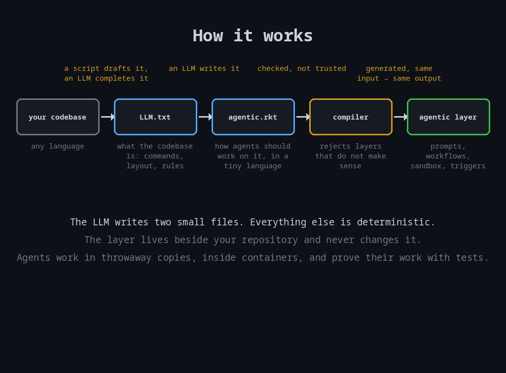
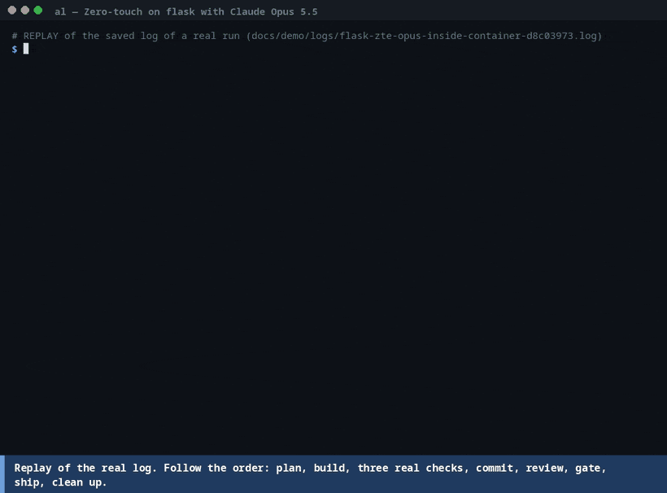
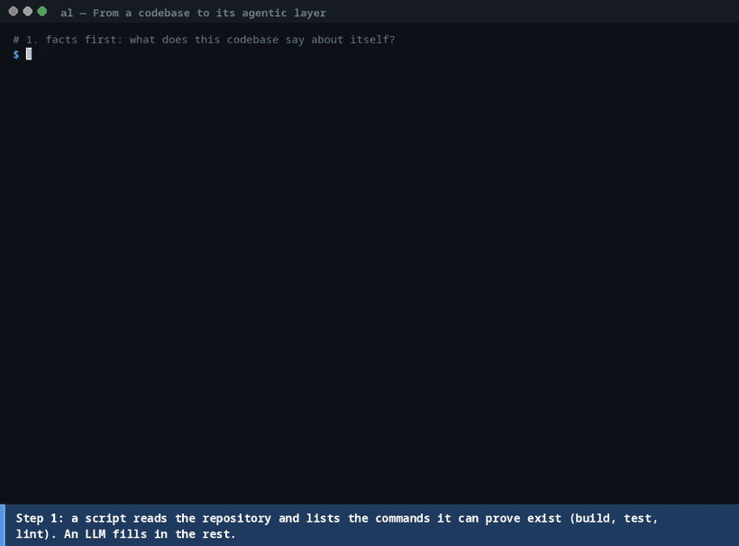
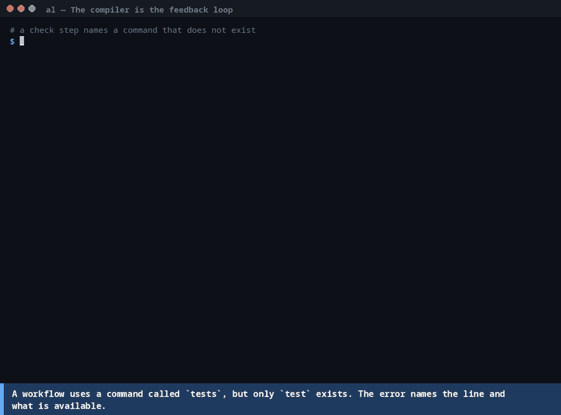
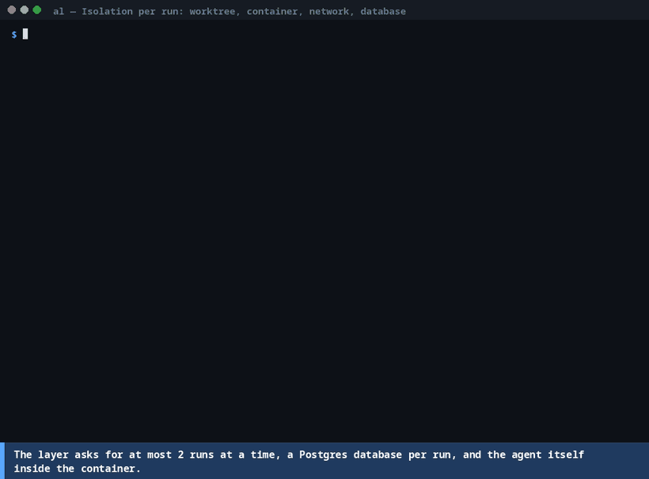

# al — an agentic layer for any codebase

AI coding agents do much better work when they have a setup made for the codebase they are working on:
the real build and test commands, a safe place to work, a way to prove what they did, and rules for when a
change may ship. That setup is called an **agentic layer**. `al` generates one for any repository, in any
language, without changing the repository.

**[Watch the 5½-minute tour (MP4, 4 MB)](docs/demo/tour.mp4)** — it explains the idea and shows every part
running for real.



## The problem

An agent that is dropped into a repository with nothing but a prompt has to guess: how do I run the tests
here? Which files must I not touch? How do I show that my change works? Teams that get good results from
agents answer those questions once, in writing, as prompts and workflows around the codebase.

Two things go wrong when you try to do that everywhere:

- **Writing it by hand does not scale.** Every repository needs its own version.
- **Letting an AI improvise it is not trustworthy.** You get pages of plausible text that nobody checked.
  It may name commands that do not exist, or let changes ship without any test.

## The idea

Put a small compiler between the AI and the result.

1. **Describe the codebase.** A script reads the repository and drafts `LLM.txt`: what it is, its commands,
   its layout, what is off-limits. An LLM completes the draft, and must cite a file for every command it lists.
2. **Let an LLM write a short definition.** From `LLM.txt` and a one-file language reference, the LLM writes
   `agentic.rkt`: about a hundred lines saying how agents should work on this codebase.
3. **Check it, then generate everything else.** A compiler rejects definitions that do not hang together
   and says exactly what is wrong, so the LLM can fix its own mistake. A generator then produces the whole
   layer: prompts, workflows, sandbox, triggers.

The LLM writes two small files. Everything after that is deterministic: the same input always gives the same layer.

## A concrete example: flask

[flask](https://github.com/pallets/flask) is a Python web framework. Its `LLM.txt` records facts like these
(the full file is [`tests/authored/flask/LLM.txt`](tests/authored/flask/LLM.txt)):

| name | command | proves what |
|---|---|---|
| lint | `uv run --locked … pre-commit run --all-files` | every pre-commit hook passes |
| typecheck | `uv run --locked … tox run -e typing` | mypy in strict mode reports no errors |
| test | `uv run --locked … tox run -- --junitxml=…` | the pytest suite passes |

From that, an LLM wrote [`agentic.rkt`](tests/authored/flask/agentic.rkt). Abridged, with comments added here:

```racket
#lang al
(agentic-layer #:name "flask"
  (codebase #:root "../../testbeds/flask" #:languages (python)
    (cmd lint      "uv run --locked … pre-commit run --all-files")     ; the codebase's own commands
    (cmd typecheck "uv run --locked … tox run -e typing")
    (cmd test      "uv run --locked … tox run -- --junitxml=.tox/reports/junit.xml")
    (paths #:source ("src/flask") #:tests ("tests")
           #:protected (".github" "uv.lock" "src/flask/sessions.py")))  ; agents may not ship changes here

  (prompt-input tasklist)          ; where work comes from: a text file of tasks
  (trigger cron)                   ; what starts a run: a poller
  (environment worktree)           ; where agents work: a private copy of the repo…
  (environment podman #:base-image "docker.io/library/python:3.12-slim" …)   ; …inside a container
  (review auto #:id zero-touch     ; who decides: an agent reviewer plus hard rules
          #:require-checks (lint typecheck test) #:allowed-classes (chore bug) #:ship merge)

  (adw zte #:environment (worktree nix-devshell podman) #:review zero-touch   ; a workflow
    (steps (compose plan-build)                        ; classify the task, plan it, implement it
           (check lint #:cmd lint #:resolve resolve-test)      ; run the real command; on failure an
           (check typecheck #:cmd typecheck #:resolve resolve-test)   ; agent fixes it and it runs again
           (check test #:cmd test #:resolve resolve-test)
           (run commit #:command commit)
           (review)                                    ; is what we built what was asked? show proof
           (ship))))                                   ; merge only if every rule holds
```

`al gen` turns that into a folder **beside** the repository:

```
flask.al/
  commands/   prompts written for flask: plan-chore, plan-bug, plan-feature, review, commit, …
  hops/       prompts that take another prompt or plan as input (e.g. "implement this plan")
  adws/       the workflows as runnable scripts, plus triggers
  env/        the container image and the Nix environment
  tasks.md    the task list
  specs/  agents/  artefacts/  trees/     plans, run logs, proof, and the agents' working copies
```

And this is a real run of that workflow with Claude Opus 5.5. The prompt was *"Add a test asserting that
Flask.testing is False on a newly created app"*. Nobody touched anything after that:



Opus planned the change, wrote the test and committed it; flask's own lint, type check and test suite ran
in a container; a second Opus pass reviewed the result against the plan with the logs and test report as
proof; the rules passed; the change was merged. It took 2 minutes 14 seconds and cost $0.69.
[The saved log](docs/demo/logs/flask-zte-opus-inside-container-d8c03973.log) is in the repository.

## The example repositories

Five well-known public repositories, chosen to cover different languages, build tools and ways of working.
Each layer was written by a fresh LLM that saw only that repository's `LLM.txt` and the language reference.
All five compiled on the first attempt. The sources are in [`tests/authored/`](tests/authored).

| Repository | Language | The layer we asked for | Verified for real |
|---|---|---|---|
| [flask](https://github.com/pallets/flask) | Python | task file + poller; container; ships chores and bugs by itself | lint, mypy and test suite; three full runs with Claude Opus 5.5 |
| [ripgrep](https://github.com/BurntSushi/ripgrep) | Rust | Forgejo issues + webhook; Rust container; an agent reviews, a human merges; proof stored on S3 | `cargo test` in its container |
| [gin](https://github.com/gin-gonic/gin) | Go | GitHub issues + CI workflow; a human reviews the pull request | `make test` in a container |
| [express](https://github.com/expressjs/express) | JavaScript | voice + task file; an "ask the codebase" workflow | `npm test` (1290 tests) |
| [jq](https://github.com/jqlang/jq) | C | spec files dropped in a folder; Debian build container; opens a pull request, never merges | autotools build and `make check` in its container |

Running the real commands is what found the mistakes the compiler cannot see. The jq layer's install command
could not work inside the sandbox and was corrected. gin's tests insist on port 8443, which was already in
use on the test machine; they pass in a container because every run has its own network.

## The ideas, in plain words

| Term | Meaning |
|---|---|
| **Agentic layer** | Everything around a codebase that lets agents work on it well. It wraps the codebase; it is not part of it. |
| **Command (template)** | A reusable prompt for one kind of job: "plan a bug fix", "review this change". Written once per codebase, with its real commands and rules filled in. |
| **HOP** (higher-order prompt) | A prompt that takes another prompt or a plan as its input, e.g. "implement the plan in this file". |
| **ADW** (AI developer workflow) | A chain of steps: agent steps (one prompt each) and check steps (run a real command). Plan → build → test → review → ship is one. |
| **Check with a feedback loop** | Run a real command. If it fails, give the output to an agent, let it fix the code, run it again. |
| **Zero-touch** | A workflow where no human is involved between the prompt and the shipped change. Allowed only when the checks, the reviewer and the hard rules all agree. |
| **Worktree** | A private working copy of the repository for one run. Agents never work in your own checkout. |

Every workflow makes four choices, known as **PITER**. The language offers several options for each:

| | Question | Options |
|---|---|---|
| **P**rompt input | Where does the work come from? | command line · forge issue · task file · spec file · voice · webhook payload |
| **T**rigger | What starts a run? | by hand · poller · webhook · forge CI · file watcher · voice |
| **E**nvironment | Where does the agent work? | worktree · Nix shell · Home Manager · container, with its own network and services |
| **R**eview | Who decides it is done? | a human, via a pull request · an agent with proof, a human merges · automatic, with hard rules |

## How it stays safe

- **Your repository is never modified.** The layer is a separate folder; agents work in private copies. Results arrive as a branch or a pull request.
- **Every run is isolated.** It has its own copy of the code, its own container, its own network (so two runs can both use port 8000) and, if needed, its own database.
- **The container cannot reach into your git repository.** It can read the history but cannot move branches or plant hooks; only the host does that, after checking nothing was tampered with.
- **Shipping without a human needs everything to agree:** all checks green, the checks re-run on the final result, the reviewer finds no blocker, the task is a kind you allowed, the change is small, and no protected file was touched. Otherwise it becomes a pull request for a person.
- **The compiler enforces the dangerous combinations.** A workflow that ships by itself must run in a container. An agent with all permissions must itself be inside one.

## See it

Every clip is a recording of real commands, with waiting time cut. The captured output is in [`docs/demo/logs/`](docs/demo/logs).

**From a repository to its layer** (gin): describe, define, generate, check. The repository has zero changed files afterwards.



**The compiler as a safety net:** a workflow that names a command that does not exist, and one that tries to ship without a container.



**Isolation:** three runs at once, limited to two at a time. Each has its own app on port 8000 and its own Postgres. From outside, neither is reachable.



More clips:
[five repositories](docs/demo/03-five-codebases.gif) ·
[task file + poller](docs/demo/04-tasklist.gif) ·
[fan-out: several agents race on one task](docs/demo/06b-fan-out.gif) ·
[`al verify`: are the layer's commands true?](docs/demo/06c-verify.gif) ·
[a live Forgejo: issue → pull request → merge](docs/demo/07-forgejo.gif) ·
[local voice in and out](docs/demo/08-voice.gif) ·
[the test suites](docs/demo/09-tests.gif)

## Try it on your own repository

You need `racket`, `uv`, `git`, and `podman` for containers.

```bash
tools/al init ~/code/myapp            # creates ~/code/myapp.al with a draft LLM.txt and the language reference
```

Then give two prompts to an LLM agent (for example Claude Code), in this repository:

1. [`meta/commands/scout-codebase.md`](meta/commands/scout-codebase.md) completes `LLM.txt` by reading your repository.
2. [`meta/commands/author-layer.md`](meta/commands/author-layer.md) writes `agentic.rkt`. Tell it in plain words what you
   want, e.g. *"tasks from a text file, run in a container, a human reviews"*.

```bash
tools/al gen    ~/code/myapp.al       # compile and generate; errors say what to fix
tools/al verify ~/code/myapp.al       # run every declared command for real: is the description true?
tools/al check  ~/code/myapp.al       # the layer is complete and your repository is untouched

cd ~/code/myapp.al
uv run adws/adw_plan-build.py "Add request-id logging" --dry-run    # a stand-in agent: no LLM, no cost
uv run adws/adw_sdlc.py "Add request-id logging"                    # the real agent
uv run adws/triggers/trigger_cron.py                                 # work through tasks.md
```

To change the layer, edit `agentic.rkt` and run `al gen` again. The whole language is one file:
[`docs/AL-DSL.llms.txt`](docs/AL-DSL.llms.txt).

## Tests

```bash
export PLTCOLLECTS="$PWD/racket:"
raco test racket/al/tests                                    # the language rules
(cd kit/runtime && uv run --with pytest pytest -q)           # the runtime, including attempts to escape the container
uv run --with pytest --with pyyaml --with jsonschema pytest tests/integration -q   # full runs on the five repositories
tests/forge/forgejo_live.sh                                  # a throwaway Forgejo: issue → PR, merge, webhook
```

The integration tests never work in your checkouts. Each session makes its own copy of every example
repository at a pinned commit, and a test fails if it leaves anything behind. Details: [`tests/README.md`](tests/README.md).

## Status

**Shown to work**

- Five repositories in five languages, each with an LLM-written layer and its real test or build commands passing.
- Three complete runs with Claude Opus 5.5 on flask, each right on the first attempt, about 2 to 3 minutes and $0.70.
- Isolation, the shipping rules, the Forgejo integration and the voice round trip, each with tests that run the real thing.

**Not yet shown**

- Large or ambiguous tasks. The real runs were small, well-defined chores.
- Fan-out with real agents, and anything on a team's private repository.
- GitHub end to end. The live forge test uses Forgejo; GitHub is covered by unit tests only.
- The agent inside the container on anything but flask.

## Where the ideas come from

The method follows the *Tactical Agentic Coding* course: template your engineering, give each agent one
prompt and one purpose, always add feedback loops, and build the layer around the codebase rather than in
it. `al` adds the compiler in the middle and the generator behind it. How the course's concepts map to this
repository, and why a small language in Racket, is in [`docs/DESIGN.md`](docs/DESIGN.md).

## Repository map

```
racket/al/        the language: vocabulary, compiler, schema and reference generators, tests
tools/al          init · scout · compile · gen · verify · check
kit/templates/    the prompts every layer starts from      kit/runtime/   what runs a workflow
meta/             the prompts that guide an LLM through describing a codebase and writing its layer
tests/            authored layers for the five repositories, integration tests, the live Forgejo test
docs/             DESIGN.md, the language reference, the demo video and clips
```
