# al — an agentic layer for any codebase

[](https://github.com/dancegit/al/actions/workflows/ci.yml)

`al` generates the agentic layer for any repository, in any language: the prompts, workflows, sandbox and rules that
let AI coding agents do good work on that codebase. An LLM writes two small files, and a compiler checks them. A
generator then produces the rest deterministically, in a folder beside the repository, without changing it.

> **Proven** — [five repositories in five languages](docs/EXAMPLES.md#the-example-repositories), each with an LLM-written layer whose real commands pass · real runs with a real model and their [saved logs](docs/demo/logs/flask-zte-opus-inside-container-d8c03973.log) ·
> [a review that says no](docs/EXAMPLES.md#a-healthcare-staffing-app-rules-stopping-conditions-and-a-review-that-says-no) · isolation and the shipping gate [under test](kit/runtime/tests).\
> **Not yet shown** — large or ambiguous tasks · GitHub end to end · a real team's repository.\
> [Full status](#status)

**[Watch the 13-minute tour][tour]** — it explains the idea and shows every part running for real.

[tour]: https://github.com/dancegit/al/releases/download/media-v1/demo-tour.mp4


## Why it exists

al serves a way of working taught by the *Tactical Agentic Coding* course ([credit](#where-the-ideas-come-from)). It
asks for a shift: the engineer stops writing the code and builds the system that writes it. That system is an
**agentic layer** around the codebase: prompts kept as templates, plans, workflows made of deterministic code plus
agents, checks, reviews and triggers. An agent dropped into a repository with only a prompt has to guess how to run
the tests, which files it must not touch and how to show that its change works; the layer answers those questions
once, in writing.

Building that layer by hand for every repository is slow, and every copy drifts. Letting an LLM improvise it gives
pages of plausible text nobody checked, which may name commands that do not exist or let changes ship without a test.
al puts a small language and a compiler in between, so the layer itself can be reviewed, versioned and tested:

1. **Describe the codebase.** A script reads the repository and drafts `LLM.txt`: what it is, its commands,
   its layout, what is off-limits. An LLM completes the draft, and must cite a file for every command it lists.
2. **Let an LLM write a short definition.** From `LLM.txt` and a one-file language reference, the LLM writes
   `agentic.rkt`: about a hundred lines saying how agents should work on this codebase.
3. **Check it, then generate everything else.** The compiler rejects definitions that do not hang together
   and says exactly what is wrong, so the LLM can fix its own mistake. The generator then produces the whole
   layer: prompts, workflows, sandbox, triggers.

The LLM writes two small files. Everything after that is deterministic: the same input always gives the same layer.

## The principles, and what al does about each

Each block is one idea of the method and what al does about it ([full mapping](docs/DESIGN.md#what-the-lessons-prescribe-and-where-it-lands)).

### Stop coding by hand: the unit of work is a plan and a workflow

The engineer's work moves from editing files to writing the plan and the workflow that carry a change out. In al a
workflow is an **ADW** (AI developer workflow, the course's name): `(adw … (steps …))`, agent steps and real commands,
run by one generic runtime ([`kit/runtime/`](kit/runtime)). Plans are written by
[`plan-chore`](kit/templates/commands/plan-chore.md), [`plan-bug`](kit/templates/commands/plan-bug.md) and
[`plan-feature`](kit/templates/commands/plan-feature.md) into the layer's `specs/`. Here is flask's definition,
abridged ([full file](tests/authored/flask/agentic.rkt), [walk-through](docs/EXAMPLES.md#flask-a-zero-touch-run)):

```racket
#lang al
(agentic-layer #:name "flask"
  (codebase #:root "../../testbeds/flask" #:languages (python)
    (cmd lint      "uv run --locked … pre-commit run --all-files")     ; the codebase's own commands
    (cmd typecheck "uv run --locked … tox run -e typing")
    (cmd test      "uv run --locked … tox run -- --junitxml=.tox/reports/junit.xml")
    (paths #:source ("src/flask") #:tests ("tests")
           #:protected (".github" "uv.lock" "src/flask/sessions.py")))  ; agents may not ship changes here
  (prompt-input tasklist)          ; where work comes from: a text file of tasks
  (trigger cron)                   ; what starts a run: a poller
  (environment worktree)           ; where agents work: a private copy of the repo…
  (environment podman #:base-image "docker.io/library/python:3.12-slim" …)   ; …inside a container
  (review auto #:id zero-touch     ; who decides: an agent reviewer plus hard rules
          #:require-checks (lint typecheck test) #:allowed-classes (chore bug) #:ship merge)
  (adw zte #:environment (worktree nix-devshell podman) #:review zero-touch   ; a workflow
    (steps (compose plan-build)                        ; classify the task, plan it, implement it
           (check lint #:cmd lint #:resolve resolve-test)      ; run the real command; on failure an
           (check typecheck #:cmd typecheck #:resolve resolve-test)   ; agent fixes it and it runs again
           (check test #:cmd test #:resolve resolve-test)
           (run commit #:command commit)
           (review)                                    ; is what we built what was asked? show proof
           (ship))))                                   ; merge only if every rule holds
```

`al gen` turns that into a folder **beside** the repository:

```
flask.al/
  commands/   prompts written for flask: plan-chore, plan-bug, plan-feature, review, commit, …
  hops/       prompts that take another prompt or plan as input (e.g. "implement this plan")
  adws/       the workflows as runnable scripts, plus triggers
  env/        the container image and the Nix environment (from one pinned `toolchain`, if declared)
  tasks.md    the task list
  specs/  agents/  artefacts/  trees/     plans, run logs, proof, and the agents' working copies
```


### See the task as the agent sees it

An agent knows only its context, its model, its prompt and its tools, so each of those must be right for this
codebase. `LLM.txt` is drafted by `al scout` and completed with
[`meta/commands/scout-codebase.md`](meta/commands/scout-codebase.md), which cites a file for every command. A
`#:focus` line adds an instruction to one command ([guide](docs/GUIDE.md#edit-a-prompt-template-yourself));
`(conditional-doc "path" "when")` becomes the generated `conditional_docs.md`, read when its condition holds; `(expert
NAME …)` keeps an expertise file; the [`prime`](kit/templates/commands/prime.md) command builds a picture of the
codebase before work starts. The whole vocabulary: [`docs/AL-DSL.llms.txt`](docs/AL-DSL.llms.txt).

### Template your engineering

Solve a kind of problem once, as a prompt, and reuse it. There is one command per class of work (`plan-chore`,
`plan-bug`, `plan-feature`, `plan-patch` in [`kit/templates/commands/`](kit/templates/commands)). A **HOP**
(higher-order prompt, the course's name) takes another prompt or a plan as input, such as
[implement this plan](kit/templates/hops/run-plan.md) ([`kit/templates/hops/`](kit/templates/hops)); some prompts
write prompts ([`meta-command`](kit/templates/hops/meta-command.md)). `al eject` copies a template into the layer, and
`al gen` keeps your edited copy from then on. Every example layer is explained in [`docs/layers`](docs/layers/README.md):

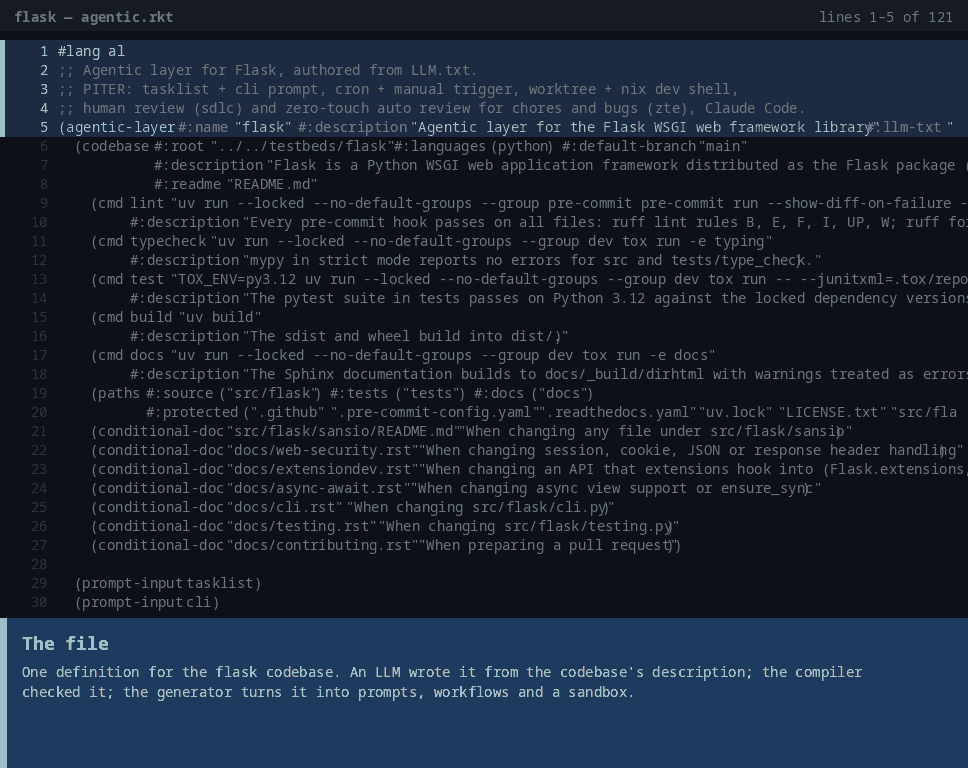

### Stay out of the loop

Work should go on while nobody watches. Every workflow makes four choices, which the course calls **PITER**:

| | Question | Options |
|---|---|---|
| **P**rompt input | Where does the work come from? | command line · forge issue · task file · spec file · voice · webhook payload |
| **T**rigger | What starts a run? | by hand · poller · webhook · forge CI · file watcher · voice |
| **E**nvironment | Where does the agent work? | worktree · Nix shell · Home Manager · container, with its own network and services; one pinned Nix `toolchain` can provide the tools of all three |
| **R**eview | Who decides it is done? | a human, via a pull request · an agent with proof, a human merges · automatic, with hard rules |

A **worktree** is a private working copy of the repository for one run; agents never work in your own checkout.
[Options](docs/DESIGN.md#piter-alternatives) · clips: [task file + poller](docs/demo/04-tasklist.gif) · [a live Forgejo: issue → pull request → merge](docs/demo/07-forgejo.gif).

### Always close the loop

A change is not done until a real command says so. `(check NAME #:cmd test #:resolve resolve-test #:retries 3)` runs
the codebase's own command; on failure an agent gets the output, fixes the code, and the check runs again, up to
`#:retries` resolve attempts (default 3, [`docs/AL-DSL.llms.txt`](docs/AL-DSL.llms.txt)). Review blockers go back to a
patch round, up to `#:max-retries` (default 3), then the run stops for a person. `al verify` proves the declared commands
are true ([clip](docs/demo/06c-verify.gif)).

### One agent, one prompt, one purpose

A focused agent does better work than one that juggles jobs. Every `(run …)` step is a fresh headless agent with one command (the phrase is the course's). The runtime also
checks that a step did only its own job ([`discipline.py`](kit/runtime/adw_modules/discipline.py), [tests](kit/runtime/tests/test_step_discipline.py)): a step that may not
commit but committed, moved a ref or left files at the top of the layer fails as a step-discipline violation, and what can be undone safely is undone
([guide](docs/GUIDE.md#when-something-goes-wrong)).

### Review on proof

The review asks: is what was built what was asked for? Show it. It returns issues with the severities `blocker`, `tech_debt` and `skippable`
([`review.md`](kit/templates/commands/review.md)). Screenshots, recordings, video keyframes, logs and test reports are collected and handed to the reviewers
([`docs/ARTEFACTS.md`](docs/ARTEFACTS.md)). A review can say no: [clip](docs/showcase/04-review-says-no.gif), and [the planted
defect](docs/EXAMPLES.md#a-healthcare-staffing-app-rules-stopping-conditions-and-a-review-that-says-no).

The plan ends with a **Proof plan**. Before the build, `prove` checks every criterion can be proven here, else stops with the party who can clear it. `evidence` runs the plan's commands and asks for an evidence patch when proof is missing; `freshen` keeps the review on the current tree. A person can pre-approve with `al run --approve` or clear a stop with `al approve` ([guide](docs/GUIDE.md#proof-plan-pre-approvals-and-al-approve), [proof](docs/ARTEFACTS.md#run-scoped-proof-and-what-the-evidence-step-adds)).

### Aim for zero touch, earn it in steps

**Zero-touch engineering** (ZTE, the course's name) means no person between the request and the shipped change. In al it is `(review auto …)`: the agent's verdict *and* hard
gates: required checks re-run on the final result, allowed classes (default chore and bug), `#:max-diff-lines` (default 400), protected paths, and a container (the compiler
refuses a self-shipping workflow without one). Anything else falls back to a pull request for a person ([guide](docs/GUIDE.md#step-12--let-small-things-ship-by-themselves)).

For a team that accepts work as a whole, one line such as `(delivery sprint)` or `(delivery gitflow)` declares the branches work collects in and which of them only people may
change, so agents branch from and deliver into the right one ([How work is delivered](docs/GUIDE.md#how-work-is-delivered)). `al promote` then moves a stage into the next: a
presentation pack, the people's recorded acceptance (`al decide`), then version, tag, deploy and back-merge ([Promote a stage](docs/GUIDE.md#promote-a-stage),
[clip](docs/showcase/05-delivery.gif)).

### Measure it

What is not measured cannot be improved. The [`track-kpis`](kit/templates/commands/track-kpis.md) command computes
size, attempts, streak and presence (how often a person had to be there) from the runs' `state.json`. The
[dashboard](kit/dashboard/README.md) shows cost and time per step, check attempts, gate reasons and why a run was
handed over; run events: [`docs/DESIGN.md`](docs/DESIGN.md#run-events). `(budget limits …)` caps spending.

### Put the layer first

Improving the layer is ordinary work with its own reviewed workflow. `al improve LAYER "…"` makes the smallest change that satisfies a request in words, in a private copy; six
checks must pass (it still compiles, regenerates identically twice, every workflow completes a dry run, …), and the pull request explains each affected block before and after.
[Walk-through](docs/EXAMPLES.md#changing-a-layer-ask-in-words-approve-a-pull-request), [clip](docs/demo/05g-layer-change.gif). Three rules make this safe:

- **A person always approves.** There is no automatic mode for changes to how agents work.
- **Refinements survive regeneration.** `al eject` copies a template into the layer; `al gen` uses your copy and
  refuses to overwrite a generated file you edited by hand.
- **Agents cannot rewrite their own instructions in passing.** With the layer in your repository
  (`al init --in-repo`), an ordinary workflow that touches it is stopped and handed to a person.

al is built with its own layer: [`agentic/`](agentic), explained in [`docs/layers/al.md`](docs/layers/al.md) ([clip](docs/demo/06e-al-for-al.gif)).

## What you can do with it today

Every frame of the `docs/showcase` clips is real output of this repository on test fixtures with invented names (the mock agent plays the model);
[`docs/showcase/README.md`](docs/showcase/README.md) says what each one proves and how to record them all again with `uv run tools/showcase/make.py`.

| Capability | Preview | What it shows | Watch / read |
|---|---|---|---|
| Create a layer | | `al init`, `al author`, `al gen`: from a repository to its checked layer; the repository is unchanged. | [clip](docs/demo/01-layer.gif) · [guide](docs/GUIDE.md#step-1--create-the-layer-folder) |
| Adopt an agent setup | 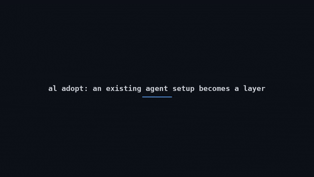 | An existing agent setup (rule files, prompts, scripts) adopted into a new layer; the app is untouched. | [clip](https://github.com/dancegit/al/releases/download/media-v1/showcase-07-adopt.mp4) · [guide](docs/GUIDE.md#step-2--describe-the-codebase) |
| Start work | 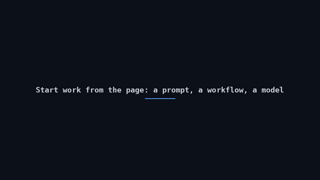 | Start a workflow from the dashboard with a prompt and a model, or with `al run`; the run's graph fills in live. | [clip](https://github.com/dancegit/al/releases/download/media-v1/showcase-01-start-work.mp4) · [guide](docs/GUIDE.md#start-work-from-the-dashboard-or-the-command-line) |
| Watch and steer runs | 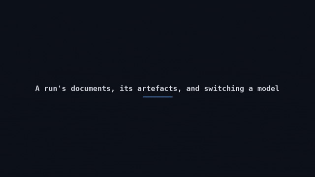 | The live dashboard; plans and reports rendered in the run page, screenshots as artefacts, the heavy tier switched in the Models panel. | [dashboard](docs/demo/06d-dashboard.gif) · [clip](https://github.com/dancegit/al/releases/download/media-v1/showcase-03-run-documents.mp4) · [watch](docs/GUIDE.md#watch-the-work) · [models](docs/GUIDE.md#choose-models-and-limit-spending) |
| Several repositories | 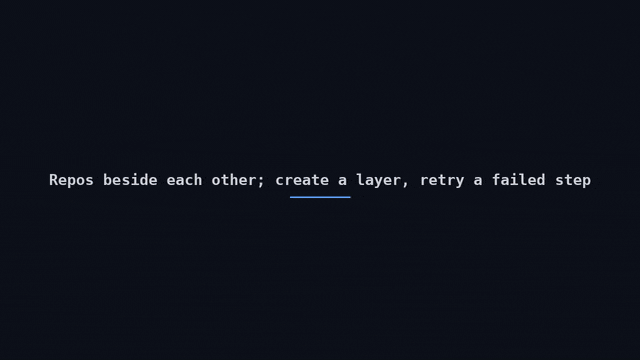 | The Repos view: four repositories, a Create job with its command lines, a missing tool, Retry from. | [clip](https://github.com/dancegit/al/releases/download/media-v1/showcase-02-repos.mp4) · [guide](docs/GUIDE.md#work-with-several-repositories-from-the-dashboard) |
| The sandbox | 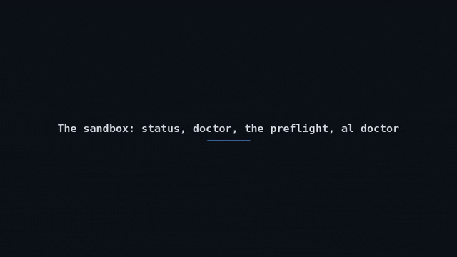 | `al sandbox` status and doctor, a run stopped by its preflight table, and `al doctor`'s tool list. | [clip](https://github.com/dancegit/al/releases/download/media-v1/showcase-06-sandbox.mp4) · [sandbox](docs/GUIDE.md#the-container-al-sandbox) · [al doctor](docs/GUIDE.md#when-al-cannot-find-a-tool-al-doctor) |
| Delivery and promotion | 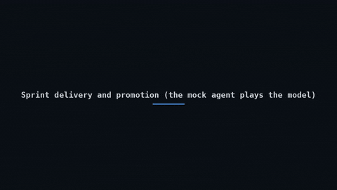 | Runs delivered into a sprint branch; `al promote` waits for a person, then merges, versions and tags. | [clip](https://github.com/dancegit/al/releases/download/media-v1/showcase-05-delivery.mp4) · [delivery](docs/GUIDE.md#how-work-is-delivered) · [promotion](docs/GUIDE.md#run-it) |
| A promotion in the page | 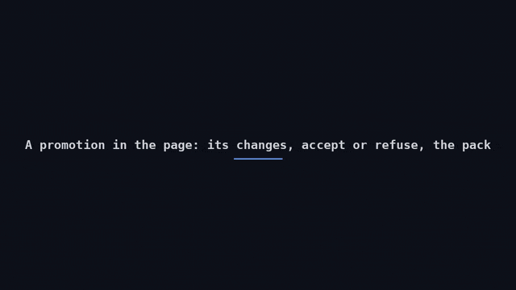 | The open promotion of a layer, its card with accept/refuse per change, and the presentation pack. | [clip](https://github.com/dancegit/al/releases/download/media-v1/showcase-09-promotion-pack.mp4) · [guide](docs/GUIDE.md#decide) |
| Deploy to a host | 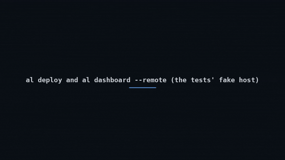 | A dry-run deploy to a host, then the dashboard of a deployed layer through an ssh tunnel. | [clip](https://github.com/dancegit/al/releases/download/media-v1/showcase-08-deploy-remote.mp4) · [notes](docs/showcase/README.md#08-deploy-remote) · [guide](docs/GUIDE.md#running-a-layer-on-another-machine) |
| Test what a change touches | | `(testing targeted …)` and `#:targeted "pytest -q {tests}"`: a run checks the tests its change concerns ("ran 3 of 43 tests: 2 s instead of about 1 min"); the full suites run once per batch (`al batch`, the stage head, every N landed changes), a miss is bisected to its run, fixed by a fix run and counted (`al kpis`). | [guide](docs/GUIDE.md#test-what-a-change-touches-prove-the-whole-per-batch) · [design](docs/DESIGN.md#depths-batches-and-misses) |
| Notifications | | `al notify-test` sends one marked test message through the layer's notifiers. | [design](docs/DESIGN.md#telling-a-person) |
| A stand-in for routine decisions | | Switch it on in the dashboard's Stand-in panel or with `al decider`; it proposes what to do with a stopped run (Go ahead · Yes, with this change · No, I decide) or takes the decisions you declared, inside hard limits. | [guide](docs/GUIDE.md#let-a-stand-in-decide-when-a-run-stops) |
| Models and cost | | Claude Opus 5.5 by default, Claude Fable 5.2 opt-in for heavy work; tiers per step, per-run overrides, `(budget limits …)`. | [guide](docs/GUIDE.md#choose-models-and-limit-spending) |
| A review that says no | 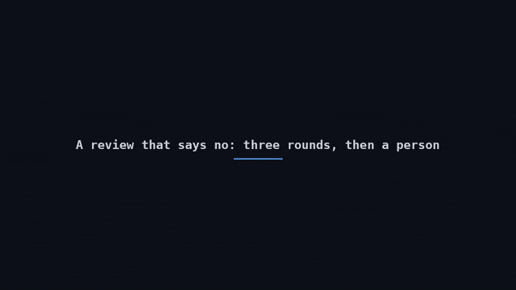 | A rejected review with its three rounds and reasons; the run is handed over, not counted as passed. | [clip](https://github.com/dancegit/al/releases/download/media-v1/showcase-04-review-says-no.mp4) · [guide](docs/GUIDE.md#step-12--let-small-things-ship-by-themselves) |

## See it

**[The 13-minute tour][tour]** shows every part running. Four real examples:

**flask, zero-touch.** Claude Opus 5.5 was asked to *"Add a test asserting that Flask.testing is False on a newly created app"*. It planned, wrote and committed the test;
flask's lint, type check and tests ran in a container; a second pass reviewed the result with the logs as proof; every rule of the gate held, and the result waited on the
branch `al/ship/main` for one manual fast-forward, because `main` was checked out in the application. 2 minutes 14 seconds, $0.69 ([saved
log](docs/demo/logs/flask-zte-opus-inside-container-d8c03973.log)); the clip is above. Full walk-through:
[docs/EXAMPLES.md#flask-a-zero-touch-run](docs/EXAMPLES.md#flask-a-zero-touch-run).

**A Notes web app.** A visual change was reviewed by a person from screenshots in the pull request; a new search feature was reviewed by two agents from a recorded video and
merged without a person. Full walk-through: [docs/EXAMPLES.md#a-web-application-…](docs/EXAMPLES.md#a-web-application-end-to-end-who-reviews-and-on-what-proof).


**Rota, a healthcare staffing app.** A rest rule shipped on video proof; a database change hit a stopping condition and was handed to a person; a planted defect was rejected
by both reviewer agents, then fixed and merged. Full walk-through:
[docs/EXAMPLES.md#a-healthcare-staffing-app-…](docs/EXAMPLES.md#a-healthcare-staffing-app-rules-stopping-conditions-and-a-review-that-says-no).

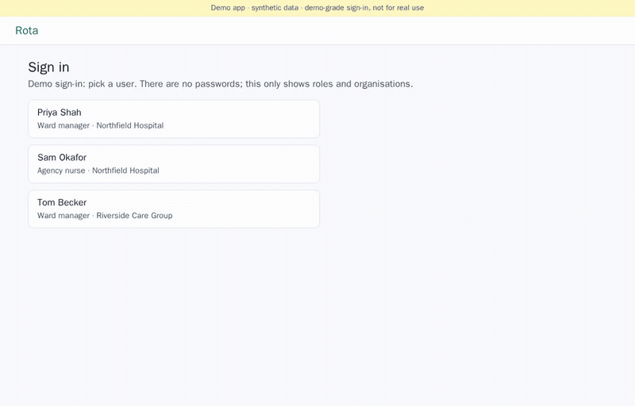

**Five example repositories** (flask, ripgrep, gin, express, jq): five languages, each layer written by a fresh LLM
and compiled on the first attempt. Full walk-through: [docs/EXAMPLES.md#the-example-repositories](docs/EXAMPLES.md#the-example-repositories).
More clips, with captions: [docs/EXAMPLES.md#more-clips](docs/EXAMPLES.md#more-clips).

## Try it on your own repository

**The full walkthrough, with what you should see at each step and what to do when it goes wrong, is the [step-by-step
guide](docs/GUIDE.md).** The short version (you need `racket`, `uv`, `git`, and `podman` for containers):

```bash
tools/al init ~/code/myapp            # creates ~/code/myapp.al with a draft LLM.txt and the language reference
```

Or in one command: `tools/al create ~/code/myapp` (`tools/al adopt-all ~/code/myapp` with an agent setup; `--in-repo` keeps the layer inside the repository) runs it all and prints a result card.
`tools/al adopt ~/code/myapp.al --app ~/code/myapp` brings an existing agent setup into the layer ([guide](docs/GUIDE.md#run-a-script-you-already-have)).

Then give two prompts to an LLM agent (for example Claude Code), in this repository:

1. [`meta/commands/scout-codebase.md`](meta/commands/scout-codebase.md) completes `LLM.txt` by reading your repository.
2. [`meta/commands/author-layer.md`](meta/commands/author-layer.md) writes `agentic.rkt` from what you want in plain words. `tools/al author ~/code/myapp.al --preferences "tasks from a text
   file, run in a container, a human reviews"` does this hand-off with the agent CLI and compiles the result.

```bash
tools/al gen    ~/code/myapp.al       # compile and generate; errors say what to fix
tools/al verify ~/code/myapp.al       # run every declared command for real: is the description true?
tools/al doctor ~/code/myapp.al       # where al finds racket, uv, git and the agent CLI (exit 4 when one is missing)
tools/al verify ~/code/myapp.al --workflow sdlc   # … only in that workflow's environment stack
tools/al sandbox ~/code/myapp.al doctor   # podman: check the container a run gets (also status|build|shell|prune)
tools/al voice ~/code/myapp.al setup      # (voice kokoro): fetch and verify the speech models once (also doctor)
tools/al explain ~/code/myapp.al      # read the layer back in plain language
tools/al check  ~/code/myapp.al       # the layer is complete and nothing leaked into your repository

cd ~/code/myapp.al
uv run adws/adw_plan-build.py "Add request-id logging" --dry-run    # a stand-in agent: no LLM, no cost
uv run adws/adw_sdlc.py "Add request-id logging"                    # the real agent
uv run adws/triggers/trigger_cron.py                                 # work through tasks.md
```

To change the layer, edit `agentic.rkt` and run `al gen` again. The whole language is one file: [`docs/AL-DSL.llms.txt`](docs/AL-DSL.llms.txt).
[`tests/quickstart/run.sh`](tests/quickstart/run.sh) rehearses `init`, `gen`, `verify`, `doctor`, `explain`, `check` and the `--dry-run` workflow in a clean container, with a stand-in for the agent.
The two prompts, `al author`, the `adw_sdlc.py` run and the cron trigger need a real agent login and are not covered by it.
How to run the test suites, fast and live: [`docs/EXAMPLES.md`](docs/EXAMPLES.md#tests).

## How it stays safe

- **Your repository is never modified.** The layer is a separate folder; agents work in private copies. Results arrive as a branch or a pull request.
- **Every run is isolated.** It has its own copy of the code, its own container, its own network (so two runs can both use port 8000) and, if needed, its own database.
- **The container cannot reach into your git repository.** It can read the history but cannot move branches or plant hooks; only the host does that, after checking nothing was tampered with.
- **Shipping without a human needs everything to agree:** all checks green, the checks re-run on the final result, the reviewer finds no blocker, the task is a kind you allowed, the change is small, and no protected file was touched. Otherwise it becomes a pull request for a person.
- **Fewer tests per run never means less proof overall.** With `(testing targeted …)` the gate proves the selected tests for each run (a core path, a lockfile, the layer, a large diff or an unmapped path runs everything), and the full suites for each batch on the branch the runs land on; the compiler refuses a zero-touch workflow that lands on the default branch below full depth without a batch rhythm. A layer without the clause runs every check in full, as before.
- **The compiler enforces the dangerous combinations.** A workflow that ships by itself must run in a container. An agent with all permissions must itself be inside one.
- **A server is set up only after you have seen the plan.** `al deploy --provision` prints every privileged command before it asks and before it runs, and a host uses a sandbox image only when its recipe hash equals the layer's.
- **A stand-in decides only inside the scope you declare, and the gate still decides what ships.** When a run needs a person, a strong model may propose the next step or, for the decisions you listed in `(stand-in auto #:may (…))`, take it: resume or restart a run, answer a waiting one, settle a finished one. Hard limits no setting lifts: it never overrides a rejected review, never lands a change to a protected path or work with a failing required check, never approves its own work, never edits code, and never acts on a run you touched since it stopped. `land` and `promote` only ask the gate and the promotion's approval rule again; every decision is recorded with its reason.

## Numbers

`tools/al kpis ~/code/myapp.al` counts a layer's run records: runs by outcome and why, attempts per step, review rounds, how often a person had to act, time and cost per workflow and class, changes on
the default branch. No names, paths or prompts. [`docs/KPIS.md`](docs/KPIS.md) is its output for al's own layer: 45 real runs while al was built, 24 changes landed on the default branch, none of them yet without a person.

## Status

**Shown to work**

- Five repositories in five languages, each with an LLM-written layer and its real test or build commands passing.
- Three complete runs with Claude Opus 5.5 on flask, each right on the first attempt, about 2 to 3 minutes and $0.70.
- A healthcare staffing app: a rule shipped on video proof, a database change stopped and handed to a person, and a planted defect rejected by both reviewer agents and then fixed.
- A web app end to end, three times over: a visual change reviewed by a person from screenshots, and a feature reviewed by two agents from a video, then merged.
- Isolation, the shipping rules, the Forgejo integration and the voice round trip, each with tests that run the real thing.

**Not yet shown**

- Large or ambiguous tasks. The real runs were small, well-defined chores.
- A real run on the current default models. Every recorded run used Claude Opus 5.5 on all steps.
- `al adopt` on a real team's repository. It is tested on a constructed example.
- Fan-out with real agents, and anything on a team's private repository.
- GitHub end to end. The live forge test uses Forgejo; GitHub is covered by unit tests only.
- The agent inside the container on anything but flask and the Notes demo app.
- Reviewers catching defects in general. One planted defect was rejected in two runs out of two; that is a demonstration, not a rate.
- The `track-kpis` command on a real layer's run history. It is a prompt template with no test or recorded run yet.

## Where the ideas come from

The method follows the *Tactical Agentic Coding* course. From it al takes the agentic layer built around the codebase rather than in it, PITER, ADWs and HOPs, templated
engineering, one agent with one prompt and one purpose, closed feedback loops, review on proof, zero-touch engineering and measuring the work. What al adds is the machinery
that makes those ideas a checked artefact: a small language, a compiler whose errors teach, a deterministic generator, and a runtime with rules of its own (the shipping gate,
the sandbox, step discipline). How each idea lands in this repository, and why a small language in Racket, is in
[`docs/DESIGN.md`](docs/DESIGN.md#what-the-lessons-prescribe-and-where-it-lands).

## Repository map

```
racket/al/        the language: vocabulary, compiler, schema and reference generators, tests
tools/al          init · scout · adopt · compile · gen · explain · verify · check · improve · eject · dashboard · kpis · integrate · voice
tools/al_*.py     al_provision (a host's provisioning files), al_sandbox (the sandbox image), …; kit/host/pins.json: pinned uv and agent CLIs
kit/templates/    the prompts every layer starts from      kit/runtime/   what runs a workflow
meta/             the prompts that guide an LLM through describing a codebase and writing its layer
tests/            authored layers for the five repositories, integration tests, the live Forgejo test
docs/             DESIGN.md, EXAMPLES.md (worked examples), the language reference, the demo clips (videos: release assets, docs/media.json)
```

## Licence

All rights reserved: see [`LICENSE`](LICENSE). Reading and running the source to evaluate it is welcome; anything else needs written permission, asked for through this repository's issues.
