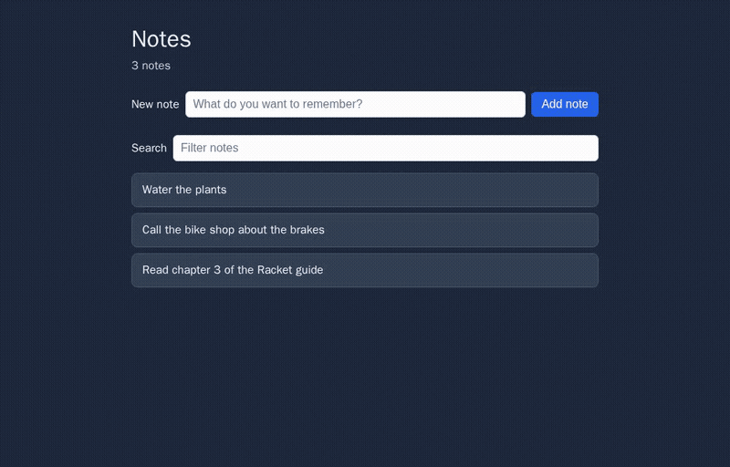
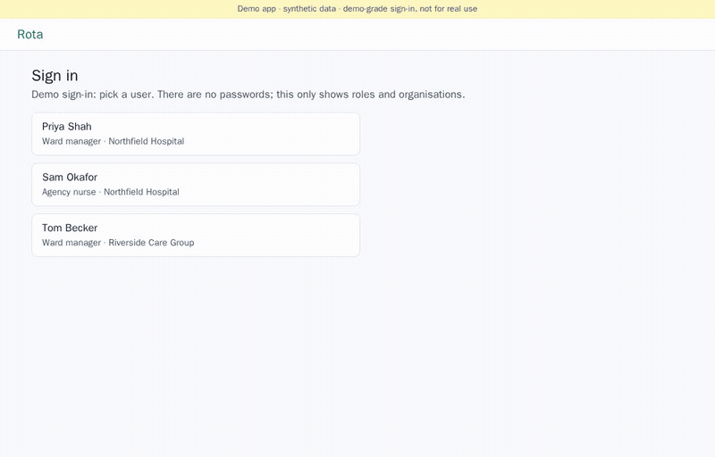
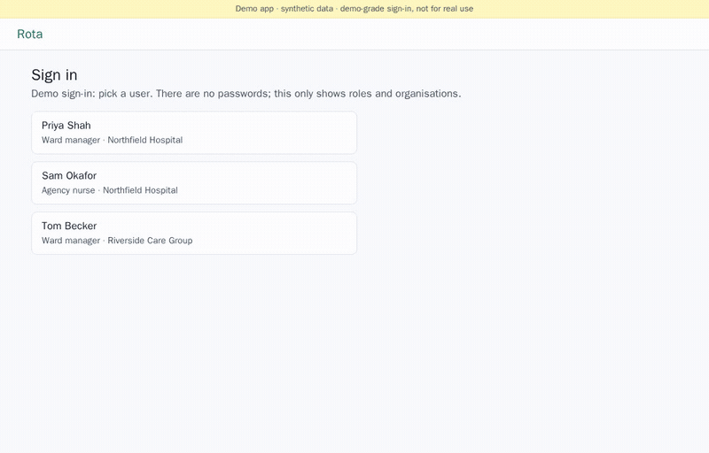
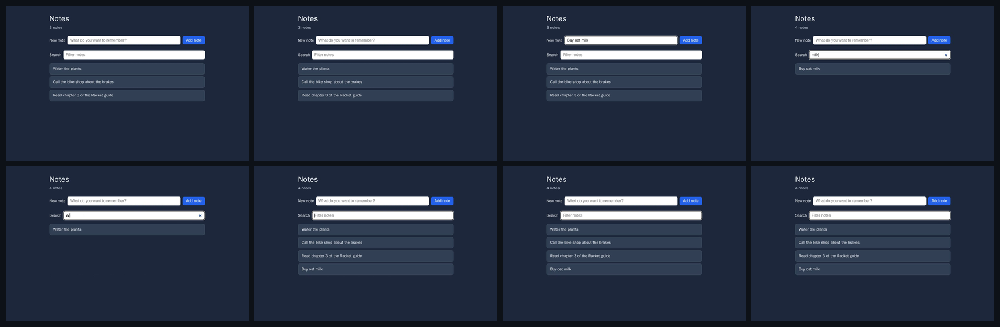
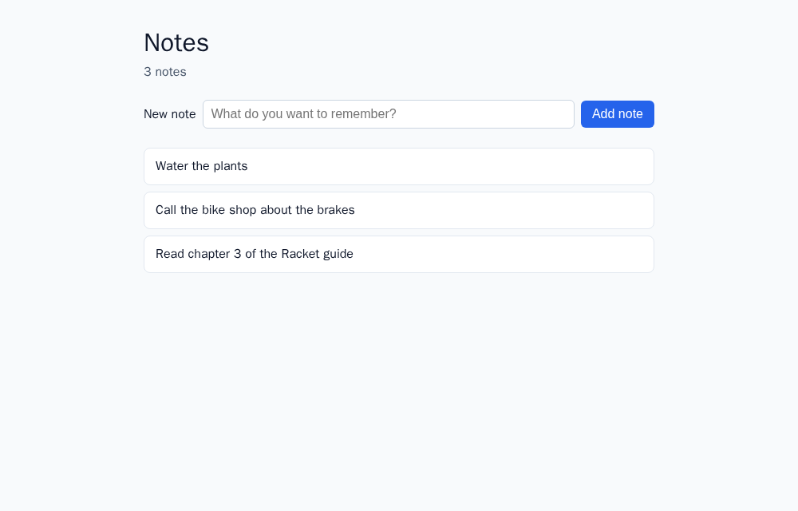
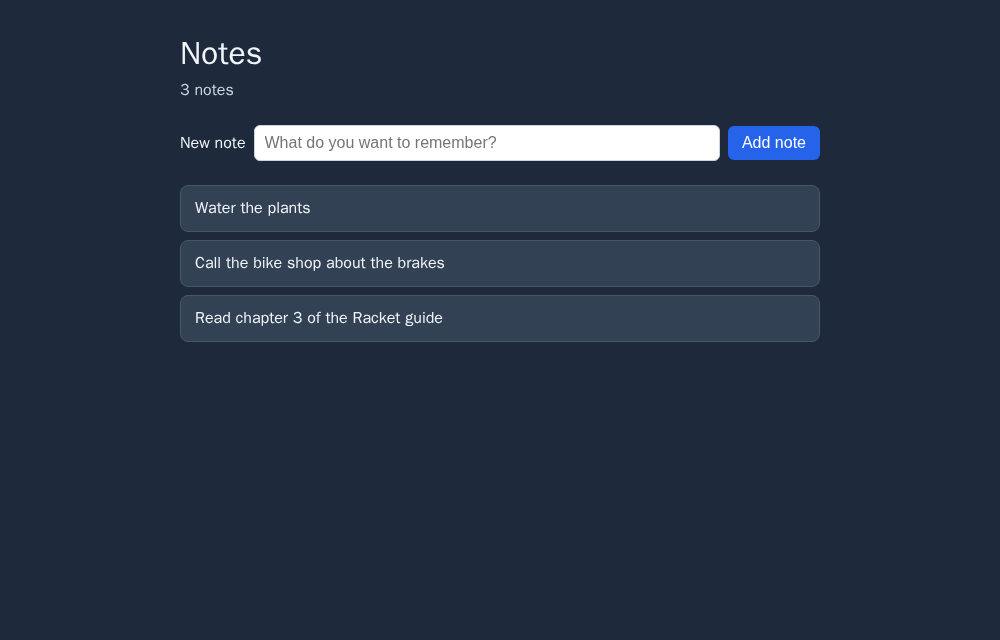
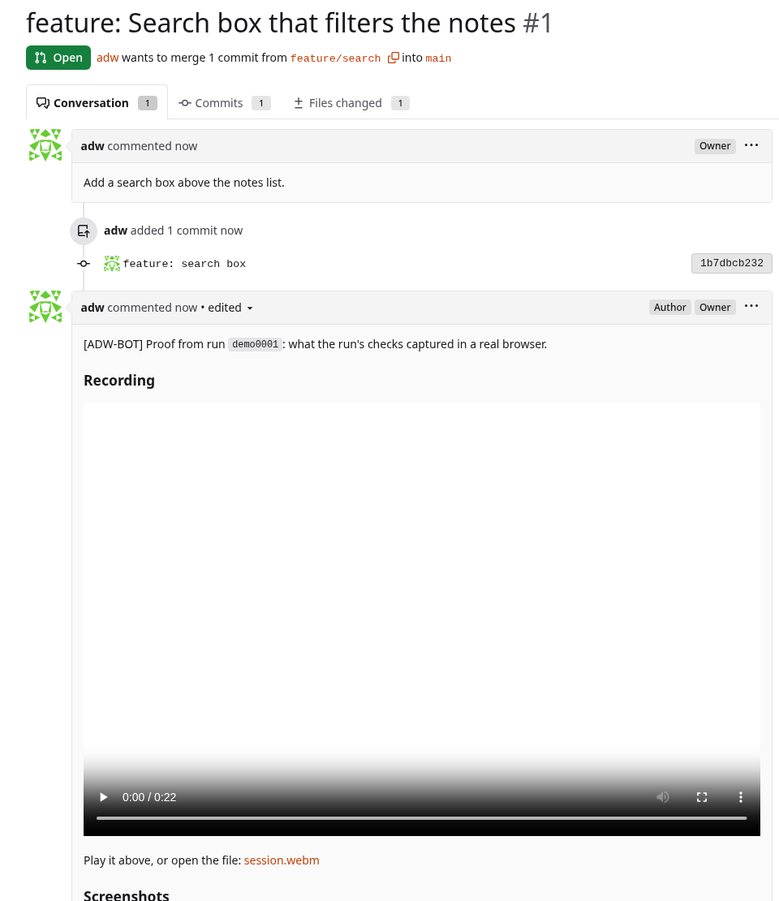
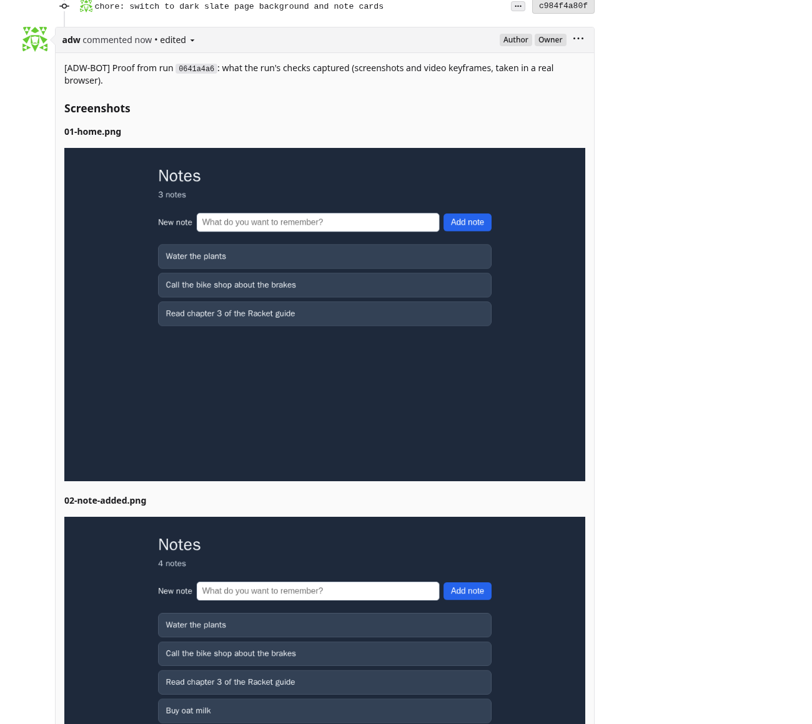
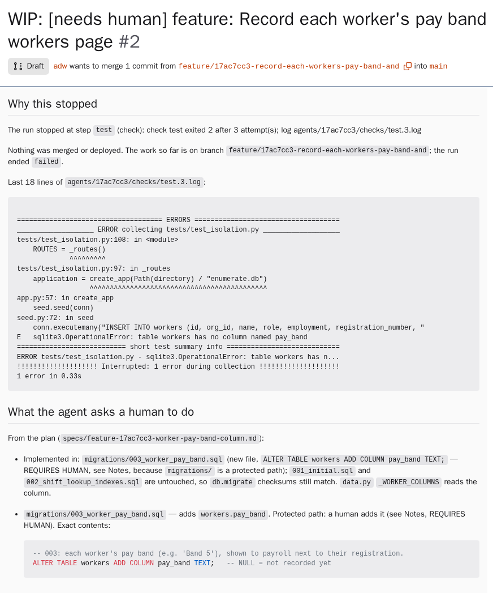

# What a reviewer gets: the proof, with real examples

A run does not ask to be believed. Its checks produce **artefacts**, and whoever reviews, a person or an
agent, judges the change on them. This page shows every kind, using files produced by the real runs in
this repository. Nothing here was made for the page: each file is what a run left behind.

There is one thing to know first. **A person and a reviewer agent get the same evidence in different
forms.** A person can watch a video. An agent cannot, so the run also cuts each video into still frames
for it. The frames are for the agents; the recording is for you.

| Proof | A person gets | A reviewer agent gets |
|---|---|---|
| Video | the recording itself, to play | still frames cut from it, evenly spaced |
| Screenshots | the pictures, attached to the pull request | the same pictures |
| Test output | the log and the report | the same, read line by line |
| The review | each reviewer's verdict, with reasons, on the pull request | (it writes it) |

## Video: the recording a person plays

When a change is something a user can see, the workflow drives the real application in a real browser
and records the session. These are three such recordings, unedited. The preview is a GIF so it plays
here; the link under each opens the original file.

**A search box that filters notes** (Notes web app, 22 seconds)



Play the original: [`b-feature.mp4`](demo/webdemo/b-feature.mp4) ·
[`b-feature.webm`](demo/webdemo/b-feature.webm) (exactly as the run recorded it)

What to look for, as the reviewer: typing "milk" leaves one note; "WATER" in capitals still matches;
"xyz" shows "No notes match"; clearing the box brings the list back. Those are the acceptance criteria
of the request, and the video either shows them or it does not.

**Workers who would get too little rest cannot be assigned** (healthcare staffing app, 19 seconds)



Play the original: [`a-rest-rule.mp4`](demo/rotademo/a-rest-rule.mp4)

**Expired registrations are labelled and cannot be selected** (healthcare staffing app, 17 seconds).
This is the recording from *after* two reviewer agents rejected a flawed first version and an agent fixed it.



Play the original: [`c-expired-badge.mp4`](demo/rotademo/c-expired-badge.mp4)

How a video comes to exist: your codebase has a command that drives the application and saves a
recording (the demo applications use a short Playwright script,
[`tests/webdemo/app/e2e`](../tests/webdemo/app/e2e)); the layer declares it as an artefact and collects
it on that check:

```racket
(artefact video #:id recording #:glob "e2e-results/*.webm" #:keyframes 8)
(check e2e #:cmd e2e #:resolve resolve-test #:collect (log screenshots recording))
```

The agent that builds a feature is told to extend that scenario so the recording demonstrates the
feature. A feature whose video does not show it working is a reason for a reviewer to reject it.

## The frames a reviewer agent sees

From the search-box recording above, the run cut eight frames. Each reviewer agent opened every one,
together with the screenshots and logs, and had to list what it examined in its verdict.



## Screenshots: before and after

Named pictures taken at fixed points of the browser scenario. For a visual change they are usually all
a person needs.

| before | after |
|---|---|
|  |  |

## On the pull request

With a forge, the run attaches the proof to the pull request, so the reviewer never has to check
anything out. The recording comes first, as a player; the screenshots follow; the frames cut for the
reviewer agents come last and are labelled as theirs. This is a real pull request on Forgejo:



And the screenshots further down the same kind of comment, from a real run:



On Forgejo the files are attached to the comment itself. GitHub has no way to attach files through its
command-line tool, so there the route is an S3-compatible store with a public address
(`(storage s3 … #:public-base-url …)`), and the pull request links to it.

## Test output

Every check keeps its full output, one file per attempt, and the pull request lists each check with its
exit code. A run's own log shows the order of events; this is the start of the search-box run:

```text
[adw 3e23886c] step plan-feature (run) passed: <tmp>/notes.al/specs/feature-3e23886c-search-box-filters-notes.md
[adw 3e23886c] step build (run) passed: The search box is in and working: typing filters the notes case-insensitively, …
[adw 3e23886c] step test (check) passed: exit 0, log agents/3e23886c/checks/test.1.log
[adw 3e23886c] step e2e (check) passed: exit 0, log agents/3e23886c/checks/e2e.1.log
```

Full logs: [`b-run.log`](demo/webdemo/b-run.log), [`a-run.log`](demo/rotademo/a-run.log),
[`c-run.log`](demo/rotademo/c-run.log).

## The review itself

A reviewer's verdict is an artefact too. It must say whether the change is approved, list every issue
with a severity, and list what it looked at. A verdict that approves without having opened the proof is
visible as such. This is one reviewer's verdict on the search box, shortened:

```json
{
  "success": true,
  "issues": [],
  "artefacts_reviewed": [
    "artefacts/3e23886c/log/e2e.1.log",
    "artefacts/3e23886c/log/test.1.log",
    "artefacts/3e23886c/screenshots/e2e-results/01-home.png",
    "artefacts/3e23886c/screenshots/e2e-results/03-search-milk.png",
    "… 13 more, including every video frame"
  ]
}
```

And this is what a rejection looks like. The change passed every test but left an acceptance criterion
unmet; the reviewer says which, and where the evidence is:

> Criterion 3 is not met: an expired worker can still be selected in the assign dropdown.
> templates/shifts.html:26 has no `disabled` attribute. The e2e log (…, steps 5-6) shows Chloe Martin
> selected in #assign-8 and submitted […]

Full files: [`b-verdicts.json`](demo/webdemo/b-verdicts.json),
[`c-round1-verdicts.json`](demo/rotademo/c-round1-verdicts.json) (the rejection),
[`c-verdicts.json`](demo/rotademo/c-verdicts.json) (the approval after the fix).

## When a run stops instead of finishing

The handover is also something to read. A run that cannot finish opens a pull request that says why
and what it needs from a person:



## All the kinds you can declare

| Kind | Typical source | Declared as |
|---|---|---|
| log | every check, automatically | `(artefact log)` |
| test report | pytest, cargo, go test, mocha with a JUnit reporter | `(artefact junit #:glob "reports/*.xml")` |
| coverage | lcov or cobertura output | `(artefact coverage #:glob "coverage.xml")` |
| screenshots | an end-to-end scenario | `(artefact image #:glob "e2e-results/*.png")` |
| video | a recorded browser or terminal session | `(artefact video #:glob "e2e-results/*.webm" #:keyframes 8)` |
| trace | a Playwright trace | `(artefact trace #:glob "traces/*.zip")` |
| HTML report | a rendered report | `(artefact html #:glob "report/index.html")` |
| audio, other files | anything else worth keeping | `(artefact audio …)`, `(artefact file …)` |

By default artefacts stay in the layer folder under `artefacts/<run id>/`. Declare
`(storage s3 #:bucket … #:endpoint …)` to also upload them to any S3-compatible store.
