# Worked examples

The full walk-throughs behind the [README](../README.md): every run here was real, and its logs, pictures and verdicts are in the repository.

## flask: a zero-touch run

[flask](https://github.com/pallets/flask) is a Python web framework. Its `LLM.txt` records facts like these
(the full file is [`tests/authored/flask/LLM.txt`](../tests/authored/flask/LLM.txt)):

| name | command | proves what |
|---|---|---|
| lint | `uv run --locked … pre-commit run --all-files` | every pre-commit hook passes |
| typecheck | `uv run --locked … tox run -e typing` | mypy in strict mode reports no errors |
| test | `uv run --locked … tox run -- --junitxml=…` | the pytest suite passes |

From that, an LLM wrote [`agentic.rkt`](../tests/authored/flask/agentic.rkt). Abridged, with comments added here:

```racket
#lang al
(agentic-layer #:name "flask"
  (codebase #:root "../../testbeds/flask" #:languages (python)
    (cmd lint      "uv run --locked … pre-commit run --all-files")     ; the codebase's own commands
    (cmd typecheck "uv run --locked … tox run -e typing")
    (cmd test      "uv run --locked … tox run -- --junitxml=.tox/reports/junit.xml")
    (paths #:source ("src/flask") #:tests ("tests")
           #:protected (".github" "uv.lock" "src/flask/sessions.py")))  ; agents may not ship changes here

  (prompt-input tasklist)          ; where work comes from: a text file of tasks
  (trigger cron)                   ; what starts a run: a poller
  (environment worktree)           ; where agents work: a private copy of the repo…
  (environment podman #:base-image "docker.io/library/python:3.12-slim" …)   ; …inside a container
  (review auto #:id zero-touch     ; who decides: an agent reviewer plus hard rules
          #:require-checks (lint typecheck test) #:allowed-classes (chore bug) #:ship merge)

  (adw zte #:environment (worktree nix-devshell podman) #:review zero-touch   ; a workflow
    (steps (compose plan-build)                        ; classify the task, plan it, implement it
           (check lint #:cmd lint #:resolve resolve-test)      ; run the real command; on failure an
           (check typecheck #:cmd typecheck #:resolve resolve-test)   ; agent fixes it and it runs again
           (check test #:cmd test #:resolve resolve-test)
           (run commit #:command commit)
           (review)                                    ; is what we built what was asked? show proof
           (ship))))                                   ; merge only if every rule holds
```

Every example layer has a page that explains its file block by block, with an animation: [`docs/layers`](layers/README.md). This is flask's:

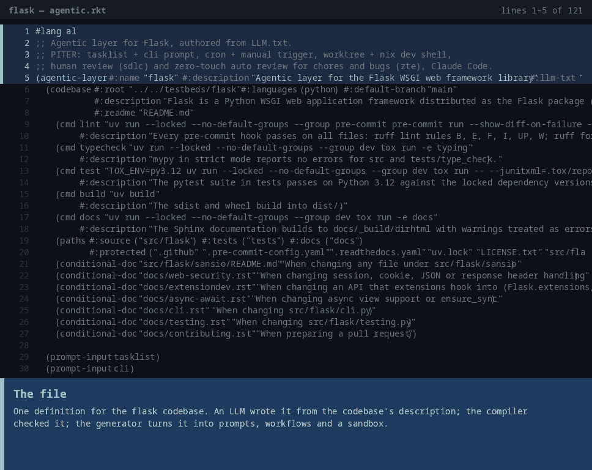

`al gen` turns that into a folder **beside** the repository:

```
flask.al/
  commands/   prompts written for flask: plan-chore, plan-bug, plan-feature, review, commit, …
  hops/       prompts that take another prompt or plan as input (e.g. "implement this plan")
  adws/       the workflows as runnable scripts, plus triggers
  env/        the container image and the Nix environment
  tasks.md    the task list
  specs/  agents/  artefacts/  trees/     plans, run logs, proof, and the agents' working copies
```

And this is a real run of that workflow with Claude Opus 5.5. The prompt was *"Add a test asserting that
Flask.testing is False on a newly created app"*. Nobody touched anything until the gate had decided:

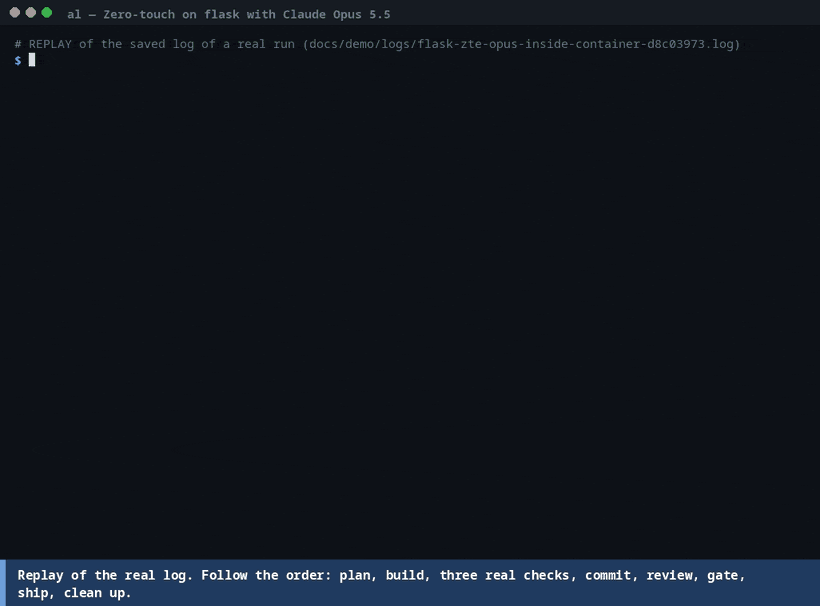

Opus planned the change, wrote the test and committed it; flask's own lint, type check and test suite ran
in a container; a second Opus pass reviewed the result against the plan with the logs and test report as
proof; every rule of the gate held. `main` was checked out in the application, so the result waited on the
branch `al/ship/main` for one manual fast-forward. It took 2 minutes 14 seconds and cost $0.69.
[The saved log](demo/logs/flask-zte-opus-inside-container-d8c03973.log) is in the repository.

## A web application, end to end: who reviews, and on what proof

The five [example repositories](#the-example-repositories) are libraries and command-line tools. To show a change you can *see*, there is
a sixth example: a small Notes web app ([`tests/webdemo/app`](../tests/webdemo/app)), hosted on a throwaway
Forgejo. Two requests were run for real with Claude Opus 5.5 working inside a container. The difference
between them is who reviews, and what counts as proof.

### 1. A visual change, reviewed by a human

*Request (filed as an issue): "Change the page background colour to dark slate and make the text light."*

The agent planned and made the change. The app's unit tests had to pass, and then the app was opened in a
real browser inside the container and screenshots were taken. The run finished by opening a pull request.

| before | after (captured by the run) |
|---|---|
| 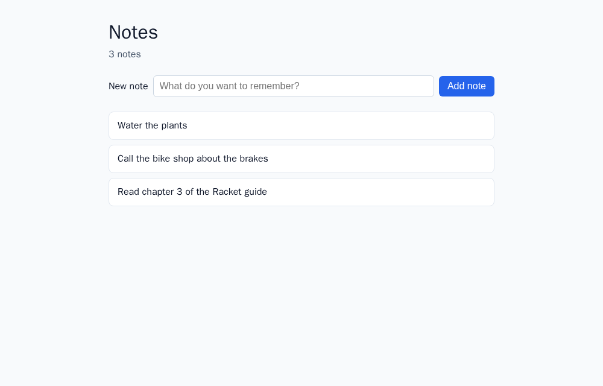 | 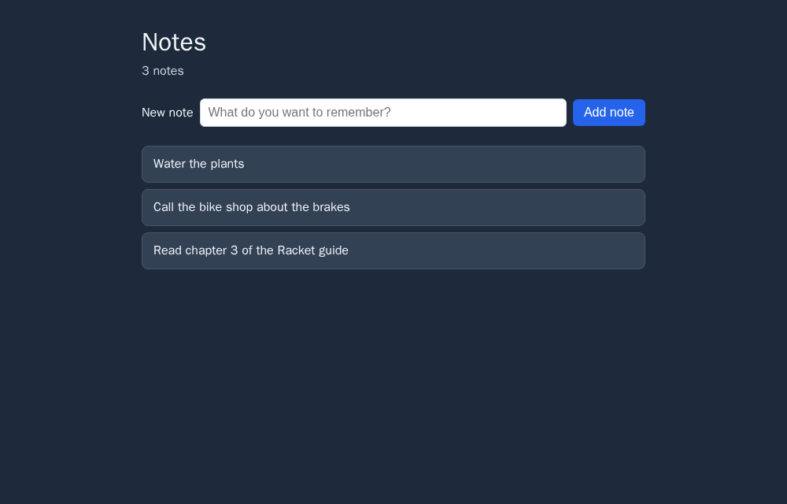 |

The screenshots are attached to the pull request, so the person reviewing sees the result without checking
anything out. Nothing ships until that person merges:

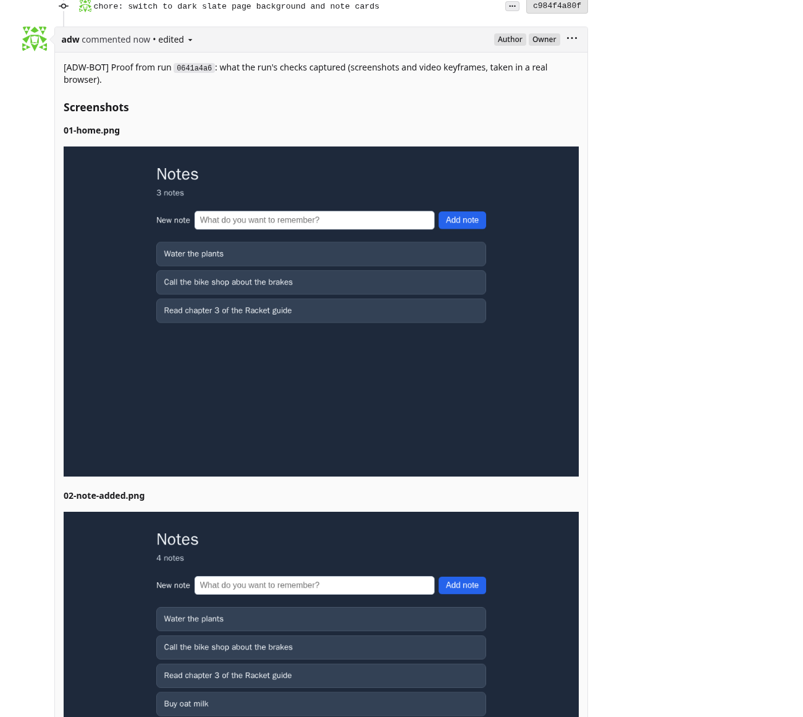

111 seconds, $0.47, three agent steps (plan, build, commit).

### 2. A new feature, reviewed by two agents and shipped without a human

*Request: "Add a search box above the notes list that filters the notes as you type; show 'No notes match'
when nothing matches."*

A feature needs stronger proof than a colour change. The agent built it, added tests, and extended the
browser scenario so that the run's **video** demonstrates the feature. This is that video:

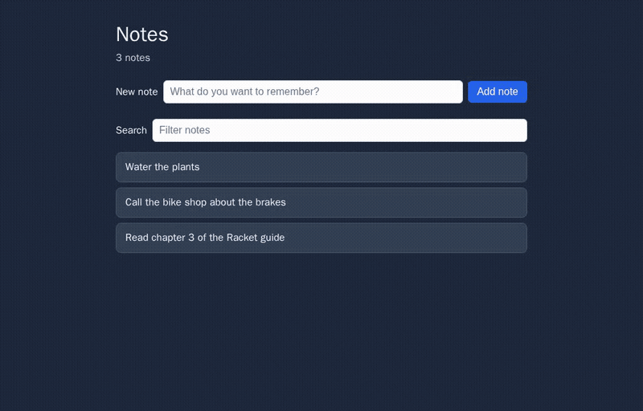

Play the original recording: [`b-feature.mp4`](https://github.com/dancegit/al/releases/download/media-v1/demo-webdemo-b-feature.mp4). A human reviewer gets this
file; the frames further down are only for the reviewer agents, who cannot watch a video.

Reviewers cannot watch a video, so the run cuts it into frames. Two independent reviewer agents each
examined all of them, together with the screenshots and the test logs:

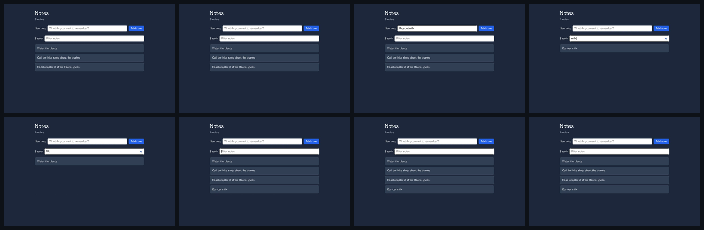

Both had to approve. Then the hard rules had to hold as well: tests and the browser run green again on the
final result, the change small enough, no protected file touched. Only then was it merged:

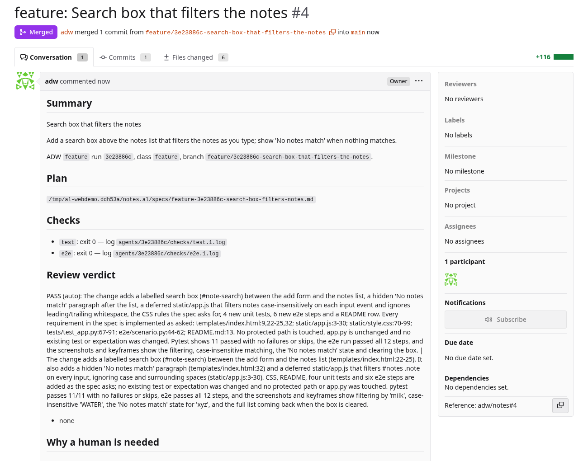

273 seconds, $1.31, five agent steps (plan, build, commit, two reviews). The reviewers' full verdicts are in
[`b-verdicts.json`](demo/webdemo/b-verdicts.json); one of them reads, in part: *"…the screenshots and
keyframes show filtering by 'milk', case-insensitive 'WATER', the 'No notes match' state for 'xyz', and the
full list coming back when the box is cleared."*

**What the proof looks like, for a person and for an agent:** [`docs/ARTEFACTS.md`](ARTEFACTS.md) shows the real recordings a
human reviewer can play, the frames reviewer agents get instead, screenshots, logs and verdicts.

| | Visual change | New feature |
|---|---|---|
| Proof | screenshots from a real browser | a video of the feature, plus screenshots and test logs |
| Who reviews | a person, in the pull request | two independent agents; both must approve |
| Who merges | the person | the gate, if every rule holds |
| What a person does | reads the PR, presses merge | nothing; can audit the PR afterwards |

To run both yourself: `tests/webdemo/webdemo_live.sh` (about 7 minutes and $1.80 of model usage).
What it sets up and what each output file is: [`tests/webdemo/README.md`](../tests/webdemo/README.md).

## A healthcare staffing app: rules, stopping conditions, and a review that says no

The seventh example is from a domain where mistakes are expensive: **Rota**, a small shift-scheduling app
for hospital wards ([`tests/rotademo/app`](../tests/rotademo/app)). It has two separate customer organisations,
workers with professional registrations that expire, and a database with migrations. All data is synthetic.

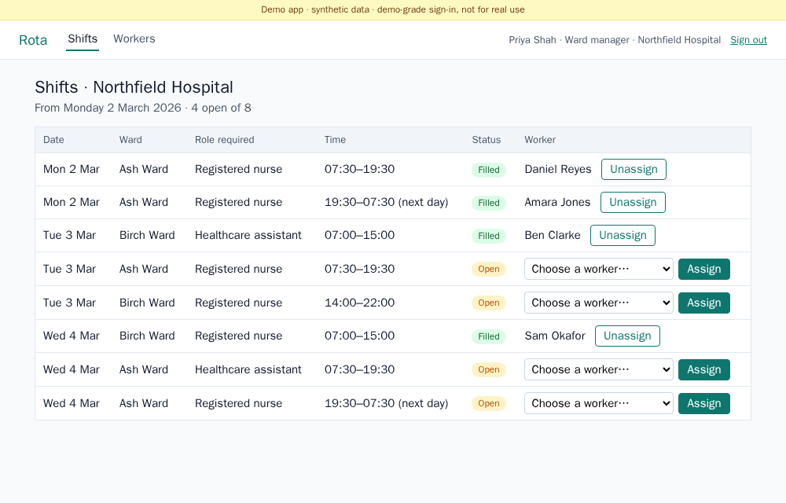

Three things in it matter more than the screens:

- **Issues carry acceptance criteria**, and plans restate them as a checklist a reviewer can tick.
- **Tests at three levels**: business rules, the API, and user journeys, plus a browser run that records video.
- **A customer-data isolation test that covers every route automatically**, including routes an agent adds
  later. One organisation must never see another's data. Agents are not allowed to change that test, the
  permission code or the database migrations.

Three requests were run for real with Claude Opus 5.5.

### 1. A safety rule, shipped on proof

*Request: refuse an assignment that would give a worker less than 11 hours of rest between shifts, in the
business rule, the API and on screen.*

The agent built it at all three levels and extended the browser scenario. The test suite, the isolation
test and the browser run passed. Two reviewer agents approved after examining 19 pieces of evidence each,
and the gate merged it. This is the video they were given:

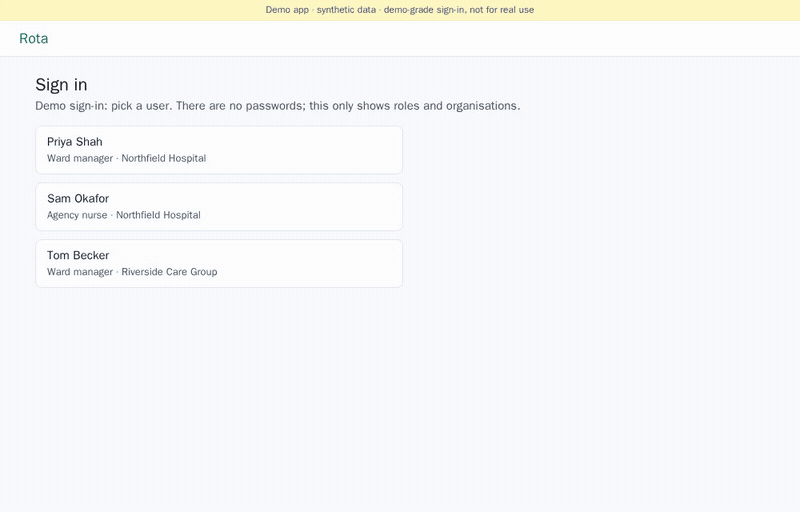

405 seconds, $2.34. Nobody was involved after the request.

### 2. A stopping condition: the agent hands over instead of guessing

*Request: record each worker's pay band and show it on the workers page.* That needs a new database
migration, and migrations are protected.

The agent did everything it was allowed to, refused to write the migration, and stated exactly what a
person should add. The tests could not pass without it, so the run stopped. It did not just fail: it
opened a draft pull request marked **[needs human]** with the reason and the request:

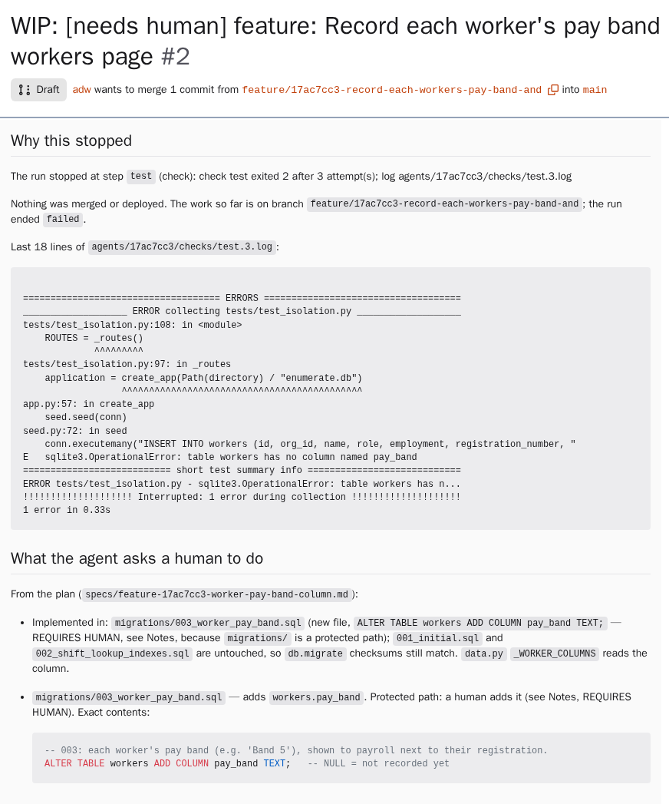

A person added that one file. The three checks then passed, and the person merged. 192 seconds, $1.24.

### 3. The review catches a defect

Approving good work proves little. So we **planted a flawed change on purpose**: it adds an "Expired"
badge for workers whose registration has lapsed, with tests, but leaves those workers selectable in the
assign dropdown. Every automated check passes. The flaw only shows if you compare the result with the
acceptance criteria. Everything after the planted step was real.

| the planted defect: Chloe Martin can still be chosen | after the fix |
|---|---|
| 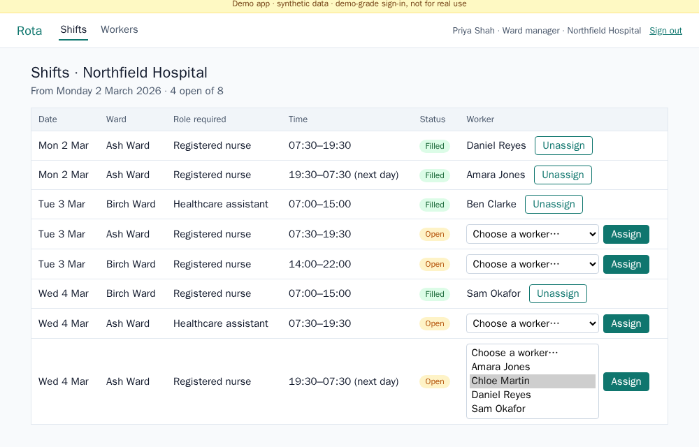 | 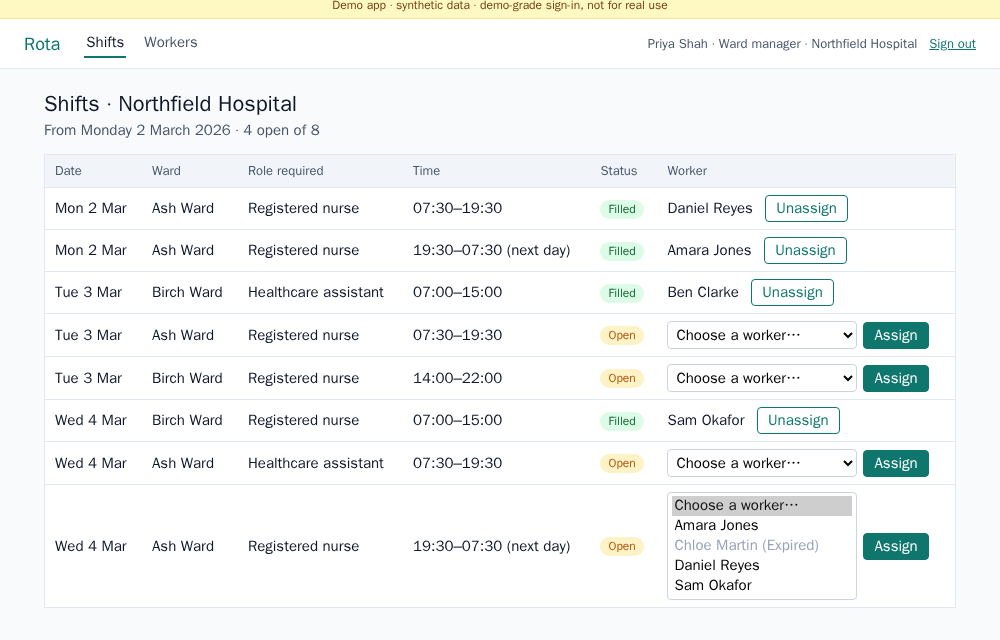 |

Both reviewer agents rejected it, independently. One wrote:

> Criterion 3 is not met: an expired worker can still be selected in the assign dropdown.
> templates/shifts.html:26 has no `disabled` attribute. The e2e log (…, steps 5-6) shows Chloe Martin
> selected in #assign-8 and submitted […]. That is exactly the after-the-fact discovery the issue asks to remove.

Their findings went to an agent that planned and made a fix. The checks ran again, both reviewers approved
the second round, and only then was it merged. 547 seconds, $2.96.

This was run twice, and both times both reviewers rejected the planted change. In the first run the
*second* review round raised a new objection, so that change went to a person instead of merging: the
reviewers are not perfectly consistent, and disagreement is treated as "ask a human".

| | Safety rule | Database change | Planted defect |
|---|---|---|---|
| What it shows | acceptance criteria, tests at three levels, proof on video | a stopping condition and a clean handover | review rejects bad work |
| Who decided | two reviewer agents and the gate | a person | reviewers said no, then yes |
| Outcome | merged, no human | draft PR; a person added one file and merged | rejected, fixed, approved, merged |

To run them: `tests/rotademo/rotademo_live.sh` (about 20 minutes and $6.50 of model usage).
Details and every output file: [`tests/rotademo/README.md`](../tests/rotademo/README.md).
A longer account of what was verified and where agents failed: [`docs/CASE-STUDY.md`](CASE-STUDY.md).

## Changing a layer: ask in words, approve a pull request

A layer is not generated once and frozen. You will want a new way to hand out work, a rule every plan
should follow, a stricter review. You can edit `agentic.rkt` yourself, but you do not have to:

```bash
al improve myapp/agentic "I want to queue work in a text file: add a task-file prompt input and a poller trigger."
```

An agent makes the smallest change that satisfies the request, in a private copy of the layer. Six
checks must pass, among them that the layer still compiles, regenerates identically twice, and that
every workflow still completes a dry run. Then it opens a pull request written for someone who does
not read the layer language:

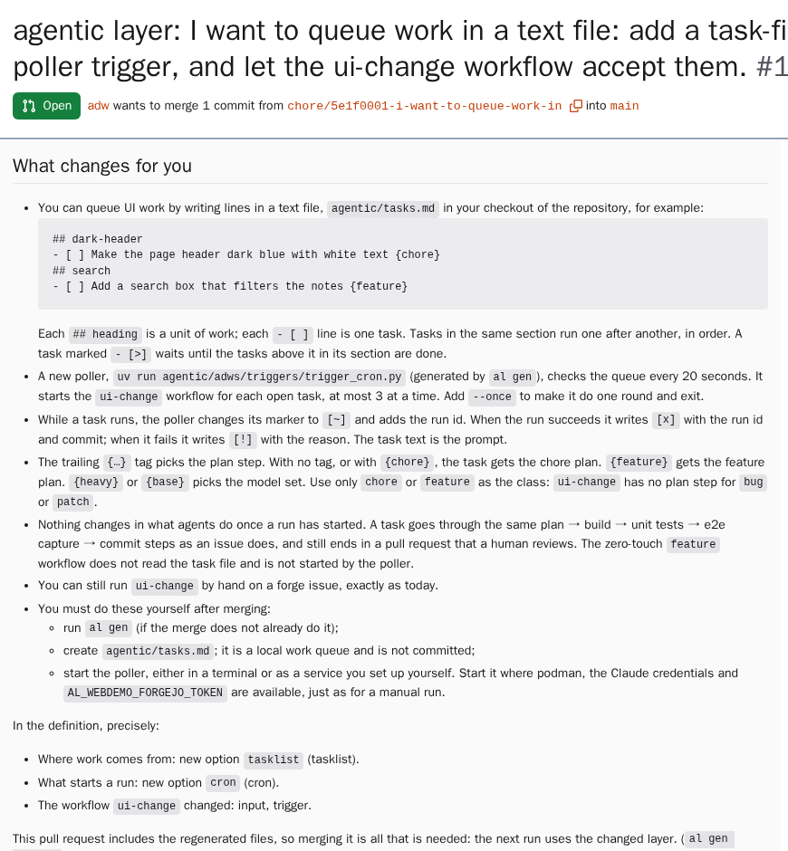

followed by each affected part of the layer explained before and after:

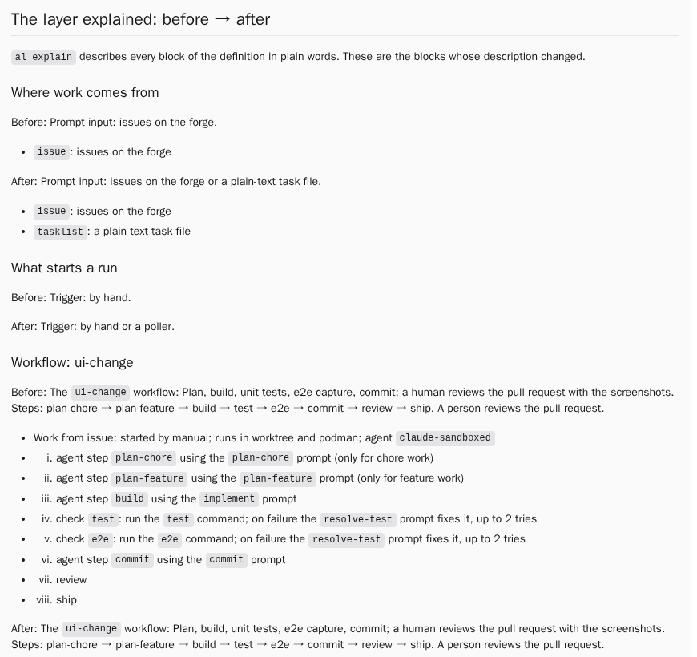

Behind it is a three-line change to the definition
([the diff](demo/selfdemo/1-layer-diff.patch)). After a person merged it, a task added to the file
was picked up by the poller and run. A second request, *"Every plan must end with a 'Rollback' section
that says exactly how to undo the change"*, changed a prompt template instead; the next plan an agent
wrote [ends with one](demo/selfdemo/2-plan-with-rollback.md). Both were real runs with Claude Opus
5.5: about 160 seconds and $0.90 each.

Three rules make this safe:

- **A person always approves.** There is no automatic mode for changes to how agents work.
- **Refinements survive regeneration.** `al eject` copies a prompt template into the layer for you to
  edit; `al gen` uses your copy from then on, and refuses to overwrite a generated file you edited by hand.
- **Agents cannot rewrite their own instructions in passing.** When the layer is checked into your
  repository (`al init --in-repo`), an ordinary workflow that touches it is stopped and handed to a person.

Details: step 14 of the [guide](GUIDE.md).

## Watching the agents work

Every generated layer has a live dashboard (`uv run adws/dashboard.py`, or `al dashboard DIR` for several
codebases at once). It shows what each agent is doing as it happens: runs in flight, the workflow as a
graph, time and cost per step, and each agent's transcript formatted for reading.

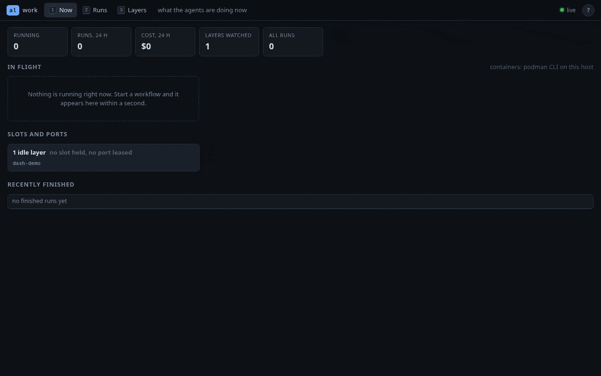

This is a real run from above (Claude Opus 5.5 adding a test to flask), opened afterwards: 3 minutes,
$0.68, the branch the classifier chose, and the build step's transcript filtered for one word.

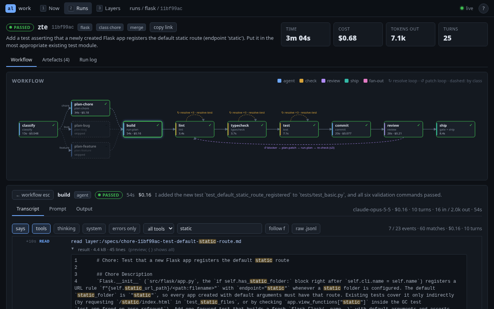

It changes nothing on its own, agent output is displayed as text and never interpreted, and it listens
on your own machine unless you give it a token. It can also run in its own container with no way out to
the network. More: [`kit/dashboard/README.md`](../kit/dashboard/README.md).

Work can be started from the page (any workflow, or one command such as `/plan-chore …` as a run that
never ships) or with `al run LAYER /NAME …`; see [Start work](GUIDE.md#start-work-from-the-dashboard-or-the-command-line).

Its **Repos** view lists the git repositories beside the layer's (`al dashboard ~/code/myapp.al`, or
`--workspace ~/code`, repeatable; `--workspace-depth N`; `--no-workspace`), each marked `layer`, `setup` or
`none`, and runs the next al step on one from the page (scout, create a layer, adopt its agent setup, gen,
check, verify, explain), showing the exact command line of each; `--no-actions` (or `--read-only`) turns
that off ([guide](GUIDE.md#work-with-several-repositories-from-the-dashboard)).

A layer with `(voice kokoro)` gets a **voice helper** panel: talk (or type) with it about runs, and it
proposes the next run as a card that starts only after you say yes and click **Approve**; speech stays on
the machine (`al voice LAYER setup` fetches the models once;
[guide](GUIDE.md#talk-to-the-dashboard)).

## al, used on itself

This repository has its own agentic layer, checked in as [`agentic/`](../agentic). It was not written by
hand: a fresh agent followed the [guide](GUIDE.md) step by step, with no inside knowledge, and
logged every place the guide was wrong or unclear ([`docs/GUIDE-FINDINGS.md`](GUIDE-FINDINGS.md);
the corrections have since been applied). The layer is explained in plain words at
[`docs/layers/al.md`](layers/al.md).

Then a real agent made a change to `al` itself, with al's own test suites as the checks. This is the
dashboard while it worked:

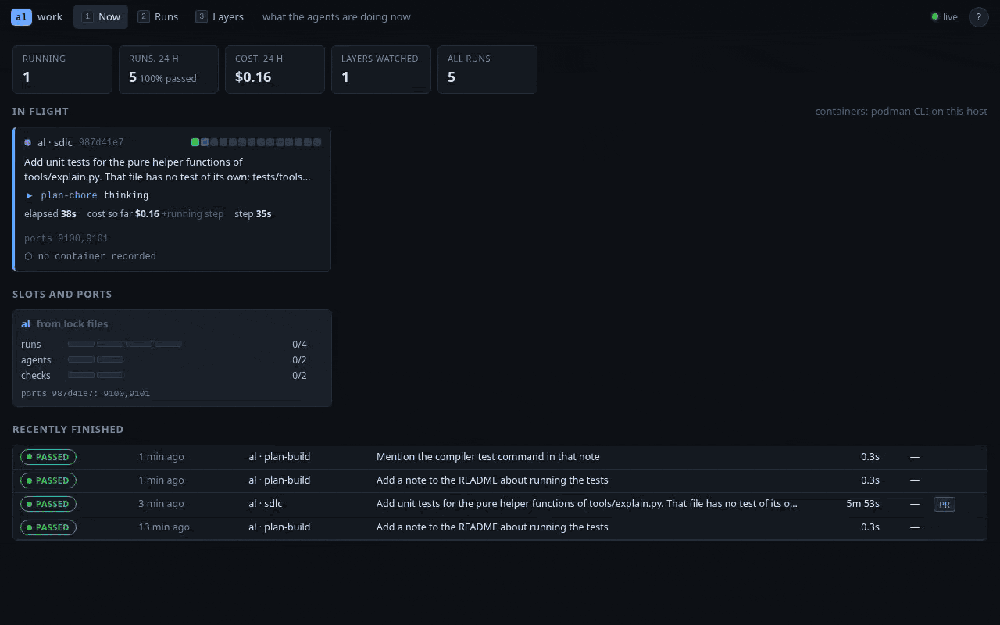

The request was unit tests for a part of `al` that had none. The run took 12½ minutes and cost $1.01:
five agent steps and five checks, all green. A person then reviewed it: ran the suite on the branch, broke
the code on purpose to confirm the new tests fail, and merged
([the change](demo/al-for-al/change.patch), [the run's own summary](demo/al-for-al/PR.md)).

## The example repositories

Five well-known public repositories, chosen to cover different languages, build tools and ways of working.
Each layer was written by a fresh LLM that saw only that repository's `LLM.txt` and the language reference.
All five compiled on the first attempt. The sources are in [`tests/authored/`](../tests/authored).

| Repository | Language | The layer we asked for | Verified for real |
|---|---|---|---|
| [flask](https://github.com/pallets/flask) | Python | task file + poller; container; ships chores and bugs by itself | lint, mypy and test suite; three full runs with Claude Opus 5.5 |
| [ripgrep](https://github.com/BurntSushi/ripgrep) | Rust | Forgejo issues + webhook; Rust container; an agent reviews, a human merges; proof stored on S3 | `cargo test` in its container |
| [gin](https://github.com/gin-gonic/gin) | Go | GitHub issues + CI workflow; a human reviews the pull request | `make test` in a container |
| [express](https://github.com/expressjs/express) | JavaScript | voice + task file; an "ask the codebase" workflow | `npm test` (1290 tests) |
| [jq](https://github.com/jqlang/jq) | C | spec files dropped in a folder; Debian build container; opens a pull request, never merges | autotools build and `make check` in its container |

Running the real commands is what found the mistakes the compiler cannot see. The jq layer's install command
could not work inside the sandbox and was corrected. gin's tests insist on port 8443, which was already in
use on the test machine; they pass in a container because every run has its own network.

## More clips

Every clip is a recording of real commands, with waiting time cut. The captured output is in [`docs/demo/logs/`](demo/logs).

**From a repository to its layer** (gin): describe, define, generate, check. The repository has zero changed files afterwards.

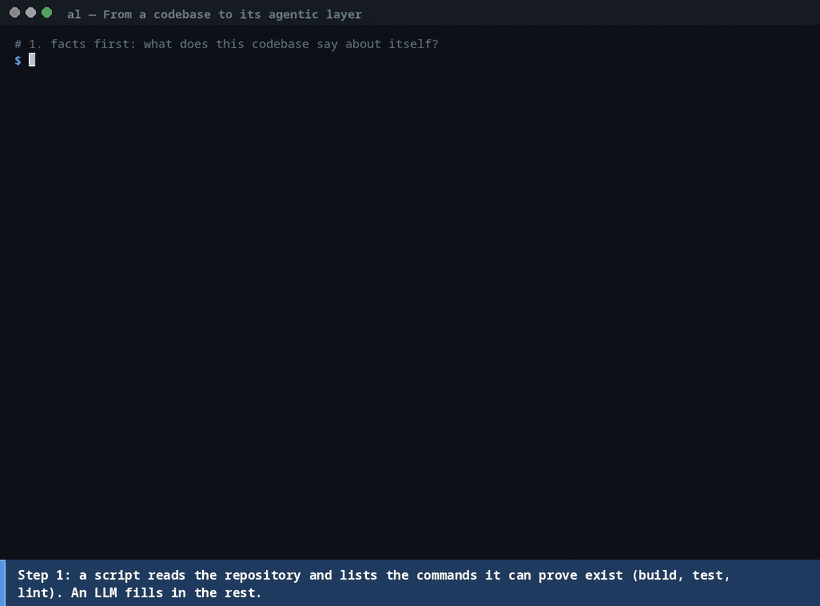

**The compiler as a safety net:** a workflow that names a command that does not exist, and one that tries to ship without a container.

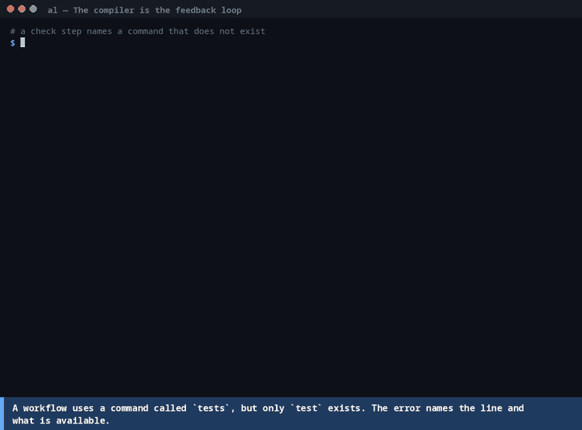

**Isolation:** three runs at once, limited to two at a time. Each has its own app on port 8000 and its own Postgres. From outside, neither is reachable.

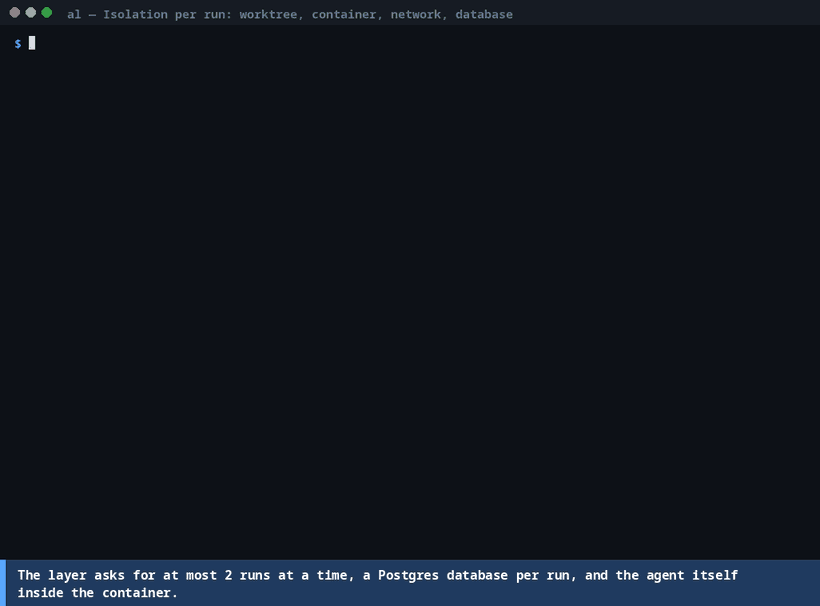

More clips:
[al used on itself](demo/06e-al-for-al.gif) ·
[the live dashboard](demo/06d-dashboard.gif) ·
[changing the layer by asking in words](demo/05g-layer-change.gif) ·
[healthcare: a safety rule shipped on proof](demo/05d-rota-feature.gif) ·
[healthcare: the review catches a planted defect](demo/05e-rota-defect.gif) ·
[healthcare: a stopping condition and handover](demo/05f-rota-handoff.gif) ·
[a visual change with human review](demo/05b-ui-change-human.gif) ·
[a feature reviewed by two agents](demo/05c-feature-agents.gif) ·
[five repositories](demo/03-five-codebases.gif) ·
[task file + poller](demo/04-tasklist.gif) ·
[fan-out: several agents race on one task](demo/06b-fan-out.gif) ·
[`al verify`: are the layer's commands true?](demo/06c-verify.gif) ·
[a live Forgejo: issue → pull request → merge](demo/07-forgejo.gif) ·
[local voice in and out](demo/08-voice.gif) ·
[the test suites](demo/09-tests.gif)

## Tests

```bash
export PLTCOLLECTS="$PWD/racket:"
raco test racket/al/tests                                    # the language rules
(cd kit/runtime && uv run --with pytest pytest -q)           # the runtime, including attempts to escape the container
uv run --with pytest --with pyyaml --with jsonschema pytest tests/integration -q   # full runs on the five repositories
uv run --with pytest --with pyyaml --with jsonschema pytest tests/tools -q         # the al command itself: eject, in-repo layers, al improve
(cd kit/dashboard && uv run --with pytest --with playwright pytest -q tests)       # the dashboard, including real-browser tests
tests/forge/forgejo_live.sh                                  # a throwaway Forgejo: issue → PR, merge, webhook
tests/forge/proof_video_live.sh                              # the recording is playable on the pull request
tests/selfdemo/selfdemo_live.sh                              # two layer changes through al improve with a real agent (about $2)
tests/webdemo/webdemo_live.sh                                # the Notes web app scenarios with a real agent (about $1.80)
tests/rotademo/rotademo_live.sh                              # the healthcare staffing scenarios with a real agent (about $6.50)
# tests/quickstart/run.sh                                    # the README's quick start in a clean container (needs podman or docker)
# tools/prepublish_check.sh                                  # before publishing: secrets, addresses, private paths and large files, tree and history
# tools/release_media.sh                                     # lists the videos of the release and prints the upload commands; uploads nothing
```

The fast suites (what CI runs; no container engine, no browser, no agent), exactly as
[`.github/workflows/ci.yml`](../.github/workflows/ci.yml) runs them:

```bash
PLTCOLLECTS="$PWD/racket:" raco test racket/al/tests
(cd kit/runtime && uv run --with pytest pytest -q)
(cd kit/dashboard && uv run --with pytest pytest -q tests)
uv run --with pytest --with pytest-xdist --with pyyaml --with jsonschema pytest tests/tools -q -n 4 -m "not podman and not browser and not slow"
uv run --with pytest --with pyyaml --with jsonschema pytest tests/tools/test_readme.py tests/tools/test_generated_references.py tests/tools/test_publish_ready.py -q
```

The integration tests never work in your checkouts. Each session makes its own copy of every example
repository at a pinned commit, and a test fails if it leaves anything behind. Details: [`tests/README.md`](../tests/README.md).
