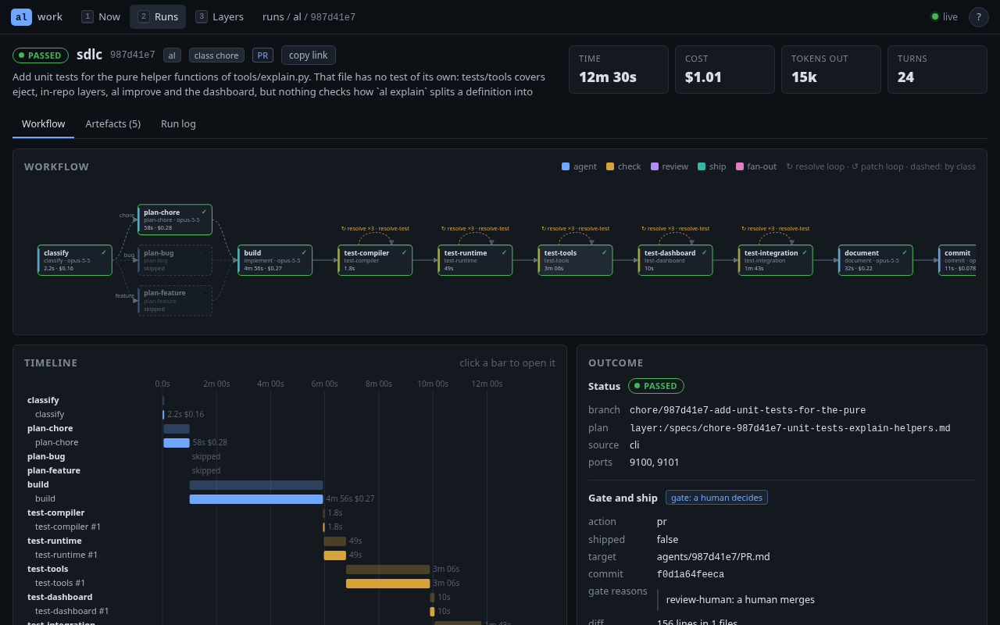

# Findings from following the guide: an agentic layer for `al` itself

This is the log of one attempt to follow [`GUIDE.md`](GUIDE.md) literally, as a newcomer, to give the `al`
repository its own agentic layer, and to make one real change with it. The agent that followed the guide
(Claude, in a git worktree of this repository on its own branch) also played the "coding agent" that the
guide hands `meta/commands/scout-codebase.md` and `meta/commands/author-layer.md` to. It did not read
`tools/al`, `kit/runtime` or `racket/al/private`, and did not copy from the example layers.

**Result.** The guide led to a layer that compiles, generates, passes `al check`, completes dry runs, and
made one real, reviewed change: 18 unit tests for `tools/explain.py`, 12 minutes 30 seconds, $1.01,
merged after review. Nothing needed the tool's internals. Along the way the guide was wrong or silent in
several places, `al verify` found that the repository's own first test command fails, and a run left
`git status` dirty, which the guide says cannot happen.

| | |
|---|---|
| The layer | [`agentic/`](../agentic) (`LLM.txt`, `agentic.rkt`, 54 generated files), explained in [`layers/al.md`](layers/al.md) |
| The real run | [`demo/al-for-al/`](demo/al-for-al): recording of the dashboard, `run.log`, `PR.md`, `change.patch`, `summary.json` |
| Machine | Linux, Racket 9.3, uv 0.12, git 2.55, podman 5.8, Claude Code 2.1, Google Chrome |

## Choices, and why

| Question | Choice | Reason |
|---|---|---|
| Where the layer lives | in the repository, `agentic/` | asked for; changes to how agents work then go through the same review as code |
| Where work comes from | the command line and a task file | no forge is assumed: anyone who clones the repository can use the layer |
| What starts a run | by hand, or the poller | the conservative start the guide recommends in step 3 |
| Where agents work | a private git worktree; checks run on the host | see below |
| Who decides | a human, from a branch and `PR.md` | first layer for this repository; no zero-touch |
| Forge | none | a hard-coded forge would not work for other clones |
| Dashboard | the default `(dashboard local)` | on by default |
| Agent | Claude Code, `claude-opus-5-5` for both model sets | the run was to be made with Opus 5.5; the default would use a smaller model for classify and commit |

**No container for the checks.** The guide recommends a container. The test suites need Racket 9.x and
`uv`. The default base image (`debian:stable-slim`, Debian 13.7) offers Racket 8.16
(`apt-cache policy racket`), and the guide says `al` is tested with 9.x. The runtime suite's sandbox
tests need podman and the dashboard's page tests need Chrome; inside a container both would be skipped,
so a green check there would prove less than a green check on the host. On the host all of them run.
A container becomes worth it when a Racket 9 image with `uv`, nested podman and a browser exists; that
was not built here.

**The checks.** `sdlc` runs five of the six declared commands: compiler, runtime, tools, dashboard
(without the browser tests, see T3) and integration. Together they take 5 minutes 30 seconds in `al verify` and took 5 minutes 51 seconds in the real run.

## Step by step

Verdicts: **as written** (the guide's text was enough and true), **guess** (it worked, but something had
to be assumed), **wrong or missing**.

| Step | The guide says | What was done | What happened | Verdict |
|---|---|---|---|---|
| Before you start | install the tools, `alias al=…`, `al --help` | checked all seven tools; ran `tools/al --help` | all present; the help lists every subcommand | as written |
| 1 Create the layer folder | `al init ~/code/myapp`; "You should see the path of the new folder, `~/code/myapp.al`, containing two files" | the in-repo form from step 14: `tools/al init . --in-repo` | 0.2 s. Created `agentic/` with `LLM.txt`, `AL-DSL.llms.txt` and a `.gitignore` (three files, not two). Printed the two clauses to put in `agentic.rkt` | guess: the in-repo form is only described 13 steps later (G1) |
| 2 Describe the codebase | give the agent `scout-codebase.md`; then check commands, protected paths, conventions, `UNVERIFIED` lines | followed the 11 steps of the scout command; added the protected paths and the conventions a maintainer would add | `LLM.txt` with 6 commands, each cited. Three things had to be decided without help: command names (G4), conventions that are in no file (G5), and the draft's title and remote URL (T10) | guess |
| 3 Decide | answer four questions in plain words | the table above | the guide's "start conservative" matched what a maintainer would pick, except the container | as written |
| 4 Have the layer written | give the agent `author-layer.md`; then `al compile … > /dev/null && echo "compiles"` | wrote `agentic.rkt` (134 lines) from `LLM.txt` and the language reference only | compiled on the first attempt, 1.0 s, no repair round. `repair-layer.md` was never needed | as written |
| 5 Read what was written | `al explain`; `--md layer.md --gif layer.gif`; "The seven example layers are explained this way in `docs/layers`" | `al explain agentic --md docs/layers/al.md --gif docs/layers/al.gif` | 1.4 s for text, 3.5 s with document and animation. The text is accurate. `docs/layers` does not exist in the repository (T1). Three wording slips (T9) | wrong or missing: the link is dead |
| 6 Generate | `al gen`; "You should see `generated N files`"; a list of folders including `env/` | `tools/al gen agentic` | 0.9 s, `generated 54 files`. No `env/` (there is no container or Nix shell); `experts/`, `templates/`, `mock/`, `bin/`, `conditional_docs.md` and `agentic-layer.json` are not in the guide's list. `commands/plan-chore.md` names the real commands, paths and rules | as written, list incomplete (G9) |
| 7 Prove the commands are true | `al verify`; "You should end with `verify: N/N ok`" | `al verify agentic --cmd test-compiler --cmd test-runtime`, then all commands | First attempt: `verify: 1/2 ok`. The compiler test command taken from the README exits 1 (T2). Fixed the layer to the command that works. Second attempt: `4/5`, one dashboard browser test is not deterministic (T3). Split that command in two. Final: see "al verify, final" below | as written, and it did what it promises: it found two things the compiler could not |
| 8 Check, then rehearse | `al check`; `uv run adws/adw_plan-build.py "…" --dry-run`; "ending with `status: passed`" | `tools/al check agentic`; `uv run agentic/adws/adw_plan-build.py "…" --dry-run`; also `adw_sdlc.py --dry-run` | `check: ok` in 2.7 s. `plan-build` dry run: 0.4 s, `status: passed`. `sdlc` dry run: 354 s (the five checks run for real), `status: passed`, `PR.md` written, branch deleted because nothing was on it | as written |
| Watch the work | `uv run adws/dashboard.py --open`; `al dashboard ~/code` | `uv run agentic/adws/dashboard.py --port N` (no `--open`: no desktop session); `tools/al dashboard .` | both serve the page; `al dashboard .` found the in-repo layer. Everything the guide lists was visible (see the recording). Two display problems (T7, T8) | as written |
| 9 The first real run | `uv run adws/adw_sdlc.py "…"`; "A typical run takes two to five minutes"; without a forge "a branch in your repository and `agents/<run id>/PR.md`"; "Your checkout is exactly as you left it" | `uv run agentic/adws/adw_sdlc.py "<request.txt>"` with the dashboard open | passed: 12 min 30 s, $1.01, branch `chore/987d41e7-…` and `PR.md`. The checkout was **not** as left: the run changed a committed layer file (T4). The run was cut from `main`, not from the checkout's branch (G2) | wrong or missing on three points (G2, G6, T4) |
| 10 Hand out work | add two lines to `tasks.md`; `trigger_cron.py --once` | the guide's two lines with `{plan-build}`; `uv run agentic/adws/triggers/trigger_cron.py --once --dry-run`, twice | first pass ran the `[ ]` task and marked it `[x] … <!-- adw:5b747797 -->`; second pass ran the `[>]` task. 0.7 s each. `--dry-run` exists but the guide does not mention it (G7) | as written, with a guess for the dry run |
| 10, forge issues and voice | declare a forge / voice | skipped: no forge, no voice | | not applicable |
| 11 Add proof | declare artefacts and collect them on the check | `(artefact log)` collected on all five checks | `PR.md` lists the five logs. No junit or coverage: nothing in the repository says where such a report would go, so none was declared | as written (logs only) |
| 12 Zero-touch | `(review auto …)` | skipped: a human reviews | | not applicable |
| 13 Several at once | `(concurrency slots …)`, services | defaults kept (4 runs, 2 agents, 2 checks) | | not applicable |
| 14 `al improve` | `al improve LAYER "…" --dry-run`; "The layer must be committed on its default branch first" | `tools/al improve agentic "Every plan must end with a 'Rollback' section…" --dry-run` | refused in 1 s: "the layer … has changes that are not committed on `main`". Correct, and as the guide says; so `al improve` could not be tried from a feature branch | as written (not exercised further) |
| 14 `al eject --list` | lists every template, where it comes from, whether it drifted | `tools/al eject agentic --list` | 17 templates, all `[kit]` | as written |
| 14 Hand-edited generated file | `al gen` stops, writes nothing, names the file and the fix; `al check` reports the same | appended a line to `agentic/commands/plan-chore.md`, ran `al gen`, `al check`, `al gen --discard-edits` | exactly the message the guide quotes; `check: FAILED` with the same reason; `--discard-edits` restored the file | as written |
| 14 Keep the layer in your repository | `al init … --in-repo`; `(codebase #:root "..")`, `(layer in-repo #:dir "agentic")`; commit the folder; "Runs leave `git status` clean" | done at step 1; committed `agentic/` after `al gen` | `git status` was clean after `al gen`, after `al verify`, after the dry runs and after the poller. It was **not** clean after the real run (T4) | wrong: the promise fails for any workflow with a `document` step |

### `al verify`, final

Five invocations, all on a throwaway copy of `main` in the layer's declared environment (a worktree, on the host):

| # | Invocation | Result | What it led to |
|---|---|---|---|
| 1 | `--cmd test-compiler --cmd test-runtime` | `verify: 1/2 ok`, 50 s. `test-compiler` exit 1 in 2.7 s; `test-runtime` ok in 46.6 s (271 passed) | the README's `raco test racket/al/tests` fails (T2); the layer now names the test file |
| 2 | all five commands | `verify: 4/5 ok`, 5 min 52 s. compiler 1.5 s, runtime 48.5 s, tools 172.7 s, integration 95.6 s ok; `test-dashboard` exit 1 in 32.9 s | one browser test is not deterministic (T3); the layer now has `test-dashboard` (no browser, used as the check) and `test-dashboard-browser` (declared, not used) |
| 3 | `--cmd test-dashboard --cmd test-dashboard-browser` | `verify: 2/2 ok`. 10.2 s and 33.1 s (the browser test happened to pass) | |
| 4 | all six commands | all six exit 0 (1.5 s, 48.8 s, 172.9 s, 10.6 s, 33.6 s, 92.7 s), then exit status 1: "THE APPLICATION CHECKOUT CHANGED DURING VERIFY" | this file was being written in the checkout while verify ran. With an in-repo layer, any edit in your checkout during `al verify` fails it (see T6) |
| 5 | all six commands, checkout left alone | `verify: 6/6 ok`, about 6 min: 1.5 s, 48.3 s, 176.1 s, 10.2 s, 32.9 s, 96.7 s | |

Nothing had to be weakened. Both layer changes replace a command that is not true on this machine with a
documented one that is, and both problems are recorded in `agentic/LLM.txt` under Unknowns.
`test-dashboard-browser` passes about half the time, so a later `al verify` may well say `5/6`.

### Time per phase

| Phase | Time |
|---|---|
| Reading the README, the guide, the two instruction files and the language reference | about 10 minutes |
| `al init` | 0.2 s |
| Describe (`LLM.txt`) | about 4 minutes of agent work |
| Author (`agentic.rkt`) and compile | about 1 minute; compile 1.0 s, first attempt |
| `al explain` / `al gen` / `al check` | 1.4 s (3.5 s with document and animation) / 0.9 s / 2.7 s |
| `al verify` | 50 s for two commands; 5 min 52 s for five; about 6 min for all six |
| Dry runs | `plan-build` 0.4 s; `sdlc` 5 min 54 s; poller 0.7 s for each pass |
| The real run | 12 min 30 s: agents 6 min 39 s (classify 2 s, plan 58 s, build 4 min 56 s, document 32 s, commit 10 s), checks 5 min 51 s |
| Review by the human reviewer | about 5 minutes, of which 2 min 53 s is `tests/tools` |
| Agent cost | $1.01 in total: classify $0.16, plan $0.28, build $0.27, document $0.22, commit $0.08 |

## The real run

**Request** ([`request.txt`](demo/al-for-al/request.txt)): unit tests for the pure helper functions of
`tools/explain.py`, which had no test of its own, with six acceptance criteria.

**What happened.** Classified as a chore; planned; the build step wrote `tests/tools/test_explain.py` and
ran the four validation commands itself; the five checks passed on the first attempt; the document step
wrote a note; the commit step committed; the gate chose "a human decides" and wrote `PR.md`.



Watched live: [`dashboard-live.mp4`](demo/al-for-al/dashboard-live.mp4) (85 s, waiting time cut) and
[`dashboard-live.gif`](demo/al-for-al/dashboard-live.gif). It shows the Now view with the run in flight,
the workflow graph, the build step's transcript in follow mode, the `test-tools` log while it grows, the
finished run with time and cost, and the history. Recorded in the host's Chrome with Playwright by
[`record_run.py`](demo/al-for-al/record_run.py), adapted from `kit/dashboard/demo/live_demo.py`, with the
same privacy check. The recording starts 41 seconds into the run: the first recorder was stopped by the
operator's own mistake (a `pkill` pattern that matched its shell), the run itself was not affected, and a
second recorder was attached to the same dashboard and run. That is why classify is already green in the
first frame.

**Review.** As the human reviewer:

- Read the diff ([`change.patch`](demo/al-for-al/change.patch)): one new file, 156 lines; `tools/explain.py` untouched.
- Read `PR.md`: request, plan path, five checks with exit 0, "a human merges".
- On the run's branch: `tests/tools/test_explain.py` passes (18 tests, 0.04 s); the whole `tests/tools` suite passes (53 passed, 1 skipped, 173 s).
- Changed `listing`, `split_blocks` and `describe_step` in a scratch copy: 7 of the 18 tests failed. The tests bind the behaviour.
- No network, subprocess, Racket or agent in the tests; no personal path or name in the diff.
- One test (`test_split_blocks_one_based_inclusive`) is looser than the plan asked for. The run's own document step said so. Accepted.

**Merged**, by cherry-pick (commit `b4c8d07` on this branch). The run's branch starts from a newer commit
of `main` than this branch, so a merge would also have brought that unrelated commit in (G2).
**Not merged:** the line the run added to `agentic/conditional_docs.md` (T4); the file was restored.

> **Status of these findings:** every correction below has been applied to the guide, and every tool defect
> listed further down has been fixed and has a test. G3 no longer applies: runs leave `git status` clean.
> This file is kept as the record of the walk-through.

## Corrections to `docs/GUIDE.md`, most important first

**G1. Say at step 1 that the layer can live in the repository.** A reader who wants that (the guide says
"most teams will") finds out in the last section, after building a sibling layer. Add to step 1, after
the first code block:

> To keep the layer inside your repository instead, versioned with the code, use
> `al init ~/code/myapp --in-repo`. It creates `~/code/myapp/agentic`. Every later command then takes
> `~/code/myapp/agentic` where this guide writes `~/code/myapp.al`, and scripts are run from the
> repository root as `uv run agentic/adws/…`. Step 14 explains what is committed and the one rule that
> comes with it.

and in step 4, when the layer is in-repo, the last line of the preferences becomes
`The layer is in the repository: (codebase #:root "..") and (layer in-repo #:dir "agentic")`.

**G2. Say which commit a run starts from.** `al verify` and every run make their private copy from the
default branch named in `agentic.rkt` (`main`), not from what is checked out. On a feature branch or in a
second worktree this means: `al verify` tests `main`, not your branch; the run's branch is based on
`main`, so merging it into your branch brings `main` with it; and a layer that is committed only on your
branch is not in the run's copy. None of this is in the guide. Add to step 7 and step 9:

> The private copy is made from your default branch (`#:default-branch`, `main` unless you say
> otherwise), not from whatever you have checked out. Commit and merge what you want agents to see first.
> If you are on another branch, the run's branch will not be based on it: take the change with
> `git cherry-pick`, or merge after your branch has caught up with the default branch.

**G3. Remove or correct "Runs leave `git status` clean" (step 14) and "Your checkout is exactly as you
left it" (step 9) for in-repo layers,** until T4 is fixed. As it stands:

> With the layer in your repository, a workflow that has a `document` step adds one line to
> `agentic/conditional_docs.md`, a committed file. Review that line with the change, or restore the file.

**G4. Step 2: say that command names are free.** `meta/LLM.txt.template.md` says names "are drawn from:
install, lint, format, typecheck, test, test-fast, e2e, build, start, docs, deploy". This repository has
five test suites and no lint. Any name compiles (`test-compiler`, `test-runtime`, …). Add to step 2, under
"Commands":

> A repository with several suites gets one row per suite, with names of your choosing
> (`test-unit`, `test-api`). The names in the template are suggestions.

and change the template sentence to "Usual names are …; use others when the codebase has several commands
of one kind."

**G5. Step 2: say where rules go that are written in no file.** The scout command allows only what a file
states; the guide then asks the human for "the rules you would tell a new colleague". Those rules have no
citation. Add:

> Rules that are in no file are yours to add under Conventions. Say so under Evidence ("stated by the
> maintainer"), and consider writing them into a CONTRIBUTING file so the next scout finds them.

**G6. Step 9: the time and cost figures are for a codebase with one fast test command.** Here the run took
12 min 30 s and $1.01, not "two to five minutes" and "$0.50 to $0.70". Two causes the guide should name:
the checks take as long as your suites (5 min 51 s here), and the build agent runs every command listed in
the planner's `#:validation` itself before the checks run them again (another 4 minutes). Replace the
sentence in step 9 with:

> A run takes the agent's time (two to four minutes for a small change) plus your checks, and the build
> step runs the plan's validation commands once more before the checks do. With a five-minute test suite,
> expect ten to fifteen minutes. Keep `#:validation` on the planning commands to the fast commands.

and in "What it costs", add: "Every agent step costs $0.08 to $0.16 before it does anything, for reading
its prompt; a workflow with five agent steps on Opus starts at about $0.60."

**G7. Step 10: mention the free rehearsal.** The step tells the reader to add two tasks and run the
poller; the next command spends money. Add after the code block:

> `uv run adws/triggers/trigger_cron.py --once --dry-run` does the same with the stand-in agent: the tasks
> are claimed and marked, nothing is charged.

**G8. Step 7: add the two failures this exercise hit to the "If it goes wrong" table.**

| Symptom | Usual cause | Fix |
|---|---|---|
| a command from your README fails on the clean copy although it works for you | your checkout has files the clean copy lacks (build output, caches), or the documented command was never run as written | find the command that works, put it in `LLM.txt` with its citation, and correct the document |
| a command passes one time and fails the next | a test that depends on timing | do not use it as a check: an agent will be sent to "fix" it. Declare a deterministic variant for the workflow and fix the test |

**G9. Step 6: the list of generated folders.** `env/` exists only with a container or Nix environment.
The list omits what a reader will see: `experts/`, `templates/`, `mock/`, `bin/`, `specs/`,
`agentic-layer.json`, `conditional_docs.md`. Mark `env/` "(if you chose a container or Nix)" and add one
line: "Also: `experts/` (if you declared any), `templates/` (your own prompt templates, step 14),
`agentic-layer.json` (the compiled definition) and `conditional_docs.md`."

**G10. Step 1: three files, and what the draft contains.** "containing two files" is three with
`--in-repo` (`.gitignore`). Add a caution: "The draft records your git remote URL. If the layer will be
committed and the remote is private, remove it."

**G11. "Watch the work": the dashboard can show the layer's explanation.** `kit/dashboard/README.md`
says the Layers view shows the plain-language explanation "when an `EXPLAIN.md` exists". The guide never
says how to make one. Add to step 5 or to "Watch the work":
"`al explain ~/code/myapp.al --md ~/code/myapp.al/EXPLAIN.md` puts the explanation on the dashboard's
Layers page." (Not tried here: unverified.)

**G12. Step 3: when a container is the wrong start.** The guide says "Start conservative: … a
container". For a codebase whose tests themselves need containers or a browser, the host proves more. Add:
"If your tests start containers or drive a browser, run the checks on the host first; a container that
skips those tests proves less."

**G13. Step 14, `#:focus`.** "For a one-line instruction, a `#:focus` line … is simpler than a template"
holds for additions. A focus line that contradicts the template loses: the commit command was told "one
summary line, no trailer lines" and the commit still has a body and an `ADW:` trailer, because the
template asks for them. Add: "A focus line adds to the template; to change what the template already
prescribes, eject it."

## Bugs and rough edges in the tool and the repository

Each with a minimal reproduction from the repository root.

**T1. `docs/layers` is git-ignored, so the pages the README and the guide link to are not in the
repository.** `.gitignore` line 2 is `layers/`, meant for the top-level scratch directory; it also matches
`docs/layers/`.

```bash
git check-ignore -v docs/layers/README.md     # .gitignore:2:layers/   docs/layers/README.md
git ls-files docs/layers                      # (at main: nothing)
```

`README.md` ("Every example layer has a page … `docs/layers`", and the flask animation) and `GUIDE.md`
step 5 point there. Fix: `/layers/` in `.gitignore`, then commit the seven pages. On this branch
`docs/layers/README.md`, `al.md` and `al.gif` were added with `git add -f`; the README there keeps the
seven existing rows, whose pages exist only untracked in the maintainer's checkout.

**T2. The first command of the README's test section fails on a clean checkout.**

```bash
export PLTCOLLECTS="$PWD/racket:"
raco test racket/al/tests; echo "exit $?"                       # exit 1
raco test racket/al/tests/compiler-test.rkt; echo "exit $?"     # 20 tests passed, exit 0
```

With a directory, `raco test` also loads `racket/al/tests/fixtures/dangling-ref.rkt`, a definition that is
invalid on purpose, and stops with its compile error (Racket 9.3). `tests/README.md` gives the same
command. `tools/demo/scenes.toml` (lines 75 and 331) already runs the single file while *showing*
`raco test racket/al/tests`, so the recorded demo displays a command that is not the one that ran. Fix:
name the file in both documents and in the `show` text, or move the fixture out of the test directory.
Found by `al verify` in step 7.

**T3. A dashboard browser test is not deterministic.**

```bash
cd kit/dashboard
for i in 1 2 3 4 5 6 7 8 9 10; do
  uv run --with pytest --with playwright pytest -q \
    "tests/test_browser_events.py::test_a_running_checks_log_is_followed_live_then_settles" | tail -1
done                                                            # 5 of 10 failed on an idle machine
```

`tests/test_browser_events.py:68`: `assert "3 passed" in epage.locator(".log").inner_text()` reads the
log element while it is empty, just after the check ends. Either the test must wait for the text, or the
page really shows an empty log for a moment when a check settles. Found by `al verify`. The layer
therefore uses the documented no-browser command as its dashboard check and declares the browser command
without using it.

**T4. With an in-repo layer, a `document` step changes a committed file and points it at an ignored one.**

```bash
uv run agentic/adws/adw_sdlc.py "any small chore"     # real agent; the mock agent does not write the line
git status --short                                    #  M agentic/conditional_docs.md
git diff agentic/conditional_docs.md
# +- `docs/chore-987d41e7-unit-tests-explain-helpers.md` — When changing listing, split_blocks or …
```

The document is written to `agentic/docs/`, which the layer's `.gitignore` excludes, so the committed
line refers to a file no other clone has. The path also reads like the repository's own `docs/`. And the
change is made in the main checkout, not in the run's private copy, so it is not on the run's branch and
not in `PR.md`. Either the run documents are committed, or the document step must not touch
`conditional_docs.md` for an in-repo layer. This contradicts guide steps 9 and 14.

**T5. `PR.md` contains absolute paths of the machine.** The plan is given as an absolute path and every
artefact as `file:///<home>/…`. With a forge, that text becomes a public pull request. Reproduce: any run
without a forge, then `grep -n "file://\|^\`/" agentic/agents/<run id>/PR.md`. In
`demo/al-for-al/PR.md` the checkout path is replaced by `<repo>`. Also: the title of `PR.md` is the whole
request (1,600 characters here); a first sentence or the plan's title would do.

**T6. `al check` fails on an in-repo layer whenever the checkout has unrelated uncommitted work.**

```bash
touch docs/scratch.txt && tools/al check agentic
# PROBLEM: application working tree changed outside the layer: ?? docs/scratch.txt
# check: FAILED
```

For a sibling layer "your repository is untouched" is the right test. For an in-repo layer the developer's
own work in progress is reported as if the layer had done it.

**T7. The live log of a check shows each chunk on its own line.** While `pytest -q` runs, the Step view
shows `....` then one `.` per line; the finished log (and the file `checks/test-tools.1.log`) has the dots
on one line. Reproduce: open a check with dotted progress output while it runs
(`demo/al-for-al/dashboard-live.mp4`, from 0:46 to 0:58).

**T8. The workflow graph does not fit a 1280-pixel window for a 14-step workflow.** `commit` is cut in
half and `review` and `ship` are off screen until the graph is scrolled sideways; nothing indicates that
there is more to the right (`demo/al-for-al/run.png`).

**T9. `al explain` wording.** For a layer with `(forge none)` and `(review human)` it says "A person
reviews the pull request" and "open a pull request and stop", while its own forge block says "No forge:
results stay as local branches". The one-paragraph summary reads "`al` is Agentic layer for al, …" (it
pastes the description after "is"). Under "The prompts" it announces "23 of their instructions are
specific to this codebase" and then lists six.

**T10. `al init` draft.** In a git worktree the draft's title is the worktree directory's name, not the
repository's. The draft writes the ssh remote URL into a file that, with `--in-repo`, is about to be
committed.

**T11. `al verify` overwrites `agents/verify/report.json` with only the commands of the last call.** After
`al verify LAYER --cmd a` the report no longer contains the others, while their logs remain beside it.
A merged report, or a note in the output, would avoid reading a stale log as current.

**T12. The commit template wins over `#:focus`.** See G13. The commit of the real run:
`chore: add unit tests …`, two body bullets, `ADW: 987d41e7`, against a focus line that asked for one
line and no trailer.

**T13. A step that has little to do still costs.** `classify` returned 49 tokens and cost $0.16 on Opus.
That is the price of the prompt, not a defect, but it makes the default (a smaller model for the `base`
set) the right one, and the guide's cost section could say so.

## What could not be verified

- `al improve`: it needs the layer on the default branch; this layer is on a feature branch.
- Checks or the agent inside a container, `(dashboard podman)`, Nix, a forge, voice, zero-touch, several runs at once.
- The dashboard's `--open` (no desktop session) and the `EXPLAIN.md` hint in G11.
- Whether T3 fails on other machines, and whether T2 fails on Racket versions other than 9.3.
- The guide's cost range with the default models: this layer runs every step on Opus.
- A second real run: one was made; it passed first time, so the allowed retry was not used.

## Left behind in the repository

- Branch `chore/987d41e7-add-unit-tests-for-the-pure` (the run's branch, kept as evidence; its commit is on this branch as `b4c8d07`). Delete it with `git branch -D` when no longer wanted.
- Nothing else: no worktree, no container, `git status` clean.
