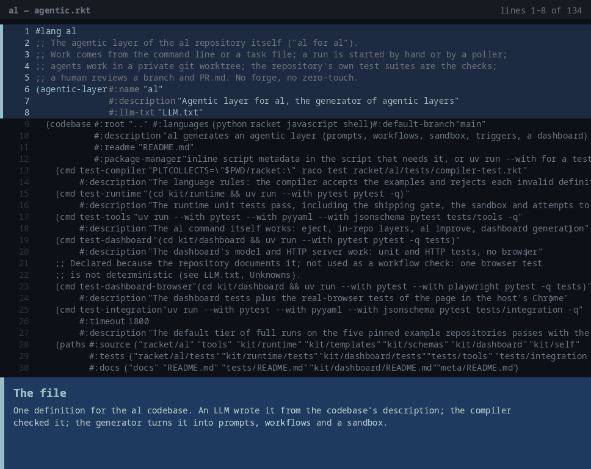

# The `al` layer, explained

Source: `agentic/agentic.rkt` (134 lines). This walkthrough is generated by `al explain` from the file and its compiled form, so it also states the defaults the author did not write down.



## In one paragraph

`al` is Agentic layer for al, the generator of agentic layers. It declares 6 codebase commands, 11 prompts and 2 workflows (`plan-build` and `sdlc`).

## Block by block

### The file

Lines 1–8. One definition for the `al` codebase. An LLM wrote it from the codebase's description; the compiler checked it; the generator turns it into prompts, workflows and a sandbox.

```racket
#lang al
;; The agentic layer of the al repository itself ("al for al").
;; Work comes from the command line or a task file; a run is started by hand or by a poller;
;; agents work in a private git worktree; the repository's own test suites are the checks;
;; a human reviews a branch and PR.md. No forge, no zero-touch.
(agentic-layer #:name "al"
               #:description "Agentic layer for al, the generator of agentic layers"
               #:llm-txt "LLM.txt"
```

### The codebase and its commands

Lines 9–46. What the codebase is (python, racket, javascript and shell) and the commands that prove things about it: `test-compiler`, `test-runtime`, `test-tools`, `test-dashboard`, `test-dashboard-browser` and `test-integration`. Agents show that something works by running these, never by saying so. 10 protected paths: agents may not ship changes there without a person.

- `test-compiler` runs `PLTCOLLECTS="$PWD/racket:" raco test racket/al/tests/compiler-test.rkt` — The language rules: the compiler accepts the examples and rejects each invalid definition with the documented error
- `test-runtime` runs `(cd kit/runtime && uv run --with pytest pytest -q)` — The runtime unit tests pass, including the shipping gate, the sandbox and attempts to escape the container
- `test-tools` runs `uv run --with pytest --with pyyaml --with jsonschema pytest tests/tools -q` — The al command itself works: eject, in-repo layers, al improve, dashboard generation
- `test-dashboard` runs `(cd kit/dashboard && uv run --with pytest pytest -q tests)` — The dashboard's model and HTTP server work: unit and HTTP tests, no browser
- `test-dashboard-browser` runs `(cd kit/dashboard && uv run --with pytest --with playwright pytest -q tests)` — The dashboard tests plus the real-browser tests of the page in the host's Chrome
- `test-integration` runs `uv run --with pytest --with pyyaml --with jsonschema pytest tests/integration -q` — The default tier of full runs on the five pinned example repositories passes with the mock agent, and generated prompts equal the golden snapshots
- Protected: `racket/al/private`, `kit/runtime/adw_modules/review.py`, `kit/runtime/adw_modules/ship.py`, `kit/runtime/adw_modules/gitsafe.py`, `kit/runtime/adw_modules/envs.py`, `docs/AL-DSL.llms.txt`, `schemas/agentic-layer-v1.schema.json`, `docs/demo`, `tests/authored` and `tests/integration/testbeds.toml`
- Read `docs/DESIGN.md` when changing the language, the compiler or how the generator maps a definition to files
- Read `tests/README.md` when adding or changing a test under tests/integration, or anything al verify does
- Read `kit/dashboard/README.md` when changing anything under kit/dashboard
- Read `docs/AL-DSL.llms.txt` when writing or changing any agentic.rkt or a test that contains one
- Read `meta/README.md` when changing a prompt under meta/commands
- Read `docs/GUIDE.md` when changing the behaviour or output of a tools/al subcommand, because the guide quotes it

```racket
  (codebase #:root ".." #:languages (python racket javascript shell) #:default-branch "main"
            #:description "al generates an agentic layer (prompts, workflows, sandbox, triggers, a dashboard) for any git repository. An LLM writes LLM.txt and agentic.rkt in a small Racket language; a compiler checks the definition and a generator produces the layer from templates. The command is tools/al (Python, run with uv); the runtime and the dashboard are Python with the standard library only."
            #:readme "README.md"
            #:package-manager "inline script metadata in the script that needs it, or uv run --with for a test command; there is no manifest or lock file"
    (cmd test-compiler "PLTCOLLECTS=\"$PWD/racket:\" raco test racket/al/tests/compiler-test.rkt"
         #:description "The language rules: the compiler accepts the examples and rejects each invalid definition with the documented error")
    (cmd test-runtime "(cd kit/runtime && uv run --with pytest pytest -q)"
         #:description "The runtime unit tests pass, including the shipping gate, the sandbox and attempts to escape the container")
    (cmd test-tools "uv run --with pytest --with pyyaml --with jsonschema pytest tests/tools -q"
         #:description "The al command itself works: eject, in-repo layers, al improve, dashboard generation")
    (cmd test-dashboard "(cd kit/dashboard && uv run --with pytest pytest -q tests)"
         #:description "The dashboard's model and HTTP server work: unit and HTTP tests, no browser")
    ;; Declared because the repository documents it; not used as a workflow check: one browser test
    ;; is not deterministic (see LLM.txt, Unknowns).
    (cmd test-dashboard-browser "(cd kit/dashboard && uv run --with pytest --with playwright pytest -q tests)"
         #:description "The dashboard tests plus the real-browser tests of the page in the host's Chrome")
    (cmd test-integration "uv run --with pytest --with pyyaml --with jsonschema pytest tests/integration -q"
         #:timeout 1800
         #:description "The default tier of full runs on the five pinned example repositories passes with the mock agent, and generated prompts equal the golden snapshots")
    (paths #:source ("racket/al" "tools" "kit/runtime" "kit/templates" "kit/schemas" "kit/dashboard" "kit/self" "meta")
           #:tests ("racket/al/tests" "kit/runtime/tests" "kit/dashboard/tests" "tests/tools" "tests/integration")
           #:docs ("docs" "README.md" "tests/README.md" "kit/dashboard/README.md" "meta/README.md")
           #:protected ("racket/al/private"
                        "kit/runtime/adw_modules/review.py"
                        "kit/runtime/adw_modules/ship.py"
                        "kit/runtime/adw_modules/gitsafe.py"
                        "kit/runtime/adw_modules/envs.py"
                        "docs/AL-DSL.llms.txt"
                        "schemas/agentic-layer-v1.schema.json"
                        "docs/demo"
                        "tests/authored"
                        "tests/integration/testbeds.toml"))
    (conditional-doc "docs/DESIGN.md" "When changing the language, the compiler or how the generator maps a definition to files")
    (conditional-doc "tests/README.md" "When adding or changing a test under tests/integration, or anything al verify does")
    (conditional-doc "kit/dashboard/README.md" "When changing anything under kit/dashboard")
    (conditional-doc "docs/AL-DSL.llms.txt" "When writing or changing any agentic.rkt or a test that contains one")
    (conditional-doc "meta/README.md" "When changing a prompt under meta/commands")
    (conditional-doc "docs/GUIDE.md" "When changing the behaviour or output of a tools/al subcommand, because the guide quotes it"))
```

### Where the layer lives

Lines 48–48. The layer is the `agentic/` directory of the repository itself and is committed with the code. Runs keep their state in ignored directories, and an ordinary workflow that changes the layer goes to a person.

```racket
  (layer in-repo #:dir "agentic")
```

### The forge

Lines 49–49. No forge: results stay as local branches.

```racket
  (forge none)
```

### Which agents and models do the work

Lines 50–50. Agent: claude-code. Reading the codebase, classifying the work, documentation, commits and pull requests use claude-opus-5-5; planning, patch plans, fixing failed checks, review, building, new prompts and new workflows use claude-opus-5-5.

- `claude-code`: claude-code, model tiers base = `claude-opus-5-5` and heavy = `claude-opus-5-5`, permission mode `acceptEdits`
- For one run, `--model-set TIER`, `--model TIER=MODEL_ID` (or AL_MODEL_SET / AL_MODELS) change this without editing the file

```racket
  (agent claude-code #:model-base "claude-opus-5-5" #:model-heavy "claude-opus-5-5")
```

### Where work comes from

Lines 52–53. Prompt input: the command line or a plain-text task file.

- `cli`: the command line
- `tasklist`: a plain-text task file

```racket
  (prompt-input cli)
  (prompt-input tasklist)
```

### What starts a run

Lines 54–55. Trigger: by hand or a poller.

```racket
  (trigger manual)
  (trigger cron)
```

### Where agents work

Lines 57–57. Environment: a private copy of the repository for every run.

- `worktree`: each run gets its own git worktree; your checkout is never touched

```racket
  (environment worktree)
```

### What counts as proof

Lines 59–59. Artefacts collected after the checks and shown to whoever reviews: command logs.

- `log`: command logs

```racket
  (artefact log)
```

### Who decides it is done

Lines 61–61. Review: a person, through a pull request.

- `human`: open a pull request and stop; a person reads it and merges

```racket
  (review human)
```

### Watching the work

Lines 62–62. A live dashboard on http://127.0.0.1:8765 shows what the agents are doing.

- Start it with `uv run agentic/adws/dashboard.py`; it only reads the layer's run files and never changes anything

```racket
  (dashboard local)
```

### The prompts

Lines 64–101. 11 prompts written for this codebase, each for one kind of job: `prime`, `classify`, `plan-chore`, `plan-bug`, `plan-feature`, `plan-patch`, `resolve-test`, `review`, `document`, `commit` and `pull-request`. 23 of their instructions are specific to this codebase.

- `prime`: the prime template
- `classify`: the classify template
- `plan-chore`: the plan-chore template
- `plan-bug`: the plan-bug template
- `plan-feature`: the plan-feature template
- `plan-patch`: the plan-patch template
- `resolve-test`: the resolve-test template
- `review`: the review template
- `document`: the document template
- `commit`: the commit template
- `pull-request`: the pull-request template
- Codebase-specific rule: “A new test for tools/al or tools/explain.py goes in tests/tools/test_<topic>.py; for kit/runtime/adw_modules/X.py in kit/runtime/tests/test_X.py; for the dashboard in kit/dashboard/tests; for the compiler in racket/al/tests.”
- Codebase-specific rule: “Tests must not need the network and must not call a real LLM: agent steps in tests use the mock agent or --dry-run.”
- Codebase-specific rule: “Tests work in pytest's temporary directory and leave no branch, worktree or container behind; nothing is written into the repository checkout.”
- Codebase-specific rule: “No personal paths in committed files: no home directory, user name or machine-specific absolute path.”
- Codebase-specific rule: “Never mention a private repository, a real employer or a real customer; examples use public repositories or synthetic data.”
- Codebase-specific rule: “The regression test goes in the test directory of the area fixed (tests/tools, kit/runtime/tests, kit/dashboard/tests, racket/al/tests) and must fail before the fix.”

```racket
  (command prime #:template prime)
  (command classify #:template classify #:output json)
  (command plan-chore #:template plan-chore #:model-set heavy #:output path
           #:validation (test-compiler test-runtime test-tools test-dashboard)
           #:focus ("A new test for tools/al or tools/explain.py goes in tests/tools/test_<topic>.py; for kit/runtime/adw_modules/X.py in kit/runtime/tests/test_X.py; for the dashboard in kit/dashboard/tests; for the compiler in racket/al/tests."
                    "Tests must not need the network and must not call a real LLM: agent steps in tests use the mock agent or --dry-run."
                    "Tests work in pytest's temporary directory and leave no branch, worktree or container behind; nothing is written into the repository checkout."
                    "No personal paths in committed files: no home directory, user name or machine-specific absolute path."
                    "Never mention a private repository, a real employer or a real customer; examples use public repositories or synthetic data."))
  (command plan-bug #:template plan-bug #:model-set heavy #:output path
           #:validation (test-compiler test-runtime test-tools test-dashboard test-integration)
           #:focus ("The regression test goes in the test directory of the area fixed (tests/tools, kit/runtime/tests, kit/dashboard/tests, racket/al/tests) and must fail before the fix."
                    "docs/AL-DSL.llms.txt and schemas/agentic-layer-v1.schema.json are generated from racket/al/private/vocab.rkt: never edit them by hand; a fix that needs the vocabulary or compiler changed is stated for a human instead of made."
                    "Tests must not need the network unless marked `network`, and must not call a real LLM."
                    "No personal paths and no private repository, employer or customer names in committed files."))
  (command plan-feature #:template plan-feature #:model-set heavy #:output path
           #:validation (test-compiler test-runtime test-tools test-dashboard test-integration)
           #:focus ("A feature is user-visible as tools/al output, a generated file or a dashboard screen; the plan names which, and the test that shows it."
                    "A change to a template under kit/templates changes generated prompts: update the snapshots with --update-golden on the integration suite and include the snapshot diff in the same change."
                    "The vocabulary (racket/al/private/vocab.rkt) is the single source of the schema and the language reference; both are regenerated, never hand-edited, and a vocabulary change is handed to a human."
                    "kit/runtime and kit/dashboard use the Python standard library only; a script that needs a third-party package declares it in its inline `# /// script` header."
                    "A test that needs podman, nix or a browser carries that marker and skips when the tool is missing; it never downloads one."
                    "No personal paths and no private repository, employer or customer names in committed files."))
  (command plan-patch #:template plan-patch #:model-set heavy #:output path
           #:validation (test-compiler test-runtime test-tools test-dashboard))
  (command resolve-test #:template resolve-test #:model-set heavy
           #:focus ("Fix the code or the new test, never weaken or delete an existing test to make a command pass."
                    "A failure in tests/integration golden snapshots after a template change is resolved with --update-golden and a reviewed snapshot diff, not by editing snapshots by hand."))
  (command review #:template review #:model-set heavy #:output json
           #:focus ("Proof is the log of the test command for the area touched; a change without a test that would fail without it is a blocker for bug and feature work."
                    "Any personal path, user name, private repository, employer or customer name in the diff is a blocker."
                    "A hand edit of docs/AL-DSL.llms.txt, schemas/agentic-layer-v1.schema.json or any file under docs/demo is a blocker."))
  (command document #:template document
           #:focus ("Prose in README.md and docs/ is plain and factual: short sentences, no marketing adjectives, numbers only from real runs."
                    "docs/GUIDE.md quotes tools/al output: when a subcommand's output changes, the quoted text changes with it."))
  (command commit #:template commit
           #:focus ("One lower-case summary line that names the area first (e.g. `dashboard: …`, `runtime: …`, `tools: …`); no trailer lines."))
  (command pull-request #:template pull-request)
```

### Prompts that take a prompt

Lines 102–104. Higher-order prompts: `implement` (takes a plan), `meta-command` (takes a prompt) and `meta-adw` (takes a prompt). For example, one implements whatever plan it is given.

```racket
  (hop implement #:template run-plan #:takes plan)
  (hop meta-command #:template meta-command #:produces command)
  (hop meta-adw #:template meta-adw #:produces adw)
```

### Agent experts

Lines 106–111. Areas where an agent keeps its own notes and updates them after each change: `language` (The #lang al language: vocabulary, compiler rules, schema and reference generation, compiler tests), `runtime` (The workflow runtime: steps, environments, review and shipping gate, triggers, task list, events) and `dashboard` (The live read-only dashboard: run model, events, HTTP server, page, transcript normalisation).

```racket
  (expert language #:domain "The #lang al language: vocabulary, compiler rules, schema and reference generation, compiler tests"
          #:paths ("racket/al"))
  (expert runtime #:domain "The workflow runtime: steps, environments, review and shipping gate, triggers, task list, events"
          #:paths ("kit/runtime"))
  (expert dashboard #:domain "The live read-only dashboard: run model, events, HTTP server, page, transcript normalisation"
          #:paths ("kit/dashboard"))
```

### Workflow: plan-build

Lines 113–120. The `plan-build` workflow: Classify the request, plan it by class, implement the plan; nothing else. Steps: classify → plan-chore → plan-bug → plan-feature → build. A person reviews the pull request.

- Work from cli or tasklist; started by manual or cron; runs in worktree; agent `claude-code`
- 1. agent step `classify` using the `classify` prompt
- 2. agent step `plan-chore` using the `plan-chore` prompt (only for chore work)
- 3. agent step `plan-bug` using the `plan-bug` prompt (only for bug work)
- 4. agent step `plan-feature` using the `plan-feature` prompt (only for feature work)
- 5. agent step `build` using the `implement` prompt

```racket
  (adw plan-build #:description "Classify the request, plan it by class, implement the plan; nothing else"
       #:input (cli tasklist) #:trigger (manual cron) #:environment (worktree) #:review human
    (steps
      (run classify #:command classify #:args ("$prompt"))
      (run plan-chore #:command plan-chore #:args ("$prompt") #:when class-chore)
      (run plan-bug #:command plan-bug #:args ("$prompt") #:when class-bug)
      (run plan-feature #:command plan-feature #:args ("$prompt") #:when class-feature)
      (run build #:command implement #:args ("$plan"))))
```

### Workflow: sdlc

Lines 122–134. The `sdlc` workflow: Plan, build, run the repository's test suites, document, commit; a human reviews the branch and PR.md. Steps: classify → plan-chore → plan-bug → plan-feature → build → test-compiler → test-runtime → test-tools → test-dashboard → test-integration → document → commit → review → ship. A person reviews the pull request.

- Work from cli or tasklist; started by manual or cron; runs in worktree; agent `claude-code`
- 1. agent step `classify` using the `classify` prompt
- 2. agent step `plan-chore` using the `plan-chore` prompt (only for chore work)
- 3. agent step `plan-bug` using the `plan-bug` prompt (only for bug work)
- 4. agent step `plan-feature` using the `plan-feature` prompt (only for feature work)
- 5. agent step `build` using the `implement` prompt
- 6. check `test-compiler`: run the `test-compiler` command; on failure the `resolve-test` prompt fixes it, up to 3 tries
- 7. check `test-runtime`: run the `test-runtime` command; on failure the `resolve-test` prompt fixes it, up to 3 tries
- 8. check `test-tools`: run the `test-tools` command; on failure the `resolve-test` prompt fixes it, up to 3 tries
- 9. check `test-dashboard`: run the `test-dashboard` command; on failure the `resolve-test` prompt fixes it, up to 3 tries
- 10. check `test-integration`: run the `test-integration` command; on failure the `resolve-test` prompt fixes it, up to 3 tries
- 11. agent step `document` using the `document` prompt
- 12. agent step `commit` using the `commit` prompt
- 13. review
- 14. ship

```racket
  (adw sdlc #:description "Plan, build, run the repository's test suites, document, commit; a human reviews the branch and PR.md"
       #:input (cli tasklist) #:trigger (manual cron) #:environment (worktree) #:review human
    (steps
      (compose plan-build)
      (check test-compiler #:cmd test-compiler #:resolve resolve-test #:collect (log))
      (check test-runtime #:cmd test-runtime #:resolve resolve-test #:collect (log))
      (check test-tools #:cmd test-tools #:resolve resolve-test #:collect (log))
      (check test-dashboard #:cmd test-dashboard #:resolve resolve-test #:collect (log))
      (check test-integration #:cmd test-integration #:resolve resolve-test #:collect (log))
      (run document #:command document #:args ("$plan"))
      (run commit #:command commit)
      (review)
      (ship))))
```
