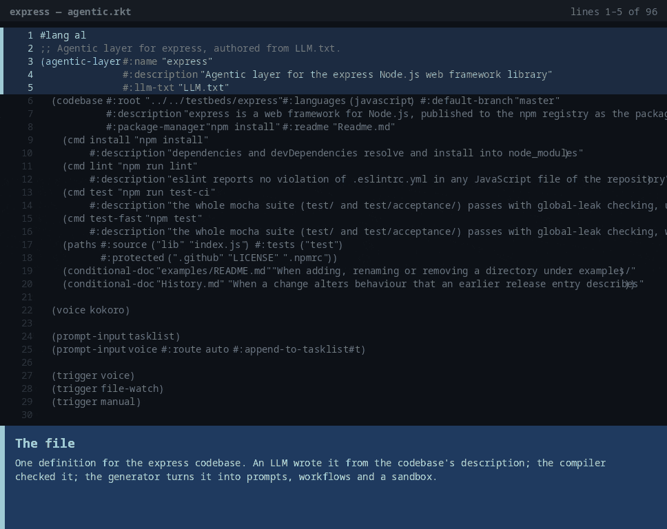

# The `express` layer, explained

Source: `tests/authored/express/agentic.rkt` (96 lines). This walkthrough is generated by `al explain` from the file and its compiled form, so it also states the defaults the author did not write down.



## In one paragraph

The `express` layer: Agentic layer for the express Node.js web framework library. It declares 4 codebase commands, 12 prompts and 3 workflows (`plan-build`, `sdlc` and `ask`).

## Block by block

### The file

Lines 1–5. One definition for the `express` codebase. An LLM wrote it from the codebase's description; the compiler checked it; the generator turns it into prompts, workflows and a sandbox.

```racket
#lang al
;; Agentic layer for express, authored from LLM.txt.
(agentic-layer #:name "express"
               #:description "Agentic layer for the express Node.js web framework library"
               #:llm-txt "LLM.txt"
```

### The codebase and its commands

Lines 6–20. What the codebase is (javascript) and the commands that prove things about it: `install`, `lint`, `test` and `test-fast`. Agents show that something works by running these, never by saying so. 3 protected paths: agents may not ship changes there without a person.

- `install` runs `npm install` — dependencies and devDependencies resolve and install into node_modules
- `lint` runs `npm run lint` — eslint reports no violation of .eslintrc.yml in any JavaScript file of the repository
- `test` runs `npm run test-ci` — the whole mocha suite (test/ and test/acceptance/) passes with global-leak checking, under nyc, writing coverage/lcov.info and a text coverage table to stdout
- `test-fast` runs `npm test` — the whole mocha suite (test/ and test/acceptance/) passes with global-leak checking, without coverage
- Protected: `.github`, `LICENSE` and `.npmrc`
- Read `examples/README.md` when adding, renaming or removing a directory under examples/
- Read `History.md` when a change alters behaviour that an earlier release entry describes

```racket
  (codebase #:root "../../testbeds/express" #:languages (javascript) #:default-branch "master"
            #:description "express is a web framework for Node.js, published to the npm registry as the package express and consumed through require('express'). CommonJS JavaScript with no build step: index.js re-exports lib/express.js. Tested with mocha and supertest, linted with eslint 8, published to npm by a GitHub Actions workflow when a GitHub release is published."
            #:package-manager "npm install" #:readme "Readme.md"
    (cmd install "npm install"
         #:description "dependencies and devDependencies resolve and install into node_modules")
    (cmd lint "npm run lint"
         #:description "eslint reports no violation of .eslintrc.yml in any JavaScript file of the repository")
    (cmd test "npm run test-ci"
         #:description "the whole mocha suite (test/ and test/acceptance/) passes with global-leak checking, under nyc, writing coverage/lcov.info and a text coverage table to stdout")
    (cmd test-fast "npm test"
         #:description "the whole mocha suite (test/ and test/acceptance/) passes with global-leak checking, without coverage")
    (paths #:source ("lib" "index.js") #:tests ("test")
           #:protected (".github" "LICENSE" ".npmrc"))
    (conditional-doc "examples/README.md" "When adding, renaming or removing a directory under examples/")
    (conditional-doc "History.md" "When a change alters behaviour that an earlier release entry describes"))
```

### Voice

Lines 22–22. Speech in and out, both running locally (Kokoro for speech, Whisper for recognition).

```racket
  (voice kokoro)
```

### Where work comes from

Lines 24–25. Prompt input: a plain-text task file or spoken requests.

- `tasklist`: a plain-text task file
- `voice`: spoken requests

```racket
  (prompt-input tasklist)
  (prompt-input voice #:route auto #:append-to-tasklist #t)
```

### What starts a run

Lines 27–29. Trigger: a push-to-talk loop, a watcher on the task file or by hand.

```racket
  (trigger voice)
  (trigger file-watch)
  (trigger manual)
```

### Where agents work

Lines 31–33. Environment: a private copy of the repository for every run, a Home Manager module that installs the tools and the checkout itself, read-only.

- `worktree`: each run gets its own git worktree; your checkout is never touched
- `home-manager`: provides nodejs_22

```racket
  (environment worktree)
  (environment home-manager #:packages ("nodejs_22"))
  (environment host)
```

### What counts as proof

Lines 35–36. Artefacts collected after the checks and shown to whoever reviews: command logs and a coverage report.

- `log`: command logs
- `coverage`: a coverage report from `coverage/lcov.info`

```racket
  (artefact log)
  (artefact coverage #:glob "coverage/lcov.info")
```

### Who decides it is done

Lines 38–38. Review: an agent that reviews on evidence, with a person merging.

- `agent`: 1 reviewer agent(s) judge the change against the plan; a person merges

```racket
  (review agent #:artefacts (log))
```

### The prompts

Lines 40–65. 12 prompts written for this codebase, each for one kind of job: `prime`, `classify`, `plan-chore`, `plan-bug`, `plan-feature`, `plan-patch`, `resolve-test`, `review`, `document`, `commit`, `pull-request` and `question`. 13 of their instructions are specific to this codebase; the first 6:

- `prime`: the prime template
- `classify`: the classify template
- `plan-chore`: the plan-chore template
- `plan-bug`: the plan-bug template
- `plan-feature`: the plan-feature template
- `plan-patch`: the plan-patch template
- `resolve-test`: the resolve-test template
- `review`: the review template
- `document`: the document template
- `commit`: the commit template
- `pull-request`: the pull-request template
- `question`: the question template
- Codebase-specific rule: “No lock file is committed: never add package-lock.json, npm-shrinkwrap.json or yarn.lock.”
- Codebase-specific rule: “A test-only addition goes in test/<object>.<member>.js (unit) or test/acceptance/<example>.js (acceptance test for examples/<example>).”
- Codebase-specific rule: “The regression test goes in the existing test/<object>.<member>.js for the affected member (test/res.send.js for res.send in lib/response.js); create that file if absent.”
- Codebase-specific rule: “Tests are mocha describe/it blocks issuing HTTP requests with supertest; the outer describe names the object (res), the inner one the member (.send()).”
- Codebase-specific rule: “Code must run on every Node.js version from 18 and must not create global variables: mocha runs with --check-leaks.”
- Codebase-specific rule: “A new member of lib/response.js, lib/request.js or lib/application.js gets its tests in test/res.<member>.js, test/req.<member>.js or test/app.<member>.js.”

```racket
  (command prime #:template prime)
  (command classify #:template classify #:output json)
  (command plan-chore #:template plan-chore #:model-set heavy #:output path #:validation (lint test)
           #:focus ("No lock file is committed: never add package-lock.json, npm-shrinkwrap.json or yarn.lock."
                    "A test-only addition goes in test/<object>.<member>.js (unit) or test/acceptance/<example>.js (acceptance test for examples/<example>)."))
  (command plan-bug #:template plan-bug #:model-set heavy #:output path #:validation (lint test)
           #:focus ("The regression test goes in the existing test/<object>.<member>.js for the affected member (test/res.send.js for res.send in lib/response.js); create that file if absent."
                    "Tests are mocha describe/it blocks issuing HTTP requests with supertest; the outer describe names the object (res), the inner one the member (.send())."
                    "Code must run on every Node.js version from 18 and must not create global variables: mocha runs with --check-leaks."))
  (command plan-feature #:template plan-feature #:model-set heavy #:output path #:validation (lint test)
           #:focus ("A new member of lib/response.js, lib/request.js or lib/application.js gets its tests in test/res.<member>.js, test/req.<member>.js or test/app.<member>.js."
                    "State the user-visible change as a public API signature or the HTTP response (status, headers, body) an application produces."
                    "The global Buffer is forbidden; take Buffer from the node:buffer module."
                    "Code must run on every Node.js version from 18 and must not create global variables: mocha runs with --check-leaks."))
  (command plan-patch #:template plan-patch #:model-set heavy #:output path #:validation (lint test))
  (command resolve-test #:template resolve-test #:model-set heavy
           #:focus ("JavaScript is indented with 2 spaces, files end with a newline, no trailing whitespace, comparisons use === except == null, no unused variables."))
  (command review #:template review #:model-set heavy #:output json
           #:focus ("The proof is the mocha spec output in the test log: the names of the tests covering the change and the pass count must be present."
                    "A bug fix or feature without a test in test/<object>.<member>.js for the changed member is a blocker."
                    "A change under .github, LICENSE or .npmrc is a blocker for a human."))
  (command document #:template document)
  (command commit #:template commit)
  (command pull-request #:template pull-request)
  (command question #:template question
           #:description "Answer a question about the codebase without changing it")
```

### Prompts that take a prompt

Lines 66–68. Higher-order prompts: `implement` (takes a plan), `meta-command` (takes a prompt) and `meta-adw` (takes a prompt). For example, one implements whatever plan it is given.

```racket
  (hop implement #:template run-plan #:takes plan)
  (hop meta-command #:template meta-command #:produces command)
  (hop meta-adw #:template meta-adw #:produces adw)
```

### Workflow: plan-build

Lines 70–78. The `plan-build` workflow: Classify, plan by class and implement the plan. Steps: classify → plan-chore → plan-bug → plan-feature → build. No ship step: nothing is reviewed or published; the result stays with the run.

- Work from tasklist or voice; started by voice, file-watch or manual; runs in worktree and home-manager; agent `claude-code`
- 1. agent step `classify` using the `classify` prompt
- 2. agent step `plan-chore` using the `plan-chore` prompt (only for chore work)
- 3. agent step `plan-bug` using the `plan-bug` prompt (only for bug work)
- 4. agent step `plan-feature` using the `plan-feature` prompt (only for feature work)
- 5. agent step `build` using the `implement` prompt

```racket
  (adw plan-build #:description "Classify, plan by class and implement the plan"
       #:input (tasklist voice) #:trigger (voice file-watch manual)
       #:environment (worktree home-manager) #:review agent
    (steps
      (run classify #:command classify #:args ("$prompt"))
      (run plan-chore #:command plan-chore #:args ("$prompt") #:when class-chore)
      (run plan-bug #:command plan-bug #:args ("$prompt") #:when class-bug)
      (run plan-feature #:command plan-feature #:args ("$prompt") #:when class-feature)
      (run build #:command implement #:args ("$plan"))))
```

### Workflow: sdlc

Lines 80–90. The `sdlc` workflow: Plan, build, lint, test, document, commit, agent review; a human merges. Steps: classify → plan-chore → plan-bug → plan-feature → build → lint → test → document → commit → review → ship. An agent reviews on evidence; a person merges (the branch and its description file (`PR.md`)).

- Work from tasklist or voice; started by voice, file-watch or manual; runs in worktree and home-manager; agent `claude-code`
- 1. agent step `classify` using the `classify` prompt
- 2. agent step `plan-chore` using the `plan-chore` prompt (only for chore work)
- 3. agent step `plan-bug` using the `plan-bug` prompt (only for bug work)
- 4. agent step `plan-feature` using the `plan-feature` prompt (only for feature work)
- 5. agent step `build` using the `implement` prompt
- 6. check `lint`: run the `lint` command; on failure the `resolve-test` prompt fixes it, up to 3 tries
- 7. check `test`: run the `test` command; on failure the `resolve-test` prompt fixes it, up to 3 tries
- 8. agent step `document` using the `document` prompt
- 9. agent step `commit` using the `commit` prompt
- 10. review (blockers go to a patch plan and a fix, then it is reviewed again)
- 11. ship

```racket
  (adw sdlc #:description "Plan, build, lint, test, document, commit, agent review; a human merges"
       #:input (tasklist voice) #:trigger (voice file-watch manual)
       #:environment (worktree home-manager) #:review agent
    (steps
      (compose plan-build)
      (check lint #:cmd lint #:resolve resolve-test)
      (check test #:cmd test #:resolve resolve-test #:collect (log coverage))
      (run document #:command document #:args ("$plan"))
      (run commit #:command commit)
      (review #:patch plan-patch #:implement implement)
      (ship)))
```

### Workflow: ask

Lines 92–96. The `ask` workflow: Read-only: answer a spoken question about the codebase. Steps: answer. No ship step: nothing is reviewed or published; the result stays with the run.

- Work from voice; started by voice or manual; runs in host; agent `claude-code`
- 1. agent step `answer` using the `question` prompt

```racket
  (adw ask #:description "Read-only: answer a spoken question about the codebase"
       #:input (voice) #:trigger (voice manual)
       #:environment (host) #:review agent
    (steps
      (run answer #:command question #:args ("$prompt")))))
```

### Which agents and models do the work (not written down: the default)

Agent: claude-code. Reading the codebase, classifying the work, documentation, commits, pull requests and answering questions use claude-opus-5-5; planning, patch plans, fixing failed checks, review, building, new prompts and new workflows use claude-fable-5-2.

- `claude-code`: claude-code, model tiers base = `claude-opus-5-5` and heavy = `claude-fable-5-2`, permission mode `acceptEdits`
- For one run, `--model-set TIER`, `--model TIER=MODEL_ID` (or AL_MODEL_SET / AL_MODELS) change this without editing the file

### Watching the work (not written down: the default)

A live dashboard on http://127.0.0.1:8765 shows what the agents are doing.

- Start it with `uv run adws/dashboard.py`; it only reads the layer's run files and never changes anything
