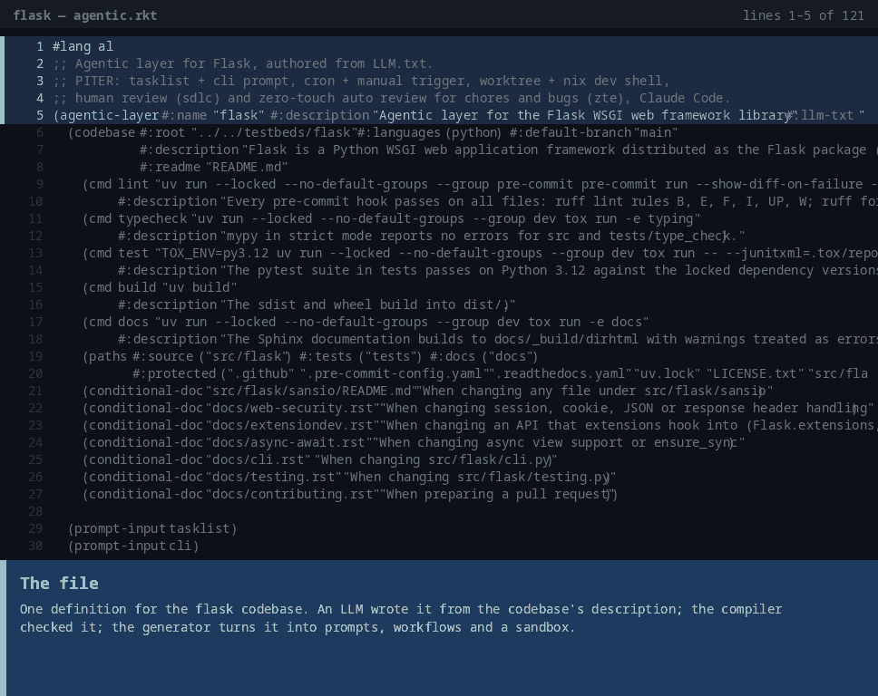

# The `flask` layer, explained

Source: `tests/authored/flask/agentic.rkt` (121 lines). This walkthrough is generated by `al explain` from the file and its compiled form, so it also states the defaults the author did not write down.



## In one paragraph

`flask` is Agentic layer for the Flask WSGI web framework library. It declares 5 codebase commands, 11 prompts and 3 workflows (`plan-build`, `sdlc` and `zte`).

## Block by block

### The file

Lines 1–5. One definition for the `flask` codebase. An LLM wrote it from the codebase's description; the compiler checked it; the generator turns it into prompts, workflows and a sandbox.

```racket
#lang al
;; Agentic layer for Flask, authored from LLM.txt.
;; PITER: tasklist + cli prompt, cron + manual trigger, worktree + nix dev shell,
;; human review (sdlc) and zero-touch auto review for chores and bugs (zte), Claude Code.
(agentic-layer #:name "flask" #:description "Agentic layer for the Flask WSGI web framework library" #:llm-txt "LLM.txt"
```

### The codebase and its commands

Lines 6–27. What the codebase is (python) and the commands that prove things about it: `lint`, `typecheck`, `test`, `build` and `docs`. Agents show that something works by running these, never by saying so. 6 protected paths: agents may not ship changes there without a person.

- `lint` runs `uv run --locked --no-default-groups --group pre-commit pre-commit run --show-diff-on-failure --color=always --all-files` — Every pre-commit hook passes on all files: ruff lint rules B, E, F, I, UP, W; ruff format; uv.lock matches pyproject.toml; codespell; whitespace and end-of-file hooks. Hooks rewrite files in place and exit non-zero when they changed something.
- `typecheck` runs `uv run --locked --no-default-groups --group dev tox run -e typing` — mypy in strict mode reports no errors for src and tests/type_check.
- `test` runs `TOX_ENV=py3.12 uv run --locked --no-default-groups --group dev tox run -- --junitxml=.tox/reports/junit.xml` — The pytest suite in tests passes on Python 3.12 against the locked dependency versions, with every warning treated as an error; writes a JUnit XML report.
- `build` runs `uv build` — The sdist and wheel build into dist/.
- `docs` runs `uv run --locked --no-default-groups --group dev tox run -e docs` — The Sphinx documentation builds to docs/_build/dirhtml with warnings treated as errors.
- Protected: `.github`, `.pre-commit-config.yaml`, `.readthedocs.yaml`, `uv.lock`, `LICENSE.txt` and `src/flask/sessions.py`
- Read `src/flask/sansio/README.md` when changing any file under src/flask/sansio
- Read `docs/web-security.rst` when changing session, cookie, JSON or response header handling
- Read `docs/extensiondev.rst` when changing an API that extensions hook into (Flask.extensions, init_app patterns, signals, teardown callbacks)
- Read `docs/async-await.rst` when changing async view support or ensure_sync
- Read `docs/cli.rst` when changing src/flask/cli.py
- Read `docs/testing.rst` when changing src/flask/testing.py
- Read `docs/contributing.rst` when preparing a pull request

```racket
  (codebase #:root "../../testbeds/flask" #:languages (python) #:default-branch "main"
            #:description "Flask is a Python WSGI web application framework distributed as the Flask package (requires Python >=3.11). It is used as a library and through its flask command line entry point, is built on Werkzeug, Jinja, Click, ItsDangerous, MarkupSafe and Blinker, is managed with uv and tox, and ships to PyPI."
            #:readme "README.md"
    (cmd lint "uv run --locked --no-default-groups --group pre-commit pre-commit run --show-diff-on-failure --color=always --all-files"
         #:description "Every pre-commit hook passes on all files: ruff lint rules B, E, F, I, UP, W; ruff format; uv.lock matches pyproject.toml; codespell; whitespace and end-of-file hooks. Hooks rewrite files in place and exit non-zero when they changed something.")
    (cmd typecheck "uv run --locked --no-default-groups --group dev tox run -e typing"
         #:description "mypy in strict mode reports no errors for src and tests/type_check.")
    (cmd test "TOX_ENV=py3.12 uv run --locked --no-default-groups --group dev tox run -- --junitxml=.tox/reports/junit.xml"
         #:description "The pytest suite in tests passes on Python 3.12 against the locked dependency versions, with every warning treated as an error; writes a JUnit XML report.")
    (cmd build "uv build"
         #:description "The sdist and wheel build into dist/.")
    (cmd docs "uv run --locked --no-default-groups --group dev tox run -e docs"
         #:description "The Sphinx documentation builds to docs/_build/dirhtml with warnings treated as errors.")
    (paths #:source ("src/flask") #:tests ("tests") #:docs ("docs")
           #:protected (".github" ".pre-commit-config.yaml" ".readthedocs.yaml" "uv.lock" "LICENSE.txt" "src/flask/sessions.py"))
    (conditional-doc "src/flask/sansio/README.md" "When changing any file under src/flask/sansio")
    (conditional-doc "docs/web-security.rst" "When changing session, cookie, JSON or response header handling")
    (conditional-doc "docs/extensiondev.rst" "When changing an API that extensions hook into (Flask.extensions, init_app patterns, signals, teardown callbacks)")
    (conditional-doc "docs/async-await.rst" "When changing async view support or ensure_sync")
    (conditional-doc "docs/cli.rst" "When changing src/flask/cli.py")
    (conditional-doc "docs/testing.rst" "When changing src/flask/testing.py")
    (conditional-doc "docs/contributing.rst" "When preparing a pull request"))
```

### Where work comes from

Lines 29–30. Prompt input: a plain-text task file or the command line.

- `tasklist`: a plain-text task file
- `cli`: the command line

```racket
  (prompt-input tasklist)
  (prompt-input cli)
```

### What starts a run

Lines 31–32. Trigger: a poller or by hand.

```racket
  (trigger cron)
  (trigger manual)
```

### Where agents work

Lines 34–39. Environment: a private copy of the repository for every run, a Nix shell with the toolchain and a container (the checks run inside it).

- `worktree`: each run gets its own git worktree; your checkout is never touched
- `nix-devshell`: provides python312, uv and git
- `podman`: image based on `docker.io/library/python:3.12-slim`; the checks run inside it; caches for uv and pre-commit

```racket
  (environment worktree)
  (environment nix-devshell #:packages ("python312" "uv" "git")
               #:nixpkgs "path:/nix/store/243rp6ap5vd4zhgh24fqhvd8m1k48yyi-nixpkgs/nixpkgs")

  (environment podman #:base-image "docker.io/library/python:3.12-slim" #:packages ("git")
               #:setup ("pip install --no-cache-dir uv") #:caches ("uv" "pre-commit"))
```

### What counts as proof

Lines 41–42. Artefacts collected after the checks and shown to whoever reviews: command logs and a test report.

- `log`: command logs
- `junit`: a test report from `.tox/reports/junit.xml`

```racket
  (artefact log)
  (artefact junit #:glob ".tox/reports/junit.xml")
```

### Who decides it is done

Lines 44–47. Review: a person, through a pull request or reviewer agents plus hard rules, with no person.

- `human`: open a pull request and stop; a person reads it and merges
- `zero-touch`: 1 reviewer agent(s) must approve, and then every rule must hold: the commands `lint`, `typecheck` and `test` pass again on the final result; the work is a chore or bug; the change is at most 400 lines; no protected path was touched. If so it ships by `merge`; otherwise a person decides

```racket
  (review human)
  (review auto #:id zero-touch #:artefacts (log junit) #:ship merge
          #:require-checks (lint typecheck test) #:allowed-classes (chore bug)
          #:block-protected-paths #t)
```

### The prompts

Lines 49–80. 11 prompts written for this codebase, each for one kind of job: `prime`, `classify`, `plan-chore`, `plan-bug`, `plan-feature`, `plan-patch`, `resolve-test`, `review`, `document`, `commit` and `pull-request`. 21 of their instructions are specific to this codebase.

- `prime`: the prime template
- `classify`: the classify template
- `plan-chore`: the plan-chore template
- `plan-bug`: the plan-bug template
- `plan-feature`: the plan-feature template
- `plan-patch`: the plan-patch template
- `resolve-test`: the resolve-test template
- `review`: the review template
- `document`: the document template
- `commit`: the commit template
- `pull-request`: the pull-request template
- Codebase-specific rule: “Dependencies are declared in pyproject.toml and locked in uv.lock; uv.lock is regenerated with uv, never edited by hand, and is a protected path.”
- Codebase-specific rule: “When files under docs change, the plan also lists the docs cmd as a validation step.”
- Codebase-specific rule: “A code change adds an entry to CHANGES.rst under the topmost (unreleased) version, as a '-   ' bullet ending with an :issue:`<number>` or :pr:`<number>` reference.”
- Codebase-specific rule: “The regression test goes into the existing tests/test_<area>.py module of the source file being fixed (src/flask/blueprints.py -> tests/test_blueprints.py, src/flask/json/tag.py -> tests/test_json_tag.py); a regression with no matching module goes into tests/test_regression.py.”
- Codebase-specific rule: “The regression test must fail without the fix.”
- Codebase-specific rule: “Add an entry to CHANGES.rst under the topmost (unreleased) version, as a '-   ' bullet ending with an :issue:`<number>` or :pr:`<number>` reference.”

```racket
  (command prime #:template prime)
  (command classify #:template classify #:output json)
  (command plan-chore #:template plan-chore #:model-set heavy #:output path #:validation (lint typecheck test)
           #:focus ("Dependencies are declared in pyproject.toml and locked in uv.lock; uv.lock is regenerated with uv, never edited by hand, and is a protected path."
                    "When files under docs change, the plan also lists the docs cmd as a validation step."
                    "A code change adds an entry to CHANGES.rst under the topmost (unreleased) version, as a '-   ' bullet ending with an :issue:`<number>` or :pr:`<number>` reference."))
  (command plan-bug #:template plan-bug #:model-set heavy #:output path #:validation (lint typecheck test)
           #:focus ("The regression test goes into the existing tests/test_<area>.py module of the source file being fixed (src/flask/blueprints.py -> tests/test_blueprints.py, src/flask/json/tag.py -> tests/test_json_tag.py); a regression with no matching module goes into tests/test_regression.py."
                    "The regression test must fail without the fix."
                    "Add an entry to CHANGES.rst under the topmost (unreleased) version, as a '-   ' bullet ending with an :issue:`<number>` or :pr:`<number>` reference."
                    "Code under src/flask/sansio does no IO and does not use the Flask globals."))
  (command plan-feature #:template plan-feature #:model-set heavy #:output path #:validation (lint typecheck test)
           #:focus ("New tests go into the existing tests/test_<area>.py module of the source file being changed, as functions named test_<behaviour>; shared fixtures live in tests/conftest.py."
                    "A feature adds a CHANGES.rst entry under the topmost (unreleased) version, '.. versionadded:: <version>' or '.. versionchanged:: <version>' entries in the docstrings of the changed code, and documentation under docs."
                    "Code under src passes mypy with strict = true; every warning raised during the tests fails the suite."
                    "Code under src/flask/sansio does no IO and does not use the Flask globals."))
  (command plan-patch #:template plan-patch #:model-set heavy #:output path #:validation (lint typecheck test))
  (command resolve-test #:template resolve-test #:model-set heavy
           #:focus ("The lint cmd's hooks rewrite files in place and exit non-zero when they changed something: keep the rewritten files and fix only what the hooks still report."
                    "Every warning raised during the tests fails the suite (filterwarnings = error): fix the cause of the warning, do not add a filter."
                    "Imports are one name per 'from ... import ...' line; maximum line length is 88."))
  (command review #:template review #:model-set heavy #:output json
           #:focus ("A code change must come with tests in tests/test_<area>.py that fail without the change; the junit report from the test cmd must list them as passed."
                    "A code change must add a CHANGES.rst entry under the topmost (unreleased) version ending with an :issue: or :pr: reference."
                    "A change to documented behaviour must add a '.. versionchanged::' or '.. versionadded::' docstring entry and update the relevant file under docs."
                    "A feature is user-visible as a public API signature of the flask package, an HTTP response produced by a view under the test client, or flask CLI output; the junit report listing the new test cases as passed is its proof."))
  (command document #:template document
           #:focus ("Documentation is reStructuredText under docs; a change to documented behaviour also adds a '.. versionchanged:: <version>' or '.. versionadded:: <version>' entry in the docstring of the changed code."))
  (command commit #:template commit
           #:focus ("A commit message is one lower-case imperative summary line without a type prefix, for example: add `versionchanged` for ctx signature change (#6176)."))
  (command pull-request #:template pull-request
           #:focus ("The description links its issue with 'fixes #<issue number>'."))
```

### Prompts that take a prompt

Lines 81–83. Higher-order prompts: `run-plan` (takes a plan), `meta-command` (takes a prompt) and `meta-adw` (takes a prompt). For example, one implements whatever plan it is given.

```racket
  (hop run-plan #:template run-plan #:takes plan)
  (hop meta-command #:template meta-command #:produces command)
  (hop meta-adw #:template meta-adw #:produces adw)
```

### Agent experts

Lines 85–86. Areas where an agent keeps its own notes and updates them after each change: `sansio` (The sans-IO application, blueprint and scaffold base classes, which must not do IO and must not use the Flask globals).

```racket
  (expert sansio #:domain "The sans-IO application, blueprint and scaffold base classes, which must not do IO and must not use the Flask globals"
          #:paths ("src/flask/sansio"))
```

### Workflow: plan-build

Lines 88–96. The `plan-build` workflow: Classify, plan by work class and implement the plan. Steps: classify → plan-chore → plan-bug → plan-feature → build. A person reviews the pull request.

- Work from tasklist or cli; started by cron or manual; runs in worktree and nix-devshell; agent `claude-code`
- 1. agent step `classify` using the `classify` prompt
- 2. agent step `plan-chore` using the `plan-chore` prompt (only for chore work)
- 3. agent step `plan-bug` using the `plan-bug` prompt (only for bug work)
- 4. agent step `plan-feature` using the `plan-feature` prompt (only for feature work)
- 5. agent step `build` using the `run-plan` prompt

```racket
  (adw plan-build #:description "Classify, plan by work class and implement the plan"
       #:input (tasklist cli) #:trigger (cron manual)
       #:environment (worktree nix-devshell) #:review human #:agent claude-code
    (steps
      (run classify #:command classify #:args ("$prompt"))
      (run plan-chore #:command plan-chore #:args ("$prompt") #:when class-chore)
      (run plan-bug #:command plan-bug #:args ("$prompt") #:when class-bug)
      (run plan-feature #:command plan-feature #:args ("$prompt") #:when class-feature)
      (run build #:command run-plan #:args ("$plan"))))
```

### Workflow: sdlc

Lines 98–109. The `sdlc` workflow: Plan, build, lint, typecheck, test, document, commit; a human reviews the result. Steps: classify → plan-chore → plan-bug → plan-feature → build → lint → typecheck → test → document → commit → review → ship. A person reviews the pull request.

- Work from tasklist or cli; started by cron or manual; runs in worktree and nix-devshell; agent `claude-code`
- 1. agent step `classify` using the `classify` prompt
- 2. agent step `plan-chore` using the `plan-chore` prompt (only for chore work)
- 3. agent step `plan-bug` using the `plan-bug` prompt (only for bug work)
- 4. agent step `plan-feature` using the `plan-feature` prompt (only for feature work)
- 5. agent step `build` using the `run-plan` prompt
- 6. check `lint`: run the `lint` command; on failure the `resolve-test` prompt fixes it, up to 3 tries
- 7. check `typecheck`: run the `typecheck` command; on failure the `resolve-test` prompt fixes it, up to 3 tries
- 8. check `test`: run the `test` command; on failure the `resolve-test` prompt fixes it, up to 3 tries
- 9. agent step `document` using the `document` prompt
- 10. agent step `commit` using the `commit` prompt
- 11. review (blockers go to a patch plan and a fix, then it is reviewed again)
- 12. ship

```racket
  (adw sdlc #:description "Plan, build, lint, typecheck, test, document, commit; a human reviews the result"
       #:input (tasklist cli) #:trigger (cron manual)
       #:environment (worktree nix-devshell) #:review human #:agent claude-code
    (steps
      (compose plan-build)
      (check lint #:cmd lint #:resolve resolve-test #:collect (log))
      (check typecheck #:cmd typecheck #:resolve resolve-test #:collect (log))
      (check test #:cmd test #:resolve resolve-test #:collect (log junit))
      (run document #:command document #:args ("$plan"))
      (run commit #:command commit)
      (review #:patch plan-patch #:implement run-plan)
      (ship)))
```

### Workflow: zte

Lines 111–121. The `zte` workflow: Zero-touch: merges chores and bugs when lint, typecheck and test all pass. Steps: classify → plan-chore → plan-bug → plan-feature → build → lint → typecheck → test → commit → review → ship. No person is involved if every rule holds; it ships by merge.

- Work from tasklist or cli; started by cron or manual; runs in worktree, nix-devshell and podman; agent `claude-code`
- 1. agent step `classify` using the `classify` prompt
- 2. agent step `plan-chore` using the `plan-chore` prompt (only for chore work)
- 3. agent step `plan-bug` using the `plan-bug` prompt (only for bug work)
- 4. agent step `plan-feature` using the `plan-feature` prompt (only for feature work)
- 5. agent step `build` using the `run-plan` prompt
- 6. check `lint`: run the `lint` command; on failure the `resolve-test` prompt fixes it, up to 3 tries
- 7. check `typecheck`: run the `typecheck` command; on failure the `resolve-test` prompt fixes it, up to 3 tries
- 8. check `test`: run the `test` command; on failure the `resolve-test` prompt fixes it, up to 3 tries
- 9. agent step `commit` using the `commit` prompt
- 10. review (blockers go to a patch plan and a fix, then it is reviewed again)
- 11. ship

```racket
  (adw zte #:description "Zero-touch: merges chores and bugs when lint, typecheck and test all pass"
       #:input (tasklist cli) #:trigger (cron manual)
       #:environment (worktree nix-devshell podman) #:review zero-touch #:agent claude-code #:classes (chore bug)
    (steps
      (compose plan-build)
      (check lint #:cmd lint #:resolve resolve-test #:collect (log))
      (check typecheck #:cmd typecheck #:resolve resolve-test #:collect (log))
      (check test #:cmd test #:resolve resolve-test #:collect (log junit))
      (run commit #:command commit)
      (review #:patch plan-patch #:implement run-plan)
      (ship))))
```

### Which agents and models do the work (not written down: the default)

Agent: claude-code. Reading the codebase, classifying the work, documentation, commits and pull requests use claude-opus-5-5; planning, patch plans, fixing failed checks, review, building, new prompts and new workflows use claude-fable-5-2.

- `claude-code`: claude-code, model tiers base = `claude-opus-5-5` and heavy = `claude-fable-5-2`, permission mode `acceptEdits`
- For one run, `--model-set TIER`, `--model TIER=MODEL_ID` (or AL_MODEL_SET / AL_MODELS) change this without editing the file

### Watching the work (not written down: the default)

A live dashboard on http://127.0.0.1:8765 shows what the agents are doing.

- Start it with `uv run adws/dashboard.py`; it only reads the layer's run files and never changes anything
