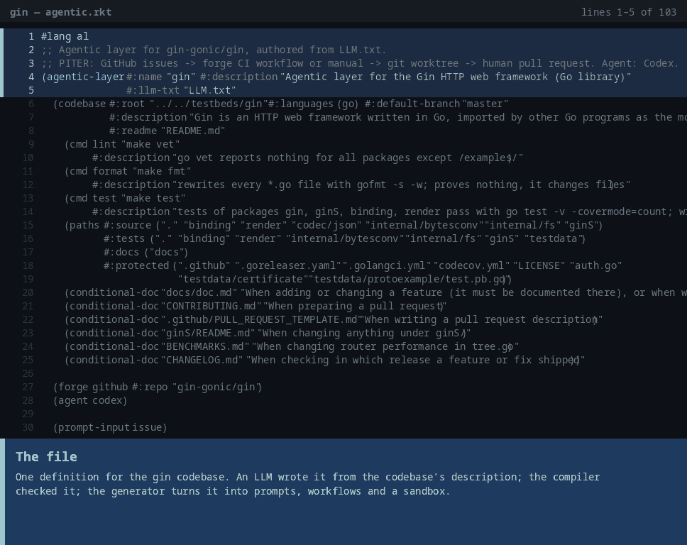

# The `gin` layer, explained

Source: `tests/authored/gin/agentic.rkt` (103 lines). This walkthrough is generated by `al explain` from the file and its compiled form, so it also states the defaults the author did not write down.



## In one paragraph

`gin` is Agentic layer for the Gin HTTP web framework (Go library). It declares 3 codebase commands, 11 prompts and 2 workflows (`plan-build` and `sdlc`).

## Block by block

### The file

Lines 1–5. One definition for the `gin` codebase. An LLM wrote it from the codebase's description; the compiler checked it; the generator turns it into prompts, workflows and a sandbox.

```racket
#lang al
;; Agentic layer for gin-gonic/gin, authored from LLM.txt.
;; PITER: GitHub issues -> forge CI workflow or manual -> git worktree -> human pull request. Agent: Codex.
(agentic-layer #:name "gin" #:description "Agentic layer for the Gin HTTP web framework (Go library)"
               #:llm-txt "LLM.txt"
```

### The codebase and its commands

Lines 6–25. What the codebase is (go) and the commands that prove things about it: `lint`, `format` and `test`. Agents show that something works by running these, never by saying so. 8 protected paths: agents may not ship changes there without a person.

- `lint` runs `make vet` — go vet reports nothing for all packages except /examples/
- `format` runs `make fmt` — rewrites every *.go file with gofmt -s -w; proves nothing, it changes files
- `test` runs `make test` — tests of packages gin, ginS, binding, render pass with go test -v -covermode=count; writes coverage.out
- Protected: `.github`, `.goreleaser.yaml`, `.golangci.yml`, `codecov.yml`, `LICENSE`, `auth.go`, `testdata/certificate` and `testdata/protoexample/test.pb.go`
- Read `docs/doc.md` when adding or changing a feature (it must be documented there), or when working with the build tags jsoniter, go_json, sonic, nomsgpack
- Read `CONTRIBUTING.md` when preparing a pull request
- Read `.github/PULL_REQUEST_TEMPLATE.md` when writing a pull request description
- Read `ginS/README.md` when changing anything under ginS/
- Read `BENCHMARKS.md` when changing router performance in tree.go
- Read `CHANGELOG.md` when checking in which release a feature or fix shipped

```racket
  (codebase #:root "../../testbeds/gin" #:languages (go) #:default-branch "master"
            #:description "Gin is an HTTP web framework written in Go, imported by other Go programs as the module github.com/gin-gonic/gin. Root package gin (router, context, middleware) plus sub-packages binding, render, codec/json, ginS and internal. Shipped by pushing a git tag, which runs GoReleaser in GitHub Actions."
            #:readme "README.md"
    (cmd lint "make vet"
         #:description "go vet reports nothing for all packages except /examples/")
    (cmd format "make fmt"
         #:description "rewrites every *.go file with gofmt -s -w; proves nothing, it changes files")
    (cmd test "make test"
         #:description "tests of packages gin, ginS, binding, render pass with go test -v -covermode=count; writes coverage.out")
    (paths #:source ("." "binding" "render" "codec/json" "internal/bytesconv" "internal/fs" "ginS")
           #:tests ("." "binding" "render" "internal/bytesconv" "internal/fs" "ginS" "testdata")
           #:docs ("docs")
           #:protected (".github" ".goreleaser.yaml" ".golangci.yml" "codecov.yml" "LICENSE" "auth.go"
                        "testdata/certificate" "testdata/protoexample/test.pb.go"))
    (conditional-doc "docs/doc.md" "When adding or changing a feature (it must be documented there), or when working with the build tags jsoniter, go_json, sonic, nomsgpack")
    (conditional-doc "CONTRIBUTING.md" "When preparing a pull request")
    (conditional-doc ".github/PULL_REQUEST_TEMPLATE.md" "When writing a pull request description")
    (conditional-doc "ginS/README.md" "When changing anything under ginS/")
    (conditional-doc "BENCHMARKS.md" "When changing router performance in tree.go")
    (conditional-doc "CHANGELOG.md" "When checking in which release a feature or fix shipped"))
```

### The forge

Lines 27–27. Issues and pull requests live on github (`gin-gonic/gin`).

```racket
  (forge github #:repo "gin-gonic/gin")
```

### Which agents and models do the work

Lines 28–28. Agent: codex. Reading the codebase, classifying the work, documentation, commits and pull requests use gpt-5.4-mini; planning, patch plans, fixing failed checks, review, building, new prompts and new workflows use gpt-5.4.

- `codex`: codex, model tiers base = `gpt-5.4-mini` and heavy = `gpt-5.4`
- For one run, `--model-set TIER`, `--model TIER=MODEL_ID` (or AL_MODEL_SET / AL_MODELS) change this without editing the file

```racket
  (agent codex)
```

### Where work comes from

Lines 30–30. Prompt input: issues on the forge.

- `issue`: issues on the forge

```racket
  (prompt-input issue)
```

### What starts a run

Lines 31–32. Trigger: the forge's CI or by hand.

```racket
  (trigger forge-actions #:runner "self-hosted")
  (trigger manual)
```

### Where agents work

Lines 34–37. Environment: a private copy of the repository for every run and a container (the checks run inside it).

- `worktree`: each run gets its own git worktree; your checkout is never touched
- `podman`: image based on `docker.io/library/golang:1.26-bookworm`; the checks run inside it; caches for go

```racket
  (environment worktree)
  ;; gin's own tests bind fixed ports (:8443 among others); a container per run gives every run its
  ;; own network namespace, so they cannot collide with the host or with each other.
  (environment podman #:base-image "docker.io/library/golang:1.26-bookworm" #:caches ("go"))
```

### What counts as proof

Lines 39–40. Artefacts collected after the checks and shown to whoever reviews: command logs and a coverage report.

- `log`: command logs
- `coverage`: a coverage report from `coverage.out`

```racket
  (artefact log)
  (artefact coverage #:glob "coverage.out")
```

### Who decides it is done

Lines 42–42. Review: a person, through a pull request.

- `human`: open a pull request and stop; a person reads it and merges

```racket
  (review human)
```

### The prompts

Lines 44–74. 11 prompts written for this codebase, each for one kind of job: `prime`, `classify`, `plan-chore`, `plan-bug`, `plan-feature`, `plan-patch`, `resolve-test`, `review`, `document`, `commit` and `pull-request`. 20 of their instructions are specific to this codebase.

- `prime`: the prime template
- `classify`: the classify template
- `plan-chore`: the plan-chore template
- `plan-bug`: the plan-bug template
- `plan-feature`: the plan-feature template
- `plan-patch`: the plan-patch template
- `resolve-test`: the resolve-test template
- `review`: the review template
- `document`: the document template
- `commit`: the commit template
- `pull-request`: the pull-request template
- Codebase-specific rule: “A code change adds or modifies tests in <name>_test.go in the same directory as the changed <name>.go.”
- Codebase-specific rule: “Use any, not interface{}.”
- Codebase-specific rule: “The regression test goes in the <name>_test.go file beside the fixed <name>.go, using github.com/stretchr/testify assertions.”
- Codebase-specific rule: “The fix must compile and pass under the CI build tag sets: none, -tags nomsgpack, -tags sonic with --ldflags=-checklinkname=0, -tags go_json, and -race.”
- Codebase-specific rule: “Use any, not interface{}.”
- Codebase-specific rule: “A feature is a new or changed exported function, method, type or option of package gin, binding or render; plan its tests in <name>_test.go beside the source, using github.com/stretchr/testify assertions.”

```racket
  (command prime #:template prime)
  (command classify #:template classify #:output json)
  (command plan-chore #:template plan-chore #:model-set heavy #:output path #:validation (lint test)
           #:focus ("A code change adds or modifies tests in <name>_test.go in the same directory as the changed <name>.go."
                    "Use any, not interface{}."))
  (command plan-bug #:template plan-bug #:model-set heavy #:output path #:validation (lint test)
           #:focus ("The regression test goes in the <name>_test.go file beside the fixed <name>.go, using github.com/stretchr/testify assertions."
                    "The fix must compile and pass under the CI build tag sets: none, -tags nomsgpack, -tags sonic with --ldflags=-checklinkname=0, -tags go_json, and -race."
                    "Use any, not interface{}."))
  (command plan-feature #:template plan-feature #:model-set heavy #:output path #:validation (lint test)
           #:focus ("A feature is a new or changed exported function, method, type or option of package gin, binding or render; plan its tests in <name>_test.go beside the source, using github.com/stretchr/testify assertions."
                    "Plan a section for the feature in docs/doc.md, not in README.md."
                    "The change must compile and pass under the CI build tag sets: none, -tags nomsgpack, -tags sonic with --ldflags=-checklinkname=0, -tags go_json, and -race."
                    "Use any, not interface{}."))
  (command plan-patch #:template plan-patch #:model-set heavy #:output path #:validation (lint test)
           #:focus ("A code change adds or modifies tests in <name>_test.go in the same directory as the changed <name>.go."))
  (command resolve-test #:template resolve-test #:model-set heavy
           #:focus ("make test runs only packages gin, ginS, binding and render and writes coverage.out; do not edit files under testdata/certificate or testdata/protoexample/test.pb.go to make a test pass."))
  (command review #:template review #:model-set heavy #:output json
           #:focus ("Every code change has an added or modified test in the <name>_test.go beside the changed file."
                    "A feature is proven by make test output and coverage.out, and has a section in docs/doc.md; coverage targets are 99% for the project and 99% for the patch."
                    "Tests use github.com/stretchr/testify assertions; code uses any, not interface{}."))
  (command document #:template document
           #:focus ("Document a new feature in docs/doc.md, not in README.md."))
  (command commit #:template commit
           #:focus ("Commit subject has the form <type>(<optional scope>): <subject> with type one of feat, fix, chore, refactor, build, ci, docs."
                    "A pull request has at most two commits; squash otherwise."))
  (command pull-request #:template pull-request
           #:focus ("Open the pull request against the master branch."
                    "The description follows the checklist in .github/PULL_REQUEST_TEMPLATE.md."
                    "A pull request has at most two commits."))
```

### Prompts that take a prompt

Lines 75–77. Higher-order prompts: `run-plan` (takes a plan), `meta-command` (takes a prompt) and `meta-adw` (takes a prompt). For example, one implements whatever plan it is given.

```racket
  (hop run-plan #:template run-plan #:takes plan)
  (hop meta-command #:template meta-command #:produces command)
  (hop meta-adw #:template meta-adw #:produces adw)
```

### Agent experts

Lines 79–82. Areas where an agent keeps its own notes and updates them after each change: `binding` (Request binding and validation for JSON, XML, form, query, URI, header, YAML, TOML, protobuf, msgpack and BSON) and `render` (Response renderers for JSON, XML, HTML, YAML, TOML, protobuf, msgpack, BSON, PDF, redirect, text, data and reader).

```racket
  (expert binding #:domain "Request binding and validation for JSON, XML, form, query, URI, header, YAML, TOML, protobuf, msgpack and BSON"
          #:paths ("binding"))
  (expert render #:domain "Response renderers for JSON, XML, HTML, YAML, TOML, protobuf, msgpack, BSON, PDF, redirect, text, data and reader"
          #:paths ("render"))
```

### Workflow: plan-build

Lines 84–92. The `plan-build` workflow: Classify the issue, plan by class, implement the plan. Steps: classify → plan-chore → plan-bug → plan-feature → plan-patch → build. A person reviews the pull request.

- Work from issue; started by forge-actions or manual; runs in worktree; agent `codex`
- 1. agent step `classify` using the `classify` prompt
- 2. agent step `plan-chore` using the `plan-chore` prompt (only for chore work)
- 3. agent step `plan-bug` using the `plan-bug` prompt (only for bug work)
- 4. agent step `plan-feature` using the `plan-feature` prompt (only for feature work)
- 5. agent step `plan-patch` using the `plan-patch` prompt (only for patch work)
- 6. agent step `build` using the `run-plan` prompt

```racket
  (adw plan-build #:description "Classify the issue, plan by class, implement the plan"
       #:input (issue) #:trigger (forge-actions manual) #:environment (worktree) #:review human #:agent codex
    (steps
      (run classify #:command classify #:args ("$prompt"))
      (run plan-chore #:command plan-chore #:args ("$prompt") #:when class-chore)
      (run plan-bug #:command plan-bug #:args ("$prompt") #:when class-bug)
      (run plan-feature #:command plan-feature #:args ("$prompt") #:when class-feature)
      (run plan-patch #:command plan-patch #:args ("$prompt") #:when class-patch)
      (run build #:command run-plan #:args ("$plan"))))
```

### Workflow: sdlc

Lines 94–103. The `sdlc` workflow: Plan, build, vet, test, document, commit; a human reviews the pull request. Steps: classify → plan-chore → plan-bug → plan-feature → plan-patch → build → lint → test → document → commit → review → ship. A person reviews the pull request.

- Work from issue; started by forge-actions or manual; runs in worktree and podman; agent `codex`
- 1. agent step `classify` using the `classify` prompt
- 2. agent step `plan-chore` using the `plan-chore` prompt (only for chore work)
- 3. agent step `plan-bug` using the `plan-bug` prompt (only for bug work)
- 4. agent step `plan-feature` using the `plan-feature` prompt (only for feature work)
- 5. agent step `plan-patch` using the `plan-patch` prompt (only for patch work)
- 6. agent step `build` using the `run-plan` prompt
- 7. check `lint`: run the `lint` command; on failure the `resolve-test` prompt fixes it, up to 3 tries
- 8. check `test`: run the `test` command; on failure the `resolve-test` prompt fixes it, up to 3 tries
- 9. agent step `document` using the `document` prompt
- 10. agent step `commit` using the `commit` prompt
- 11. review
- 12. ship

```racket
  (adw sdlc #:description "Plan, build, vet, test, document, commit; a human reviews the pull request"
       #:input (issue) #:trigger (forge-actions manual) #:environment (worktree podman) #:review human #:agent codex
    (steps
      (compose plan-build)
      (check lint #:cmd lint #:resolve resolve-test)
      (check test #:cmd test #:resolve resolve-test #:collect (coverage log))
      (run document #:command document #:args ("$plan"))
      (run commit #:command commit)
      (review)
      (ship))))
```

### Watching the work (not written down: the default)

A live dashboard on http://127.0.0.1:8765 shows what the agents are doing.

- Start it with `uv run adws/dashboard.py`; it only reads the layer's run files and never changes anything
