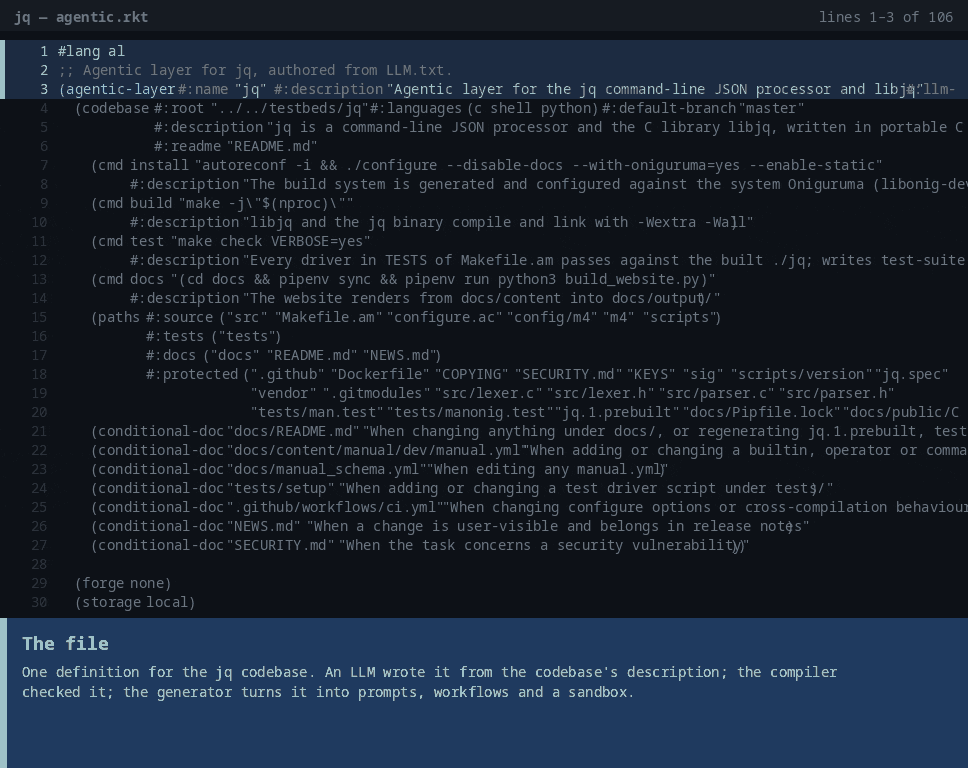

# The `jq` layer, explained

Source: `tests/authored/jq/agentic.rkt` (106 lines). This walkthrough is generated by `al explain` from the file and its compiled form, so it also states the defaults the author did not write down.



## In one paragraph

The `jq` layer: Agentic layer for the jq command-line JSON processor and libjq. It declares 4 codebase commands, 11 prompts and 2 workflows (`plan-build` and `sdlc`).

## Block by block

### The file

Lines 1–3. One definition for the `jq` codebase. An LLM wrote it from the codebase's description; the compiler checked it; the generator turns it into prompts, workflows and a sandbox.

```racket
#lang al
;; Agentic layer for jq, authored from LLM.txt.
(agentic-layer #:name "jq" #:description "Agentic layer for the jq command-line JSON processor and libjq" #:llm-txt "LLM.txt"
```

### The codebase and its commands

Lines 4–27. What the codebase is (c, shell and python) and the commands that prove things about it: `install`, `build`, `test` and `docs`. Agents show that something works by running these, never by saying so. 19 protected paths: agents may not ship changes there without a person.

- `install` runs `autoreconf -i && ./configure --disable-docs --with-oniguruma=yes --enable-static` — The build system is generated and configured against the system Oniguruma (libonig-dev); the vendor/oniguruma submodule is not fetched, because a run's container mounts the repository's .git read-only and git submodule update cannot register it; must run once in a fresh checkout before build or test
- `build` runs `make -j"$(nproc)"` — libjq and the jq binary compile and link with -Wextra -Wall
- `test` runs `make check VERBOSE=yes` — Every driver in TESTS of Makefile.am passes against the built ./jq; writes test-suite.log and tests/*.log
- `docs` runs `(cd docs && pipenv sync && pipenv run python3 build_website.py)` — The website renders from docs/content into docs/output/
- Protected: `.github`, `Dockerfile`, `COPYING`, `SECURITY.md`, `KEYS`, `sig`, `scripts/version`, `jq.spec`, `vendor`, `.gitmodules`, `src/lexer.c`, `src/lexer.h`, `src/parser.c`, `src/parser.h`, `tests/man.test`, `tests/manonig.test`, `jq.1.prebuilt`, `docs/Pipfile.lock` and `docs/public/CNAME`
- Read `docs/README.md` when changing anything under docs/, or regenerating jq.1.prebuilt, tests/man.test or tests/manonig.test
- Read `docs/content/manual/dev/manual.yml` when adding or changing a builtin, operator or command-line option
- Read `docs/manual_schema.yml` when editing any manual.yml
- Read `tests/setup` when adding or changing a test driver script under tests/
- Read `.github/workflows/ci.yml` when changing configure options or cross-compilation behaviour
- Read `NEWS.md` when a change is user-visible and belongs in release notes
- Read `SECURITY.md` when the task concerns a security vulnerability

```racket
  (codebase #:root "../../testbeds/jq" #:languages (c shell python) #:default-branch "master"
            #:description "jq is a command-line JSON processor and the C library libjq, written in portable C with no runtime dependencies. It is built with GNU autotools (autoconf, automake, libtool) and optionally links the vendored Oniguruma regex library (git submodule). The manual and website are generated from YAML with Python."
            #:readme "README.md"
    (cmd install "autoreconf -i && ./configure --disable-docs --with-oniguruma=yes --enable-static"
         #:description "The build system is generated and configured against the system Oniguruma (libonig-dev); the vendor/oniguruma submodule is not fetched, because a run's container mounts the repository's .git read-only and git submodule update cannot register it; must run once in a fresh checkout before build or test")
    (cmd build "make -j\"$(nproc)\""
         #:description "libjq and the jq binary compile and link with -Wextra -Wall")
    (cmd test "make check VERBOSE=yes"
         #:description "Every driver in TESTS of Makefile.am passes against the built ./jq; writes test-suite.log and tests/*.log")
    (cmd docs "(cd docs && pipenv sync && pipenv run python3 build_website.py)"
         #:description "The website renders from docs/content into docs/output/")
    (paths #:source ("src" "Makefile.am" "configure.ac" "config/m4" "m4" "scripts")
           #:tests ("tests")
           #:docs ("docs" "README.md" "NEWS.md")
           #:protected (".github" "Dockerfile" "COPYING" "SECURITY.md" "KEYS" "sig" "scripts/version" "jq.spec"
                        "vendor" ".gitmodules" "src/lexer.c" "src/lexer.h" "src/parser.c" "src/parser.h"
                        "tests/man.test" "tests/manonig.test" "jq.1.prebuilt" "docs/Pipfile.lock" "docs/public/CNAME"))
    (conditional-doc "docs/README.md" "When changing anything under docs/, or regenerating jq.1.prebuilt, tests/man.test or tests/manonig.test")
    (conditional-doc "docs/content/manual/dev/manual.yml" "When adding or changing a builtin, operator or command-line option")
    (conditional-doc "docs/manual_schema.yml" "When editing any manual.yml")
    (conditional-doc "tests/setup" "When adding or changing a test driver script under tests/")
    (conditional-doc ".github/workflows/ci.yml" "When changing configure options or cross-compilation behaviour")
    (conditional-doc "NEWS.md" "When a change is user-visible and belongs in release notes")
    (conditional-doc "SECURITY.md" "When the task concerns a security vulnerability"))
```

### The forge

Lines 29–29. No forge: results stay as local branches.

```racket
  (forge none)
```

### Where proof is kept

Lines 30–30. Artefacts are kept in the layer folder.

```racket
  (storage local)
```

### Which agents and models do the work

Lines 31–31. Agent: claude-code. Reading the codebase, classifying the work, documentation, commits and pull requests use claude-opus-5-5; planning, patch plans, fixing failed checks, review, building, new prompts and new workflows use claude-fable-5-2.

- `claude-code`: claude-code, model tiers base = `claude-opus-5-5` and heavy = `claude-fable-5-2`, permission mode `acceptEdits`
- For one run, `--model-set TIER`, `--model TIER=MODEL_ID` (or AL_MODEL_SET / AL_MODELS) change this without editing the file

```racket
  (agent claude-code)
```

### Where work comes from

Lines 33–34. Prompt input: the command line or spec files dropped in a folder.

- `cli`: the command line
- `spec-file`: spec files dropped in a folder

```racket
  (prompt-input cli)
  (prompt-input spec-file)
```

### What starts a run

Lines 35–35. Trigger: by hand.

```racket
  (trigger manual)
```

### Where agents work

Lines 37–38. Environment: a private copy of the repository for every run and a container (the checks run inside it).

- `worktree`: each run gets its own git worktree; your checkout is never touched
- `podman`: image based on `docker.io/library/debian:stable-slim`; the checks run inside it

```racket
  (environment worktree)
  (environment podman #:packages ("build-essential" "autoconf" "automake" "libtool" "git" "libonig-dev") #:network slirp)
```

### What counts as proof

Lines 40–42. Artefacts collected after the checks and shown to whoever reviews: command logs, files and files.

- `log`: command logs
- `test-suite-log`: files from `test-suite.log`
- `test-logs`: files from `tests/*.log`

```racket
  (artefact log)
  (artefact file #:id test-suite-log #:glob "test-suite.log")
  (artefact file #:id test-logs #:glob "tests/*.log")
```

### Who decides it is done

Lines 44–45. Review: reviewer agents plus hard rules, with no person.

- `auto`: 1 reviewer agent(s) must approve, and then every rule must hold: the commands `build` and `test` pass again on the final result; the work is a chore, bug, feature or patch; the change is at most 400 lines; no protected path was touched. If so it ships by `pr` (a branch and a description file (`PR.md`)); otherwise a person decides, through a branch and a description file (`PR.md`)

```racket
  (review auto #:artefacts (log test-suite-log test-logs) #:ship pr #:require-checks (build test)
          #:allowed-classes (chore bug feature patch))
```

### The prompts

Lines 47–81. 11 prompts written for this codebase, each for one kind of job: `prime`, `classify`, `plan-chore`, `plan-bug`, `plan-feature`, `plan-patch`, `resolve-test`, `review`, `document`, `commit` and `pull-request`. 24 of their instructions are specific to this codebase; the first 6:

- `prime`: the prime template
- `classify`: the classify template
- `plan-chore`: the plan-chore template
- `plan-bug`: the plan-bug template
- `plan-feature`: the plan-feature template
- `plan-patch`: the plan-patch template
- `resolve-test`: the resolve-test template
- `review`: the review template
- `document`: the document template
- `commit`: the commit template
- `pull-request`: the pull-request template
- Codebase-specific rule: “A new C source or header file must be added to LIBJQ_SRC or LIBJQ_INCS in Makefile.am.”
- Codebase-specific rule: “A new test driver script must be added to TESTS in Makefile.am, and every new test data file to EXTRA_DIST in Makefile.am.”
- Codebase-specific rule: “Never hand-edit src/lexer.c, src/lexer.h, src/parser.c or src/parser.h; change src/lexer.l or src/parser.y instead.”
- Codebase-specific rule: “Add a regression test: language or builtin behaviour in tests/jq.test, regex behaviour in tests/onig.test, command-line or process behaviour in tests/shtest.”
- Codebase-specific rule: “A test in tests/jq.test is three lines: jq program, input, expected output; blank lines and lines starting with # are ignored.”
- Codebase-specific rule: “Never hand-edit src/lexer.c, src/lexer.h, src/parser.c or src/parser.h; change src/lexer.l or src/parser.y instead.”

```racket
  (command prime #:template prime)
  (command classify #:template classify #:output json)
  (command plan-chore #:template plan-chore #:model-set heavy #:output path #:validation (build test)
           #:focus ("A new C source or header file must be added to LIBJQ_SRC or LIBJQ_INCS in Makefile.am."
                    "A new test driver script must be added to TESTS in Makefile.am, and every new test data file to EXTRA_DIST in Makefile.am."
                    "Never hand-edit src/lexer.c, src/lexer.h, src/parser.c or src/parser.h; change src/lexer.l or src/parser.y instead."))
  (command plan-bug #:template plan-bug #:model-set heavy #:output path #:validation (build test)
           #:focus ("Add a regression test: language or builtin behaviour in tests/jq.test, regex behaviour in tests/onig.test, command-line or process behaviour in tests/shtest."
                    "A test in tests/jq.test is three lines: jq program, input, expected output; blank lines and lines starting with # are ignored."
                    "Never hand-edit src/lexer.c, src/lexer.h, src/parser.c or src/parser.h; change src/lexer.l or src/parser.y instead."
                    "Building and running the tests must leave no change in tracked files."))
  (command plan-feature #:template plan-feature #:model-set heavy #:output path #:validation (build test)
           #:focus ("Builtins that can be written in jq go in src/builtin.jq; C builtins go in src/builtin.c."
                    "Add tests in tests/jq.test (three lines: program, input, expected output), tests/onig.test for regex, or tests/shtest for command-line options."
                    "Document every user-visible builtin or option in docs/content/manual/dev/manual.yml with examples entries; they are tests."
                    "After changing docs/content/manual/dev/manual.yml, tests/man.test, tests/manonig.test and jq.1.prebuilt must be regenerated; they are protected paths, so say so in the plan."
                    "A new C source or header file must be added to LIBJQ_SRC or LIBJQ_INCS in Makefile.am."
                    "Public libjq symbols start with jq_ or jv_."))
  (command plan-patch #:template plan-patch #:model-set heavy #:output path #:validation (build test))
  (command resolve-test #:template resolve-test #:model-set heavy
           #:focus ("C code must compile with -Wextra -Wall -Wno-unused-parameter -Wno-unused-function -Woverlength-strings -Wstrict-prototypes."
                    "Failing test output is in test-suite.log and tests/*.log."
                    "Never fix a failure by editing tests/man.test or tests/manonig.test; they are generated from docs/content/manual/dev/manual.yml."))
  (command review #:template review #:model-set heavy #:output json
           #:focus ("A user-visible change is jq CLI output (stdout, stderr, exit code) or the public API in src/jq.h and src/jv.h; require test-suite.log and tests/*.log showing the new test passing."
                    "A bug fix must add a regression test to tests/jq.test, tests/onig.test or tests/shtest."
                    "A new builtin or option must have an entry with examples in docs/content/manual/dev/manual.yml."
                    "Reject hand edits to src/lexer.c, src/lexer.h, src/parser.c and src/parser.h."
                    "New test drivers appear in TESTS and new test data files in EXTRA_DIST in Makefile.am."))
  (command document #:template document
           #:focus ("User-visible builtins and options are documented in docs/content/manual/dev/manual.yml, never in docs/content/manual/v*/manual.yml."))
  (command commit #:template commit
           #:focus ("Text files use LF line endings."
                    "Do not commit build output; building and testing must leave no change in tracked files."))
  (command pull-request #:template pull-request)
```

### Prompts that take a prompt

Lines 82–84. Higher-order prompts: `implement` (takes a plan), `new-command` (takes a prompt) and `new-adw` (takes a prompt). For example, one implements whatever plan it is given.

```racket
  (hop implement #:template run-plan #:takes plan)
  (hop new-command #:template meta-command #:produces command)
  (hop new-adw #:template meta-adw #:produces adw)
```

### Workflow: plan-build

Lines 86–94. The `plan-build` workflow: Classify, plan by class and implement the plan. Steps: classify → plan-chore → plan-bug → plan-feature → plan-patch → implement. No ship step: nothing is reviewed or published; the result stays with the run.

- Work from cli or spec-file; started by manual; runs in worktree and podman; agent `claude-code`
- 1. agent step `classify` using the `classify` prompt
- 2. agent step `plan-chore` using the `plan-chore` prompt (only for chore work)
- 3. agent step `plan-bug` using the `plan-bug` prompt (only for bug work)
- 4. agent step `plan-feature` using the `plan-feature` prompt (only for feature work)
- 5. agent step `plan-patch` using the `plan-patch` prompt (only for patch work)
- 6. agent step `implement` using the `implement` prompt

```racket
  (adw plan-build #:description "Classify, plan by class and implement the plan"
       #:input (cli spec-file) #:trigger (manual) #:environment (worktree podman) #:review auto #:agent claude-code
    (steps
      (run classify #:command classify #:args ("$prompt"))
      (run plan-chore #:command plan-chore #:args ("$prompt") #:when class-chore)
      (run plan-bug #:command plan-bug #:args ("$prompt") #:when class-bug)
      (run plan-feature #:command plan-feature #:args ("$prompt") #:when class-feature)
      (run plan-patch #:command plan-patch #:args ("$prompt") #:when class-patch)
      (run implement #:command implement #:args ("$plan"))))
```

### Workflow: sdlc

Lines 96–106. The `sdlc` workflow: Plan, build, test, document, commit, agent review with deterministic gates; opens a PR only. Steps: classify → plan-chore → plan-bug → plan-feature → plan-patch → implement → install → build → test → document → commit → review → ship. No person is involved if every rule holds; it ships by a branch and a description file (`PR.md`).

- Work from cli or spec-file; started by manual; runs in worktree and podman; agent `claude-code`
- 1. agent step `classify` using the `classify` prompt
- 2. agent step `plan-chore` using the `plan-chore` prompt (only for chore work)
- 3. agent step `plan-bug` using the `plan-bug` prompt (only for bug work)
- 4. agent step `plan-feature` using the `plan-feature` prompt (only for feature work)
- 5. agent step `plan-patch` using the `plan-patch` prompt (only for patch work)
- 6. agent step `implement` using the `implement` prompt
- 7. check `install`: run the `install` command
- 8. check `build`: run the `build` command; on failure the `resolve-test` prompt fixes it, up to 3 tries
- 9. check `test`: run the `test` command; on failure the `resolve-test` prompt fixes it, up to 3 tries
- 10. agent step `document` using the `document` prompt
- 11. agent step `commit` using the `commit` prompt
- 12. review (blockers go to a patch plan and a fix, then it is reviewed again)
- 13. ship

```racket
  (adw sdlc #:description "Plan, build, test, document, commit, agent review with deterministic gates; opens a PR only"
       #:input (cli spec-file) #:trigger (manual) #:environment (worktree podman) #:review auto #:agent claude-code
    (steps
      (compose plan-build)
      (check install #:cmd install)
      (check build #:cmd build #:resolve resolve-test #:collect (log))
      (check test #:cmd test #:resolve resolve-test #:collect (log test-suite-log test-logs))
      (run document #:command document #:args ("$plan"))
      (run commit #:command commit)
      (review #:patch plan-patch #:implement implement)
      (ship))))
```

### Watching the work (not written down: the default)

A live dashboard on http://127.0.0.1:8765 shows what the agents are doing.

- Start it with `uv run adws/dashboard.py`; it only reads the layer's run files and never changes anything
