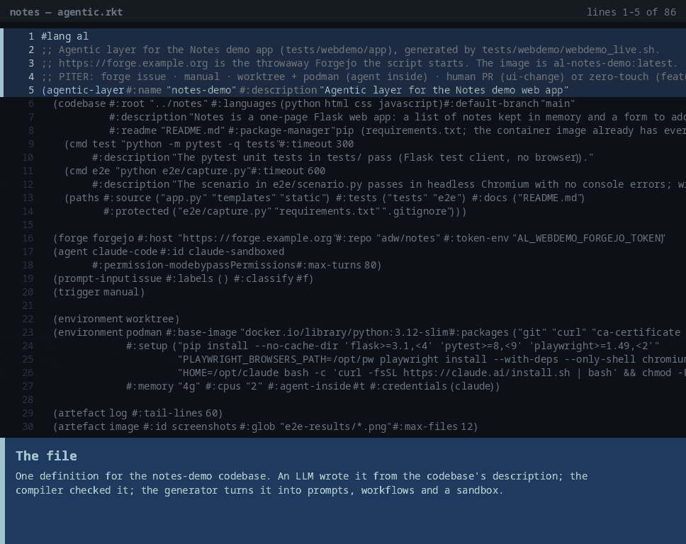

# The `notes` layer, explained

Source: `tests/webdemo/layer.rkt.in` (86 lines). This walkthrough is generated by `al explain` from the file and its compiled form, so it also states the defaults the author did not write down.



## In one paragraph

`notes` is Agentic layer for the Notes demo web app. It declares 2 codebase commands, 5 prompts and 2 workflows (`ui-change` and `feature`).

## Block by block

### The file

Lines 1–5. One definition for the `notes-demo` codebase. An LLM wrote it from the codebase's description; the compiler checked it; the generator turns it into prompts, workflows and a sandbox.

```racket
#lang al
;; Agentic layer for the Notes demo app (tests/webdemo/app), generated by tests/webdemo/webdemo_live.sh.
;; https://forge.example.org is the throwaway Forgejo the script starts. The image is al-notes-demo:latest.
;; PITER: forge issue · manual · worktree + podman (agent inside) · human PR (ui-change) or zero-touch (feature).
(agentic-layer #:name "notes-demo" #:description "Agentic layer for the Notes demo web app"
```

### The codebase and its commands

Lines 6–14. What the codebase is (python, html, css and javascript) and the commands that prove things about it: `test` and `e2e`. Agents show that something works by running these, never by saying so. 3 protected paths: agents may not ship changes there without a person.

- `test` runs `python -m pytest -q tests` — The pytest unit tests in tests/ pass (Flask test client, no browser).
- `e2e` runs `python e2e/capture.py` — The scenario in e2e/scenario.py passes in headless Chromium with no console errors; writes e2e-results/NN-<name>.png per screenshot step and e2e-results/session.webm.
- Protected: `e2e/capture.py`, `requirements.txt` and `.gitignore`

```racket
  (codebase #:root "../notes" #:languages (python html css javascript) #:default-branch "main"
            #:description "Notes is a one-page Flask web app: a list of notes kept in memory and a form to add one. app.py holds create_app() and the routes, templates/index.html is the only page, static/style.css holds all styling. tests/test_app.py has pytest unit tests using the Flask test client; e2e/capture.py walks the user scenario in e2e/scenario.py in headless Chromium and records screenshots and a video into e2e-results/."
            #:readme "README.md" #:package-manager "pip (requirements.txt; the container image already has every dependency)"
    (cmd test "python -m pytest -q tests" #:timeout 300
         #:description "The pytest unit tests in tests/ pass (Flask test client, no browser).")
    (cmd e2e "python e2e/capture.py" #:timeout 600
         #:description "The scenario in e2e/scenario.py passes in headless Chromium with no console errors; writes e2e-results/NN-<name>.png per screenshot step and e2e-results/session.webm.")
    (paths #:source ("app.py" "templates" "static") #:tests ("tests" "e2e") #:docs ("README.md")
           #:protected ("e2e/capture.py" "requirements.txt" ".gitignore")))
```

### The forge

Lines 16–16. Issues and pull requests live on forgejo (`adw/notes`).

```racket
  (forge forgejo #:host "https://forge.example.org" #:repo "adw/notes" #:token-env "AL_WEBDEMO_FORGEJO_TOKEN")
```

### Which agents and models do the work

Lines 17–18. Agent: claude-code (`claude-sandboxed`). Planning, fixing failed checks, review and building use claude-fable-5-2; commits uses claude-opus-5-5.

- `claude-sandboxed`: claude-code, model tiers base = `claude-opus-5-5` and heavy = `claude-fable-5-2`, permission mode `bypassPermissions`
- For one run, `--model-set TIER`, `--model TIER=MODEL_ID` (or AL_MODEL_SET / AL_MODELS) change this without editing the file

```racket
  (agent claude-code #:id claude-sandboxed
         #:permission-mode bypassPermissions #:max-turns 80)
```

### Where work comes from

Lines 19–19. Prompt input: issues on the forge.

- `issue`: issues on the forge

```racket
  (prompt-input issue #:labels () #:classify #f)
```

### What starts a run

Lines 20–20. Trigger: by hand.

```racket
  (trigger manual)
```

### Where agents work

Lines 22–27. Environment: a private copy of the repository for every run and a container (the agent itself runs inside it).

- `worktree`: each run gets its own git worktree; your checkout is never touched
- `podman`: image based on `docker.io/library/python:3.12-slim`; the agent itself runs inside it

```racket
  (environment worktree)
  (environment podman #:base-image "docker.io/library/python:3.12-slim" #:packages ("git" "curl" "ca-certificates" "libatomic1")
               #:setup ("pip install --no-cache-dir 'flask>=3.1,<4' 'pytest>=8,<9' 'playwright>=1.49,<2'"
                        "PLAYWRIGHT_BROWSERS_PATH=/opt/pw playwright install --with-deps --only-shell chromium && PLAYWRIGHT_BROWSERS_PATH=/opt/pw playwright install ffmpeg && chmod -R a+rX /opt/pw"
                        "HOME=/opt/claude bash -c 'curl -fsSL https://claude.ai/install.sh | bash' && chmod -R a+rX /opt/claude && ln -s /opt/claude/.local/bin/claude /usr/local/bin/claude")
               #:memory "4g" #:cpus "2" #:agent-inside #t #:credentials (claude))
```

### What counts as proof

Lines 29–31. Artefacts collected after the checks and shown to whoever reviews: command logs, screenshots and a recorded video, cut into frames for reviewers.

- `log`: command logs
- `screenshots`: screenshots from `e2e-results/*.png`
- `recording`: a recorded video, cut into frames for reviewers from `e2e-results/*.webm`

```racket
  (artefact log #:tail-lines 60)
  (artefact image #:id screenshots #:glob "e2e-results/*.png" #:max-files 12)
  (artefact video #:id recording #:glob "e2e-results/*.webm" #:keyframes 8)
```

### Who decides it is done

Lines 33–36. Review: a person, through a pull request or reviewer agents plus hard rules, with no person.

- `human`: open a pull request and stop; a person reads it and merges
- `zero-touch`: 2 reviewer agent(s) must approve, and then every rule must hold: the commands `test` and `e2e` pass again on the final result; the work is a chore, bug or feature; the change is at most 600 lines; no protected path was touched. If so it ships by `merge`; otherwise a person decides

```racket
  (review human)
  (review auto #:id zero-touch #:reviewers 2 #:artefacts (log screenshots recording) #:ship merge
          #:require-checks (test e2e) #:allowed-classes (chore bug feature) #:max-diff-lines 600
          #:block-protected-paths #t)
```

### The prompts

Lines 38–60. 5 prompts written for this codebase, each for one kind of job: `plan-chore`, `plan-feature`, `resolve-test`, `review` and `commit`. 18 of their instructions are specific to this codebase.

- `plan-chore`: the plan-chore template
- `plan-feature`: the plan-feature template
- `resolve-test`: the resolve-test template
- `review`: the review template
- `commit`: the commit template
- Codebase-specific rule: “Colours, spacing and layout live in static/style.css only; the markup is templates/index.html; routes are in app.py.”
- Codebase-specific rule: “Every user-visible change must be demonstrated in e2e/scenario.py so the screenshots and the video show it: plan the scenario steps and their expect entries (a visual change gets a 'style' expectation on the computed CSS value, e.g. background-color as rgb(...)).”
- Codebase-specific rule: “When an existing expectation in e2e/scenario.py or tests/ describes the old behaviour that the request deliberately changes, update it to the new behaviour; never delete or loosen an expectation for anything else.”
- Codebase-specific rule: “e2e/capture.py is the test harness and a protected path: never plan a change to it; its step and expect vocabulary is documented at the top of e2e/scenario.py.”
- Codebase-specific rule: “Keep text readable: every text colour on a changed background must keep a contrast ratio of at least 4.5:1.”
- Codebase-specific rule: “Routes are in app.py, the page is templates/index.html, styling is static/style.css; a small amount of JavaScript goes in static/app.js loaded by the template with defer; no build step and no new dependency.”

```racket
  (command plan-chore #:template plan-chore #:model-set heavy #:output path #:validation (test e2e)
           #:focus ("Colours, spacing and layout live in static/style.css only; the markup is templates/index.html; routes are in app.py."
                    "Every user-visible change must be demonstrated in e2e/scenario.py so the screenshots and the video show it: plan the scenario steps and their expect entries (a visual change gets a 'style' expectation on the computed CSS value, e.g. background-color as rgb(...))."
                    "When an existing expectation in e2e/scenario.py or tests/ describes the old behaviour that the request deliberately changes, update it to the new behaviour; never delete or loosen an expectation for anything else."
                    "e2e/capture.py is the test harness and a protected path: never plan a change to it; its step and expect vocabulary is documented at the top of e2e/scenario.py."
                    "Keep text readable: every text colour on a changed background must keep a contrast ratio of at least 4.5:1."))
  (command plan-feature #:template plan-feature #:model-set heavy #:output path #:validation (test e2e)
           #:focus ("Routes are in app.py, the page is templates/index.html, styling is static/style.css; a small amount of JavaScript goes in static/app.js loaded by the template with defer; no build step and no new dependency."
                    "Every user-visible behaviour of the feature must be demonstrated in e2e/scenario.py so the screenshots and the video show it: add steps (use 'type' so typing is visible in the video), an expect entry per behaviour, and a 'screenshot' for each visible state, including empty and edge states."
                    "New unit tests go into tests/test_app.py, using the client fixture."
                    "Never delete or loosen an existing expectation in tests/ or e2e/scenario.py."
                    "e2e/capture.py is the test harness and a protected path: never plan a change to it; its step and expect vocabulary is documented at the top of e2e/scenario.py."
                    "The page must log no console errors: e2e/capture.py fails on any."))
  (command resolve-test #:template resolve-test #:model-set heavy
           #:focus ("Fix the app, not the expectation: never delete or loosen an expectation in tests/ or e2e/scenario.py, and never edit e2e/capture.py."
                    "The e2e log names the failing step and expectation; a FAILED screenshot of that moment is in e2e-results/."))
  (command review #:template review #:model-set heavy #:output json
           #:focus ("Every path in ARTEFACT_MANIFEST (each entry's path and each keyframe's path) is relative to the layer directory ${layer_dir}: open it as ${layer_dir}/<path> with the Read tool, which displays images."
                    "Every user-visible requirement must be visible in an e2e screenshot (screenshots) or in a keyframe of the session video (recording); name the file that shows it. A user-visible change that e2e/scenario.py does not demonstrate is a blocker."
                    "Deleted or loosened expectations in tests/ or e2e/scenario.py are a blocker, except where the request deliberately changes the behaviour the expectation described."
                    "List every screenshot, every keyframe and every log you opened in artefacts_reviewed."))
  (command commit #:template commit
           #:focus ("A commit message is one imperative summary line under 72 characters, e.g. 'Add a search box that filters the notes'."))
```

### Prompts that take a prompt

Lines 61–61. Higher-order prompts: `implement` (takes a plan). For example, one implements whatever plan it is given.

```racket
  (hop implement #:template run-plan #:takes plan)
```

### Workflow: ui-change

Lines 63–73. The `ui-change` workflow: Plan, build, unit tests, e2e capture, commit; a human reviews the pull request with the screenshots. Steps: plan-chore → plan-feature → build → test → e2e → commit → review → ship. A person reviews the pull request.

- Work from issue; started by manual; runs in worktree and podman; agent `claude-sandboxed`
- 1. agent step `plan-chore` using the `plan-chore` prompt (only for chore work)
- 2. agent step `plan-feature` using the `plan-feature` prompt (only for feature work)
- 3. agent step `build` using the `implement` prompt
- 4. check `test`: run the `test` command; on failure the `resolve-test` prompt fixes it, up to 2 tries
- 5. check `e2e`: run the `e2e` command; on failure the `resolve-test` prompt fixes it, up to 2 tries
- 6. agent step `commit` using the `commit` prompt
- 7. review
- 8. ship

```racket
  (adw ui-change #:description "Plan, build, unit tests, e2e capture, commit; a human reviews the pull request with the screenshots"
       #:input (issue) #:trigger (manual) #:environment (worktree podman) #:review human #:agent claude-sandboxed
    (steps
      (run plan-chore #:command plan-chore #:args ("$prompt") #:when class-chore)
      (run plan-feature #:command plan-feature #:args ("$prompt") #:when class-feature)
      (run build #:command implement #:args ("$plan"))
      (check test #:cmd test #:resolve resolve-test #:retries 2 #:collect (log))
      (check e2e #:cmd e2e #:resolve resolve-test #:retries 2 #:collect (log screenshots recording))
      (run commit #:command commit)
      (review)
      (ship)))
```

### Workflow: feature

Lines 75–86. The `feature` workflow: Zero-touch: plan, build, unit tests, e2e capture, two agent reviewers with screenshots and video keyframes, merge. Steps: plan-chore → plan-feature → build → test → e2e → commit → review → ship. No person is involved if every rule holds; it ships by merge.

- Work from issue; started by manual; runs in worktree and podman; agent `claude-sandboxed`
- 1. agent step `plan-chore` using the `plan-chore` prompt (only for chore work)
- 2. agent step `plan-feature` using the `plan-feature` prompt (only for feature work)
- 3. agent step `build` using the `implement` prompt
- 4. check `test`: run the `test` command; on failure the `resolve-test` prompt fixes it, up to 2 tries
- 5. check `e2e`: run the `e2e` command; on failure the `resolve-test` prompt fixes it, up to 2 tries
- 6. agent step `commit` using the `commit` prompt
- 7. review
- 8. ship

```racket
  (adw feature #:description "Zero-touch: plan, build, unit tests, e2e capture, two agent reviewers with screenshots and video keyframes, merge"
       #:input (issue) #:trigger (manual) #:environment (worktree podman) #:review zero-touch #:agent claude-sandboxed
       #:classes (chore bug feature)
    (steps
      (run plan-chore #:command plan-chore #:args ("$prompt") #:when class-chore)
      (run plan-feature #:command plan-feature #:args ("$prompt") #:when class-feature)
      (run build #:command implement #:args ("$plan"))
      (check test #:cmd test #:resolve resolve-test #:retries 2 #:collect (log))
      (check e2e #:cmd e2e #:resolve resolve-test #:retries 2 #:collect (log screenshots recording))
      (run commit #:command commit)
      (review)
      (ship))))
```

### Watching the work (not written down: the default)

A live dashboard on http://127.0.0.1:8765 shows what the agents are doing.

- Start it with `uv run adws/dashboard.py`; it only reads the layer's run files and never changes anything
