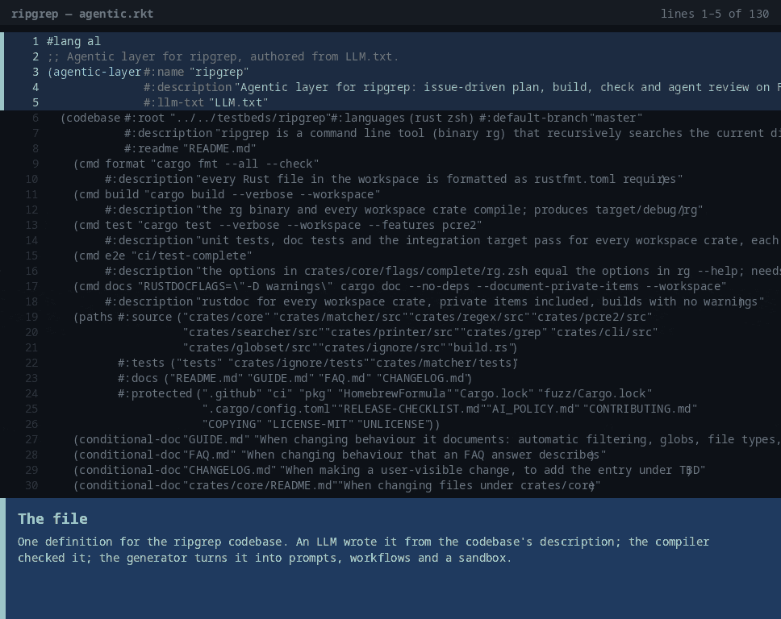

# The `ripgrep` layer, explained

Source: `tests/authored/ripgrep/agentic.rkt` (130 lines). This walkthrough is generated by `al explain` from the file and its compiled form, so it also states the defaults the author did not write down.



## In one paragraph

`ripgrep` is Agentic layer for ripgrep: issue-driven plan, build, check and agent review on Forgejo; a human merges. It declares 5 codebase commands, 12 prompts and 2 workflows (`plan-build` and `sdlc`).

## Block by block

### The file

Lines 1–5. One definition for the `ripgrep` codebase. An LLM wrote it from the codebase's description; the compiler checked it; the generator turns it into prompts, workflows and a sandbox.

```racket
#lang al
;; Agentic layer for ripgrep, authored from LLM.txt.
(agentic-layer #:name "ripgrep"
               #:description "Agentic layer for ripgrep: issue-driven plan, build, check and agent review on Forgejo; a human merges"
               #:llm-txt "LLM.txt"
```

### The codebase and its commands

Lines 6–35. What the codebase is (rust and zsh) and the commands that prove things about it: `format`, `build`, `test`, `e2e` and `docs`. Agents show that something works by running these, never by saying so. 13 protected paths: agents may not ship changes there without a person.

- `format` runs `cargo fmt --all --check` — every Rust file in the workspace is formatted as rustfmt.toml requires
- `build` runs `cargo build --verbose --workspace` — the rg binary and every workspace crate compile; produces target/debug/rg
- `test` runs `cargo test --verbose --workspace --features pcre2` — unit tests, doc tests and the integration target pass for every workspace crate, each integration test once on the default regex engine and once on PCRE2; builds target/debug/rg
- `e2e` runs `ci/test-complete` — the options in crates/core/flags/complete/rg.zsh equal the options in rg --help; needs zsh and an existing target/release/rg or target/debug/rg, so it must run after build or test
- `docs` runs `RUSTDOCFLAGS="-D warnings" cargo doc --no-deps --document-private-items --workspace` — rustdoc for every workspace crate, private items included, builds with no warnings
- Protected: `.github`, `ci`, `pkg`, `HomebrewFormula`, `Cargo.lock`, `fuzz/Cargo.lock`, `.cargo/config.toml`, `RELEASE-CHECKLIST.md`, `AI_POLICY.md`, `CONTRIBUTING.md`, `COPYING`, `LICENSE-MIT` and `UNLICENSE`
- Read `GUIDE.md` when changing behaviour it documents: automatic filtering, globs, file types, replacements, the configuration file, file encoding, binary data, preprocessors
- Read `FAQ.md` when changing behaviour that an FAQ answer describes
- Read `CHANGELOG.md` when making a user-visible change, to add the entry under TBD
- Read `crates/core/README.md` when changing files under crates/core
- Read `crates/ignore/benches/README.md` when changing directory walking or ignore matching in crates/ignore/src
- Read `fuzz/README.md` when changing glob parsing in crates/globset/src or anything under fuzz
- Read `pkg/windows/README.md` when changing build.rs or pkg/windows/Manifest.xml
- Read `RELEASE-CHECKLIST.md` when asked to change a version number, Cargo.lock or anything related to a release
- Read `AI_POLICY.md` when work is intended for the upstream repository BurntSushi/ripgrep

```racket
  (codebase #:root "../../testbeds/ripgrep" #:languages (rust zsh) #:default-branch "master"
            #:description "ripgrep is a command line tool (binary rg) that recursively searches the current directory for a regex pattern, respecting gitignore rules and skipping hidden and binary files by default. Rust edition 2024, minimum Rust 1.96, one Cargo workspace: the root package builds rg from crates/core/main.rs and nine library crates under crates/ hold the search, regex, printing, glob and ignore logic."
            #:readme "README.md"
    (cmd format "cargo fmt --all --check"
         #:description "every Rust file in the workspace is formatted as rustfmt.toml requires")
    (cmd build "cargo build --verbose --workspace"
         #:description "the rg binary and every workspace crate compile; produces target/debug/rg")
    (cmd test "cargo test --verbose --workspace --features pcre2"
         #:description "unit tests, doc tests and the integration target pass for every workspace crate, each integration test once on the default regex engine and once on PCRE2; builds target/debug/rg")
    (cmd e2e "ci/test-complete"
         #:description "the options in crates/core/flags/complete/rg.zsh equal the options in rg --help; needs zsh and an existing target/release/rg or target/debug/rg, so it must run after build or test")
    (cmd docs "RUSTDOCFLAGS=\"-D warnings\" cargo doc --no-deps --document-private-items --workspace"
         #:description "rustdoc for every workspace crate, private items included, builds with no warnings")
    (paths #:source ("crates/core" "crates/matcher/src" "crates/regex/src" "crates/pcre2/src"
                     "crates/searcher/src" "crates/printer/src" "crates/grep" "crates/cli/src"
                     "crates/globset/src" "crates/ignore/src" "build.rs")
           #:tests ("tests" "crates/ignore/tests" "crates/matcher/tests")
           #:docs ("README.md" "GUIDE.md" "FAQ.md" "CHANGELOG.md")
           #:protected (".github" "ci" "pkg" "HomebrewFormula" "Cargo.lock" "fuzz/Cargo.lock"
                        ".cargo/config.toml" "RELEASE-CHECKLIST.md" "AI_POLICY.md" "CONTRIBUTING.md"
                        "COPYING" "LICENSE-MIT" "UNLICENSE"))
    (conditional-doc "GUIDE.md" "When changing behaviour it documents: automatic filtering, globs, file types, replacements, the configuration file, file encoding, binary data, preprocessors")
    (conditional-doc "FAQ.md" "When changing behaviour that an FAQ answer describes")
    (conditional-doc "CHANGELOG.md" "When making a user-visible change, to add the entry under TBD")
    (conditional-doc "crates/core/README.md" "When changing files under crates/core")
    (conditional-doc "crates/ignore/benches/README.md" "When changing directory walking or ignore matching in crates/ignore/src")
    (conditional-doc "fuzz/README.md" "When changing glob parsing in crates/globset/src or anything under fuzz")
    (conditional-doc "pkg/windows/README.md" "When changing build.rs or pkg/windows/Manifest.xml")
    (conditional-doc "RELEASE-CHECKLIST.md" "When asked to change a version number, Cargo.lock or anything related to a release")
    (conditional-doc "AI_POLICY.md" "When work is intended for the upstream repository BurntSushi/ripgrep"))
```

### The forge

Lines 37–37. Issues and pull requests live on forgejo (`per/ripgrep`).

```racket
  (forge forgejo #:host "https://forgejo.example.org" #:repo "per/ripgrep")
```

### Where proof is kept

Lines 38–38. Artefacts are uploaded to the S3 bucket `ripgrep-adw` and kept locally too.

```racket
  (storage s3 #:bucket "ripgrep-adw" #:endpoint "https://s3.example.org")
```

### Where work comes from

Lines 40–40. Prompt input: issues on the forge.

- `issue`: issues on the forge

```racket
  (prompt-input issue #:labels ("adw"))
```

### What starts a run

Lines 41–42. Trigger: a webhook from the forge or by hand.

```racket
  (trigger webhook)
  (trigger manual)
```

### Where agents work

Lines 44–47. Environment: a private copy of the repository for every run and a container (the checks run inside it).

- `worktree`: each run gets its own git worktree; your checkout is never touched
- `podman`: image based on `docker.io/library/rust:1-slim`; the checks run inside it

```racket
  (environment worktree)
  (environment podman #:base-image "docker.io/library/rust:1-slim"
               #:packages ("zsh" "xz-utils" "lz4" "musl-tools" "brotli" "zstd" "g++")
               #:network slirp)
```

### What counts as proof

Lines 49–49. Artefacts collected after the checks and shown to whoever reviews: command logs.

- `log`: command logs

```racket
  (artefact log)
```

### Who decides it is done

Lines 51–51. Review: an agent that reviews on evidence, with a person merging.

- `agent`: 1 reviewer agent(s) judge the change against the plan; a person merges

```racket
  (review agent #:artefacts (log))
```

### The prompts

Lines 53–100. 12 prompts written for this codebase, each for one kind of job: `prime`, `classify`, `plan-chore`, `plan-bug`, `plan-feature`, `plan-patch`, `resolve-test`, `e2e-test`, `review`, `document`, `commit` and `pull-request`. 36 of their instructions are specific to this codebase.

- `prime`: the prime template
- `classify`: the classify template
- `plan-chore`: the plan-chore template
- `plan-bug`: the plan-bug template
- `plan-feature`: the plan-feature template
- `plan-patch`: the plan-patch template
- `resolve-test`: the resolve-test template
- `e2e-test`: the e2e-test template
- `review`: the review template
- `document`: the document template
- `commit`: the commit template
- `pull-request`: the pull-request template
- Codebase-specific rule: “A chore touches no behaviour of rg: formatting, rustdoc or comment fixes, edits to README.md, GUIDE.md, FAQ.md or a crate README.md, or a test-only change.”
- Codebase-specific rule: “When rustdoc comments change, add the docs command to the plan's validation: rustdoc must build with no warnings.”
- Codebase-specific rule: “Code must compile on Rust 1.96.0; do not use language or library features newer than that.”
- Codebase-specific rule: “Do not change Cargo.lock or any crate version number; those change only as part of a release (RELEASE-CHECKLIST.md).”
- Codebase-specific rule: “When the bug is visible through rg, the regression test goes in tests/regression.rs as rgtest!(r<issue number>, ...) with a '// See: https://github.com/BurntSushi/ripgrep/issues/<issue number>' comment on the line above.”
- Codebase-specific rule: “When the bug is not visible through rg, the regression test goes in the #[cfg(test)] mod tests block of the source file it covers, or in crates/<crate>/tests.”

```racket
  (command prime #:template prime)
  (command classify #:template classify #:output json)
  (command plan-chore #:template plan-chore #:model-set heavy #:output path #:validation (format test)
           #:focus ("A chore touches no behaviour of rg: formatting, rustdoc or comment fixes, edits to README.md, GUIDE.md, FAQ.md or a crate README.md, or a test-only change."
                    "When rustdoc comments change, add the docs command to the plan's validation: rustdoc must build with no warnings."
                    "Code must compile on Rust 1.96.0; do not use language or library features newer than that."
                    "Do not change Cargo.lock or any crate version number; those change only as part of a release (RELEASE-CHECKLIST.md)."))
  (command plan-bug #:template plan-bug #:model-set heavy #:output path #:validation (format test e2e)
           #:focus ("When the bug is visible through rg, the regression test goes in tests/regression.rs as rgtest!(r<issue number>, ...) with a '// See: https://github.com/BurntSushi/ripgrep/issues/<issue number>' comment on the line above."
                    "When the bug is not visible through rg, the regression test goes in the #[cfg(test)] mod tests block of the source file it covers, or in crates/<crate>/tests."
                    "Integration tests are written with rgtest! and must pass on both regex engines: rgtest! runs each test again with PCRE2 when feature pcre2 is enabled."
                    "Do not add tests to tests/misc.rs."
                    "Add an entry under the TBD heading at the top of CHANGELOG.md in the form '* [BUG #<n>](<issue or pull request URL>):' followed by an indented one-sentence description."
                    "Code must compile on Rust 1.96.0; do not use language or library features newer than that."
                    "Do not change Cargo.lock or any crate version number; those change only as part of a release (RELEASE-CHECKLIST.md)."))
  (command plan-feature #:template plan-feature #:model-set heavy #:output path #:validation (format test e2e docs)
           #:focus ("A test for a new feature of rg goes in tests/feature.rs, written with rgtest! and asserting the exact standard output, standard error or exit status of rg; do not add tests to tests/misc.rs."
                    "A new or changed command line flag is one Flag implementation in crates/core/flags/defs.rs, listed in FLAGS, with its documentation in that implementation."
                    "Every option added to or changed in crates/core/flags/defs.rs must also be added to crates/core/flags/complete/rg.zsh so that ci/test-complete prints OK."
                    "Integration tests must pass on both regex engines: rgtest! runs each test again with PCRE2 when feature pcre2 is enabled."
                    "A unit test goes in the #[cfg(test)] mod tests block of the source file it covers."
                    "Add an entry under the TBD heading at the top of CHANGELOG.md in the form '* [FEATURE #<n>](<URL>):' or '* [PERF #<n>](<URL>):' followed by an indented one-sentence description."
                    "Code must compile on Rust 1.96.0; do not use language or library features newer than that."
                    "Do not change Cargo.lock or any crate version number; those change only as part of a release (RELEASE-CHECKLIST.md)."))
  (command plan-patch #:template plan-patch #:model-set heavy #:output path #:validation (format test)
           #:focus ("Do not change Cargo.lock or any crate version number; those change only as part of a release (RELEASE-CHECKLIST.md)."))
  (command resolve-test #:template resolve-test #:model-set heavy
           #:focus ("When format fails, change only formatting: max_width = 79, use_small_heuristics = \"max\", edition = \"2024\"."
                    "When e2e fails with 'rg not found', no rg binary exists in target/debug or target/release: the test or build command must run first."
                    "When e2e reports that zsh completion options differ from --help options, edit crates/core/flags/complete/rg.zsh to match the flags in crates/core/flags/defs.rs; never edit ci/test-complete."
                    "An integration test that fails only in its second run fails on PCRE2: rgtest! runs each test once per regex engine."))
  (command e2e-test #:template e2e-test
           #:focus ("The end-to-end check of this codebase is ci/test-complete: it compares the options in rg --help with those in crates/core/flags/complete/rg.zsh and prints OK when they are equal."
                    "It needs zsh and an existing target/release/rg or target/debug/rg."))
  (command review #:template review #:model-set heavy #:output json
           #:focus ("User-visible change in this codebase is the standard output, standard error or exit status of rg, the text of rg --help and the generated man page, or a public API signature of a crate under crates/."
                    "The only proof artefact is the log: a behaviour change of rg is proven only when the test log shows the new rgtest! in tests/feature.rs or tests/regression.rs passing."
                    "Block when a user-visible change has no entry under the TBD heading of CHANGELOG.md in the form [BUG #<n>], [FEATURE #<n>] or [PERF #<n>]."
                    "Block when a flag changed in crates/core/flags/defs.rs and the e2e log does not end with OK."
                    "Block when the diff changes Cargo.lock, a crate version number, or adds a test to tests/misc.rs."))
  (command document #:template document
           #:focus ("Flag documentation lives in the Flag implementation in crates/core/flags/defs.rs; --help and the man page are generated from it."
                    "Update GUIDE.md or FAQ.md only when the change alters behaviour they describe."
                    "A user-visible change needs its entry under the TBD heading at the top of CHANGELOG.md."))
  (command commit #:template commit
           #:focus ("Do not commit a change to Cargo.lock or to a crate version number; those change only as part of a release (RELEASE-CHECKLIST.md)."))
  (command pull-request #:template pull-request
           #:focus ("Open the pull request only on the forge repository of this layer; never open an issue, pull request or comment on BurntSushi/ripgrep: AI_POLICY.md forbids autonomous agents there."))
```

### Prompts that take a prompt

Lines 102–104. Higher-order prompts: `implement` (takes a plan), `new-command` (takes a prompt) and `new-adw` (takes a prompt). For example, one implements whatever plan it is given.

```racket
  (hop implement #:template run-plan #:takes plan)
  (hop new-command #:template meta-command #:produces command)
  (hop new-adw #:template meta-adw #:produces adw)
```

### Agent experts

Lines 106–108. Areas where an agent keeps its own notes and updates them after each change: `search-core` (The regex and search core: the grep-matcher trait, its Rust regex and PCRE2 implementations, and line-oriented and multi-line searching over readers, files and memory maps).

```racket
  (expert search-core
          #:domain "The regex and search core: the grep-matcher trait, its Rust regex and PCRE2 implementations, and line-oriented and multi-line searching over readers, files and memory maps"
          #:paths ("crates/matcher/src" "crates/regex/src" "crates/pcre2/src" "crates/searcher/src"))
```

### Workflow: plan-build

Lines 110–117. The `plan-build` workflow: Classify the issue, plan by work class, implement the plan. Steps: classify → plan-chore → plan-bug → plan-feature → build. An agent reviews on evidence; a person merges.

- Work from issue; started by webhook or manual; runs in worktree and podman; agent `claude-code`
- 1. agent step `classify` using the `classify` prompt
- 2. agent step `plan-chore` using the `plan-chore` prompt (only for chore work)
- 3. agent step `plan-bug` using the `plan-bug` prompt (only for bug work)
- 4. agent step `plan-feature` using the `plan-feature` prompt (only for feature work)
- 5. agent step `build` using the `implement` prompt

```racket
  (adw plan-build #:description "Classify the issue, plan by work class, implement the plan"
       #:input (issue) #:trigger (webhook manual) #:environment (worktree podman) #:review agent
    (steps
      (run classify #:command classify #:args ("$prompt"))
      (run plan-chore #:command plan-chore #:args ("$prompt") #:when class-chore)
      (run plan-bug #:command plan-bug #:args ("$prompt") #:when class-bug)
      (run plan-feature #:command plan-feature #:args ("$prompt") #:when class-feature)
      (run build #:command implement #:args ("$plan"))))
```

### Workflow: sdlc

Lines 119–130. The `sdlc` workflow: Plan, build, check, document, commit, agent review with the logs as proof; a human merges. Steps: classify → plan-chore → plan-bug → plan-feature → build → format → test → e2e → docs → document → commit → review → ship. An agent reviews on evidence; a person merges.

- Work from issue; started by webhook or manual; runs in worktree and podman; agent `claude-code`
- 1. agent step `classify` using the `classify` prompt
- 2. agent step `plan-chore` using the `plan-chore` prompt (only for chore work)
- 3. agent step `plan-bug` using the `plan-bug` prompt (only for bug work)
- 4. agent step `plan-feature` using the `plan-feature` prompt (only for feature work)
- 5. agent step `build` using the `implement` prompt
- 6. check `format`: run the `format` command; on failure the `resolve-test` prompt fixes it, up to 3 tries
- 7. check `test`: run the `test` command; on failure the `resolve-test` prompt fixes it, up to 3 tries
- 8. check `e2e`: run the `e2e` command; on failure the `resolve-test` prompt fixes it, up to 3 tries
- 9. check `docs`: run the `docs` command; on failure the `resolve-test` prompt fixes it, up to 3 tries
- 10. agent step `document` using the `document` prompt
- 11. agent step `commit` using the `commit` prompt
- 12. review (blockers go to a patch plan and a fix, then it is reviewed again)
- 13. ship

```racket
  (adw sdlc #:description "Plan, build, check, document, commit, agent review with the logs as proof; a human merges"
       #:input (issue) #:trigger (webhook manual) #:environment (worktree podman) #:review agent
    (steps
      (compose plan-build)
      (check format #:cmd format #:resolve resolve-test #:collect (log))
      (check test #:cmd test #:resolve resolve-test #:collect (log))
      (check e2e #:cmd e2e #:resolve resolve-test #:collect (log))
      (check docs #:cmd docs #:resolve resolve-test #:collect (log))
      (run document #:command document #:args ("$plan"))
      (run commit #:command commit)
      (review #:patch plan-patch #:implement implement)
      (ship))))
```

### Which agents and models do the work (not written down: the default)

Agent: claude-code. Reading the codebase, classifying the work, browser tests, documentation, commits and pull requests use claude-opus-5-5; planning, patch plans, fixing failed checks, review, building, new prompts and new workflows use claude-fable-5-2.

- `claude-code`: claude-code, model tiers base = `claude-opus-5-5` and heavy = `claude-fable-5-2`, permission mode `acceptEdits`
- For one run, `--model-set TIER`, `--model TIER=MODEL_ID` (or AL_MODEL_SET / AL_MODELS) change this without editing the file

### Watching the work (not written down: the default)

A live dashboard on http://127.0.0.1:8765 shows what the agents are doing.

- Start it with `uv run adws/dashboard.py`; it only reads the layer's run files and never changes anything
