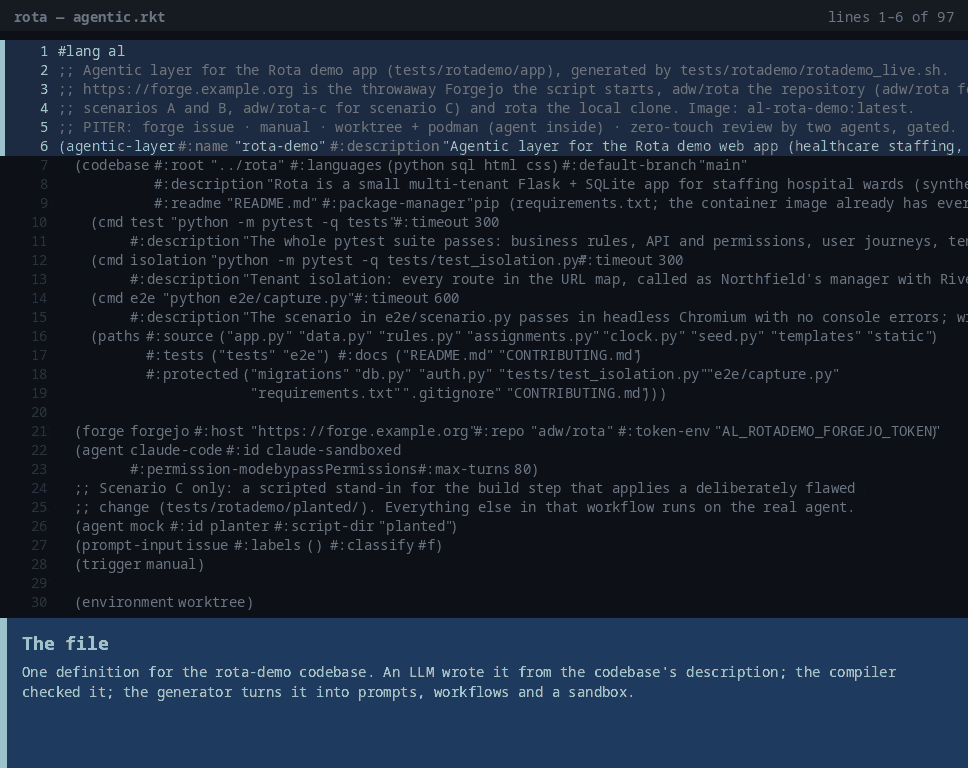

# The `rota` layer, explained

Source: `tests/rotademo/layer.rkt.in` (97 lines). This walkthrough is generated by `al explain` from the file and its compiled form, so it also states the defaults the author did not write down.



## In one paragraph

`rota` is Agentic layer for the Rota demo web app (healthcare staffing, synthetic data). It declares 3 codebase commands, 5 prompts and 2 workflows (`feature` and `planted`).

## Block by block

### The file

Lines 1–6. One definition for the `rota-demo` codebase. An LLM wrote it from the codebase's description; the compiler checked it; the generator turns it into prompts, workflows and a sandbox.

```racket
#lang al
;; Agentic layer for the Rota demo app (tests/rotademo/app), generated by tests/rotademo/rotademo_live.sh.
;; https://forge.example.org is the throwaway Forgejo the script starts, adw/rota the repository (adw/rota for
;; scenarios A and B, adw/rota-c for scenario C) and rota the local clone. Image: al-rota-demo:latest.
;; PITER: forge issue · manual · worktree + podman (agent inside) · zero-touch review by two agents, gated.
(agentic-layer #:name "rota-demo" #:description "Agentic layer for the Rota demo web app (healthcare staffing, synthetic data)"
```

### The codebase and its commands

Lines 7–19. What the codebase is (python, sql, html and css) and the commands that prove things about it: `test`, `isolation` and `e2e`. Agents show that something works by running these, never by saying so. 8 protected paths: agents may not ship changes there without a person.

- `test` runs `python -m pytest -q tests` — The whole pytest suite passes: business rules, API and permissions, user journeys, tenant isolation.
- `isolation` runs `python -m pytest -q tests/test_isolation.py` — Tenant isolation: every route in the URL map, called as Northfield's manager with Riverside's ids, leaks nothing and changes nothing of Riverside's.
- `e2e` runs `python e2e/capture.py` — The scenario in e2e/scenario.py passes in headless Chromium with no console errors; writes e2e-results/NN-<name>.png per screenshot step and e2e-results/session.webm.
- Protected: `migrations`, `db.py`, `auth.py`, `tests/test_isolation.py`, `e2e/capture.py`, `requirements.txt`, `.gitignore` and `CONTRIBUTING.md`

```racket
  (codebase #:root "../rota" #:languages (python sql html css) #:default-branch "main"
            #:description "Rota is a small multi-tenant Flask + SQLite app for staffing hospital wards (synthetic data, demo-grade sign-in). Two organisations, Northfield Hospital and Riverside Care Group, each have wards, workers and shifts. app.py holds create_app() and the routes (HTTP only); data.py is the ONLY module that runs SQL on tenant data, through a Scope bound to one organisation; auth.py holds sign-in, roles and the organisation scope; rules.py holds the pure business rules; assignments.py applies them for the UI and the JSON API alike; db.py applies the numbered SQL files in migrations/ at start-up; seed.py loads deterministic synthetic data for a fixed today (clock.py, ROTA_TODAY=2026-03-02). tests/ has pytest suites for rules, API, journeys and tenant isolation; e2e/capture.py walks e2e/scenario.py in headless Chromium and records screenshots and a video into e2e-results/."
            #:readme "README.md" #:package-manager "pip (requirements.txt; the container image already has every dependency)"
    (cmd test "python -m pytest -q tests" #:timeout 300
         #:description "The whole pytest suite passes: business rules, API and permissions, user journeys, tenant isolation.")
    (cmd isolation "python -m pytest -q tests/test_isolation.py" #:timeout 300
         #:description "Tenant isolation: every route in the URL map, called as Northfield's manager with Riverside's ids, leaks nothing and changes nothing of Riverside's.")
    (cmd e2e "python e2e/capture.py" #:timeout 600
         #:description "The scenario in e2e/scenario.py passes in headless Chromium with no console errors; writes e2e-results/NN-<name>.png per screenshot step and e2e-results/session.webm.")
    (paths #:source ("app.py" "data.py" "rules.py" "assignments.py" "clock.py" "seed.py" "templates" "static")
           #:tests ("tests" "e2e") #:docs ("README.md" "CONTRIBUTING.md")
           #:protected ("migrations" "db.py" "auth.py" "tests/test_isolation.py" "e2e/capture.py"
                        "requirements.txt" ".gitignore" "CONTRIBUTING.md")))
```

### The forge

Lines 21–21. Issues and pull requests live on forgejo (`adw/rota`).

```racket
  (forge forgejo #:host "https://forge.example.org" #:repo "adw/rota" #:token-env "AL_ROTADEMO_FORGEJO_TOKEN")
```

### Which agents and models do the work

Lines 22–26. Agent: claude-code (`claude-sandboxed`) and mock (`planter`). On `claude-sandboxed`, planning, patch plans, fixing failed checks, review and building use claude-fable-5-2; commits uses claude-opus-5-5.

- `claude-sandboxed`: claude-code, model tiers base = `claude-opus-5-5` and heavy = `claude-fable-5-2`, permission mode `bypassPermissions`
- `planter`: mock, a stand-in that runs no model
- For one run, `--model-set TIER`, `--model TIER=MODEL_ID` (or AL_MODEL_SET / AL_MODELS) change this without editing the file

```racket
  (agent claude-code #:id claude-sandboxed
         #:permission-mode bypassPermissions #:max-turns 80)
  ;; Scenario C only: a scripted stand-in for the build step that applies a deliberately flawed
  ;; change (tests/rotademo/planted/). Everything else in that workflow runs on the real agent.
  (agent mock #:id planter #:script-dir "planted")
```

### Where work comes from

Lines 27–27. Prompt input: issues on the forge.

- `issue`: issues on the forge

```racket
  (prompt-input issue #:labels () #:classify #f)
```

### What starts a run

Lines 28–28. Trigger: by hand.

```racket
  (trigger manual)
```

### Where agents work

Lines 30–35. Environment: a private copy of the repository for every run and a container (the agent itself runs inside it).

- `worktree`: each run gets its own git worktree; your checkout is never touched
- `podman`: image based on `docker.io/library/python:3.12-slim`; the agent itself runs inside it

```racket
  (environment worktree)
  (environment podman #:base-image "docker.io/library/python:3.12-slim" #:packages ("git" "curl" "ca-certificates" "libatomic1")
               #:setup ("pip install --no-cache-dir 'flask>=3.1,<4' 'pytest>=8,<9' 'playwright>=1.49,<2'"
                        "PLAYWRIGHT_BROWSERS_PATH=/opt/pw playwright install --with-deps --only-shell chromium && PLAYWRIGHT_BROWSERS_PATH=/opt/pw playwright install ffmpeg && chmod -R a+rX /opt/pw"
                        "HOME=/opt/claude bash -c 'curl -fsSL https://claude.ai/install.sh | bash' && chmod -R a+rX /opt/claude && ln -s /opt/claude/.local/bin/claude /usr/local/bin/claude")
               #:memory "4g" #:cpus "2" #:agent-inside #t #:credentials (claude))
```

### What counts as proof

Lines 37–39. Artefacts collected after the checks and shown to whoever reviews: command logs, screenshots and a recorded video, cut into frames for reviewers.

- `log`: command logs
- `screenshots`: screenshots from `e2e-results/*.png`
- `recording`: a recorded video, cut into frames for reviewers from `e2e-results/*.webm`

```racket
  (artefact log #:tail-lines 60)
  (artefact image #:id screenshots #:glob "e2e-results/*.png" #:max-files 12)
  (artefact video #:id recording #:glob "e2e-results/*.webm" #:keyframes 8)
```

### Who decides it is done

Lines 41–44. Review: a person, through a pull request or reviewer agents plus hard rules, with no person.

- `human`: open a pull request and stop; a person reads it and merges
- `zero-touch`: 2 reviewer agent(s) must approve, and then every rule must hold: the commands `test`, `isolation` and `e2e` pass again on the final result; the work is a chore, bug or feature; the change is at most 900 lines; no protected path was touched. If so it ships by `merge`; otherwise a person decides

```racket
  (review human)
  (review auto #:id zero-touch #:reviewers 2 #:artefacts (log screenshots recording) #:ship merge
          #:require-checks (test isolation e2e) #:allowed-classes (chore bug feature) #:max-diff-lines 900
          #:block-protected-paths #t #:max-retries 1)
```

### The prompts

Lines 46–67. 5 prompts written for this codebase, each for one kind of job: `plan-feature`, `plan-patch`, `resolve-test`, `review` and `commit`. 17 of their instructions are specific to this codebase.

- `plan-feature`: the plan-feature template
- `plan-patch`: the plan-patch template
- `resolve-test`: the resolve-test template
- `review`: the review template
- `commit`: the commit template
- Codebase-specific rule: “Start the plan with a section '## Acceptance criteria' that restates EVERY acceptance criterion of the issue, word for word, as a checklist line '- [ ] <criterion>' followed by where it is implemented, the test that proves it and the e2e/scenario.py step (screenshot) that shows it; a reviewer ticks this list.”
- Codebase-specific rule: “Data access goes only through data.py (the organisation-scoped Scope); routes and rules never run SQL. Business rules live in rules.py (pure) and are applied in assignments.py, so the UI and the JSON API enforce them identically.”
- Codebase-specific rule: “Schema changes are made only by adding a new numbered migration file in migrations/ (e.g. 003_<what>.sql); an applied migration is never edited. seed.py holds the synthetic demo data.”
- Codebase-specific rule: “Every user-visible behaviour must be demonstrated in e2e/scenario.py so the screenshots and the video show it: add steps, an expect entry per behaviour (the 'options' expectation checks which <select> options are offered and selectable), a 'reveal' step before a screenshot that must show a dropdown's options, and a 'screenshot' for each visible state.”
- Codebase-specific rule: “New tests go into tests/test_rules.py (pure rules), tests/test_api.py (API and permissions) and tests/test_journeys.py (pages), using the fixtures in tests/conftest.py. Never weaken tests/test_isolation.py; it already covers new routes automatically.”
- Codebase-specific rule: “Never delete or loosen an existing expectation in tests/ or e2e/scenario.py, except where the issue deliberately changes the behaviour it describes; then update it to the new behaviour.”

```racket
  (command plan-feature #:template plan-feature #:model-set heavy #:output path #:validation (test isolation e2e)
           #:focus ("Start the plan with a section '## Acceptance criteria' that restates EVERY acceptance criterion of the issue, word for word, as a checklist line '- [ ] <criterion>' followed by where it is implemented, the test that proves it and the e2e/scenario.py step (screenshot) that shows it; a reviewer ticks this list."
                    "Data access goes only through data.py (the organisation-scoped Scope); routes and rules never run SQL. Business rules live in rules.py (pure) and are applied in assignments.py, so the UI and the JSON API enforce them identically."
                    "Schema changes are made only by adding a new numbered migration file in migrations/ (e.g. 003_<what>.sql); an applied migration is never edited. seed.py holds the synthetic demo data."
                    "Every user-visible behaviour must be demonstrated in e2e/scenario.py so the screenshots and the video show it: add steps, an expect entry per behaviour (the 'options' expectation checks which <select> options are offered and selectable), a 'reveal' step before a screenshot that must show a dropdown's options, and a 'screenshot' for each visible state."
                    "New tests go into tests/test_rules.py (pure rules), tests/test_api.py (API and permissions) and tests/test_journeys.py (pages), using the fixtures in tests/conftest.py. Never weaken tests/test_isolation.py; it already covers new routes automatically."
                    "Never delete or loosen an existing expectation in tests/ or e2e/scenario.py, except where the issue deliberately changes the behaviour it describes; then update it to the new behaviour."
                    "e2e/capture.py is the test harness and a protected path: never plan a change to it; its step and expect vocabulary is documented at the top of e2e/scenario.py."))
  (command plan-patch #:template plan-patch #:model-set heavy #:output path #:validation (test isolation e2e)
           #:focus ("The issue's acceptance criteria are the definition of done: the patch closes the reviewer's blocker against them, and the e2e scenario must demonstrate the corrected behaviour (screenshot)."
                    "Data access only through data.py; schema changes only through a new migration file; never weaken tests/test_isolation.py or edit e2e/capture.py."))
  (command resolve-test #:template resolve-test #:model-set heavy
           #:focus ("Fix the app, not the expectation: never delete or loosen an expectation in tests/ or e2e/scenario.py, never weaken tests/test_isolation.py, and never edit e2e/capture.py."
                    "The e2e log names the failing step and expectation; a FAILED screenshot of that moment is in e2e-results/."))
  (command review #:template review #:model-set heavy #:output json
           #:focus ("Every path in ARTEFACT_MANIFEST (each entry's path and each keyframe's path) is relative to the layer directory ${layer_dir}: open it as ${layer_dir}/<path> with the Read tool, which displays images."
                    "Take the issue's Acceptance criteria list (ORIGINAL_PROMPT) and tick it one criterion at a time: for each, name the code (path:line), the test, and the screenshot or keyframe that proves it. A criterion that is not met, or whose user-visible part no screenshot or keyframe shows, is a blocker."
                    "Data access outside data.py's organisation scope, a weakened tests/test_isolation.py, or a schema change other than a new migration file is a blocker."
                    "Deleted or loosened expectations in tests/ or e2e/scenario.py are a blocker, except where the issue deliberately changes the behaviour the expectation described."
                    "List every screenshot, every keyframe and every log you opened in artefacts_reviewed."))
  (command commit #:template commit
           #:focus ("A commit message is one imperative summary line under 72 characters, e.g. 'Refuse assignments that break the rest rule'."))
```

### Prompts that take a prompt

Lines 68–68. Higher-order prompts: `implement` (takes a plan). For example, one implements whatever plan it is given.

```racket
  (hop implement #:template run-plan #:takes plan)
```

### Workflow: feature

Lines 70–81. The `feature` workflow: Zero-touch: plan, build, tests, tenant isolation, e2e capture, commit, two agent reviewers with screenshots and video keyframes (patch loop on blockers), gate, merge. Steps: plan → build → test → isolation → e2e → commit → review → ship. No person is involved if every rule holds; it ships by merge.

- Work from issue; started by manual; runs in worktree and podman; agent `claude-sandboxed`
- 1. agent step `plan` using the `plan-feature` prompt
- 2. agent step `build` using the `implement` prompt
- 3. check `test`: run the `test` command; on failure the `resolve-test` prompt fixes it, up to 2 tries
- 4. check `isolation`: run the `isolation` command; on failure the `resolve-test` prompt fixes it, up to 1 tries
- 5. check `e2e`: run the `e2e` command; on failure the `resolve-test` prompt fixes it, up to 2 tries
- 6. agent step `commit` using the `commit` prompt
- 7. review (blockers go to a patch plan and a fix, then it is reviewed again)
- 8. ship

```racket
  (adw feature #:description "Zero-touch: plan, build, tests, tenant isolation, e2e capture, commit, two agent reviewers with screenshots and video keyframes (patch loop on blockers), gate, merge"
       #:input (issue) #:trigger (manual) #:environment (worktree podman) #:review zero-touch #:agent claude-sandboxed
       #:classes (chore bug feature)
    (steps
      (run plan #:command plan-feature #:args ("$prompt"))
      (run build #:command implement #:args ("$plan"))
      (check test #:cmd test #:resolve resolve-test #:retries 2 #:collect (log))
      (check isolation #:cmd isolation #:resolve resolve-test #:retries 1 #:collect (log))
      (check e2e #:cmd e2e #:resolve resolve-test #:retries 2 #:collect (log screenshots recording))
      (run commit #:command commit)
      (review #:patch plan-patch #:implement implement)
      (ship)))
```

### Workflow: planted

Lines 83–97. The `planted` workflow: Like feature, but the build step is a scripted, deliberately flawed change (planted defect) to test the reviewers. Steps: plan → build → test → isolation → e2e → commit → review → ship. No person is involved if every rule holds; it ships by merge.

- Work from issue; started by manual; runs in worktree and podman; agent `claude-sandboxed`
- 1. agent step `plan` using the `plan-feature` prompt
- 2. agent step `build` using the `implement` prompt, by agent `planter`
- 3. check `test`: run the `test` command; on failure the `resolve-test` prompt fixes it, up to 2 tries
- 4. check `isolation`: run the `isolation` command; on failure the `resolve-test` prompt fixes it, up to 1 tries
- 5. check `e2e`: run the `e2e` command; on failure the `resolve-test` prompt fixes it, up to 2 tries
- 6. agent step `commit` using the `commit` prompt
- 7. review (blockers go to a patch plan and a fix, then it is reviewed again)
- 8. ship

```racket
  ;; Identical to `feature` except the build step: the scripted `planter` applies a planted,
  ;; deliberately flawed change (scenario C). Plan, checks, commit, reviewers, patch loop and
  ;; ship are all real.
  (adw planted #:description "Like feature, but the build step is a scripted, deliberately flawed change (planted defect) to test the reviewers"
       #:input (issue) #:trigger (manual) #:environment (worktree podman) #:review zero-touch #:agent claude-sandboxed
       #:classes (feature)
    (steps
      (run plan #:command plan-feature #:args ("$prompt"))
      (run build #:command implement #:args ("$plan") #:agent planter)
      (check test #:cmd test #:resolve resolve-test #:retries 2 #:collect (log))
      (check isolation #:cmd isolation #:resolve resolve-test #:retries 1 #:collect (log))
      (check e2e #:cmd e2e #:resolve resolve-test #:retries 2 #:collect (log screenshots recording))
      (run commit #:command commit)
      (review #:patch plan-patch #:implement implement)
      (ship))))
```

### Watching the work (not written down: the default)

A live dashboard on http://127.0.0.1:8765 shows what the agents are doing.

- Start it with `uv run adws/dashboard.py`; it only reads the layer's run files and never changes anything
