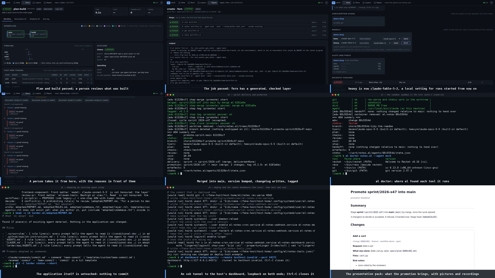

# Showcase clips

Short recordings of features that work and that the main README did not show yet. Every frame is real
output of this repository: the dashboard in a real Chromium, or `tools/al` in a terminal, run on the test
suites' own fixtures (invented names: notes, larder, fern, demo-shop, Ada Example). No model is called; the
mock agent plays it, and where a clip needs a machine it cannot have (a podman, a remote host) it uses the
test suite's stand-in and says so on its opening card.



## Regenerate

```sh
uv run tools/showcase/make.py                # all nine clips, the contact sheet, the logs
uv run tools/showcase/make.py 05 adopt       # some: by number, name or stem (05-delivery)
uv run tools/showcase/make.py --out /tmp/x --media /tmp/x/media   # elsewhere; --keep-work keeps each clip's temporary folder
```

No video is kept in the tree. Each MP4 is written to `media/media-v1/` (ignored by git) under the name it
has as a release asset, `showcase-NN-name.mp4`, and its size and sha256 are recorded in
[`docs/media.json`](../media.json); a person uploads the folder with `tools/release_media.sh`, which lists
the files and prints the `gh release` commands without running them.

It needs uv, `ffmpeg` and `ffprobe`, the DejaVu Sans Mono font (`fonts-dejavu-core`, or a monospace TTF in
`AL_SHOWCASE_FONT`) and, for the browser clips, Chrome or Chromium (found on PATH, or `AL_DASHBOARD_CHROME`).
Nothing is downloaded but uv's packages (`pillow`, `playwright`, `pytest`, from the script's inline
metadata): Playwright drives the host's browser, and its video recorder is pointed at the system `ffmpeg`
instead of the copy it would fetch. The layer's sandbox image has all of it.

Each clip is recorded in its own temporary folder with a neutral environment: `HOME` is a folder in it,
the work folder is `~/work`, the git identity is `Showcase <showcase@example.org>`, the time zone is UTC,
none of the caller's `AL_*` settings reach it and PATH holds only links to racket, raco, uv, git, python3
and sh plus the system folders. In the terminal clips the work folder is shown as `~/work` and the neutral
home as `~`; that substitution is the only change made to captured text. Before anything is rendered,
every transcript and the whole text of every dashboard page at each caption is checked for private
values (`tools/showcase/privacy.py`): this machine's home folder, user name, host name and addresses, the
global git identity, any `/home/…` or `/Users/…` path other than the neutral home, any IPv4 address but
`127.0.0.1`/`0.0.0.0`, and any e-mail address outside `example.org`, `example.com`, `example.invalid`. A
page error, a console error, or a command that exits other than as the clip expects stops the recording:
nothing that failed by accident is ever recorded.

What `make.py` writes per clip: `showcase-NN-name.mp4` in the media folder (H.264, 1280×720, 15 fps, 10–40 s,
under 3 MB: a one-line caption card, then the clip with a caption per step, sped up to fit 38 s when
longer), and in `docs/showcase`: `NN-name.gif` (a
smaller preview for the README, under 2 MB), `NN-name.png` (the last frame) and, for terminal clips,
`logs/NN-name.txt` (the captured output, as shown). Then `contact-sheet.png` from every poster. It exits 1
when a file breaks a limit. `tests/tools/test_showcase.py` checks the renderer, the privacy rules, that
every `al` command shown is one the tool accepts, and the limits of the committed files; with
`AL_SHOWCASE_RECORD=1` it also records `07-adopt` end to end.

## The five-minute demo video

One video of 4 min 45 s to 5 min shows what al is, what it does and how to use it, in seven parts:

1. the problem, on Rota, the shift-scheduling app for hospital wards;
2. what al is, the real Rota layer;
3. how to use it (`al init`, `al adopt`, `al gen`, `al check`, then `al run` or the Start panel);
4. a run end to end on the dashboard;
5. guardrails and proof (the proof table, a protected path cleared with Approve & resume in the
   dashboard, a handover to a person, reviewers that say no);
6. where it fits and what it does not show yet;
7. where to find it.

It is recorded by the same
renderers as the clips above (`tools/showcase/term.py` for terminals, `browser_clips.py` for the dashboard),
from `tools/demovideo/`: `narration.md` is the script (every caption and every scene length comes from it),
`scenes.py` records one scene per id of the script, `make.py` is the command, `verify.py` checks the result.

`narration.md` holds each caption and, under it, the spoken line: the indented `  > ` lines are what the
voice says while that caption is shown. The caption stays a short label for a viewer with the sound off;
the spoken line may hold at most 2.6 words a second of its caption's time and is scanned by the same
privacy rules as the captions. Pictures of the recorded Rota runs (`docs/demo/rotademo`) are shown on
cards with their source under them. The dashboard is shown at page zoom 1.25 with an outline on what
the voice talks about, terminal scenes dim every line but the ones it talks about, cards build line by
line, the captions are lower thirds in a sans face with the part's chapter tag, and each part fades in
and out over 0.35 s under the caption band.

```sh
uv run tools/demovideo/make.py scene 01-problem 02-layer --work /tmp/al-demo # one clip per scene id; --rehearse runs it without video
uv run tools/demovideo/make.py assemble --work /tmp/al-demo                  # al-demo.mp4 and the timed narration.md
ELEVENLABS_API_KEY=… uv run tools/demovideo/make.py assemble --work /tmp/al-demo   # the ElevenLabs voice
uv run tools/demovideo/make.py assemble --work /tmp/al-demo --voice kokoro   # the Kokoro voice of this machine
uv run tools/demovideo/verify.py media/demo-video                            # the contact sheet and privacy-ocr.json; exit 1 when a check fails
```

`make.py clean --work DIR` removes the work folder; `scene` and `assemble` stop when it
holds more than 2.5 GB.

**Where the files go.** Nothing is written into the tree. Clips and other intermediates stay in `--work`.
`assemble` writes `al-demo.mp4` and `narration.md` (the script with each scene's and each caption's time in
the final video, then what was sped up, what was blanked and which stand-ins were used) into
`.al-proof/demo/` when the repository has a `.al-proof` folder (a run's proof folder), else into
`media/demo-video/`; git ignores both. `verify.py` adds `al-demo-contact-sheet.png` (one frame every 10 s) and
`privacy-ocr.json` beside them.

**The voice.** `assemble` says each caption's spoken line, as one mono audio stream that the `mute:` command
in `narration.md` drops. `--voice auto` (the default) tries in order: ElevenLabs when `ELEVENLABS_API_KEY` is
set, else Kokoro when its model files are already cached, else the local `espeak-ng` when it is installed,
else no voice. `--voice elevenlabs`, `--voice kokoro`, `--voice local` and `--voice none` choose one;
`--no-voice` is the same as `--voice none`.

- `--voice kokoro` runs `kit/runtime/voice/say.py` on this machine, by its command line only (`--voice
  --speed --out --no-play`, through `uv run`): voice `af_heart` (or `AL_DEMO_KOKORO_VOICE`), speed 1.0, each
  line played at most ×1.12 faster to fit. Nothing is sent anywhere. Kokoro's model files are downloaded
  once by say.py into the user's cache, outside the repository (`AL_KOKORO_CACHE`, else
  `$XDG_CACHE_HOME/al/kokoro`, else `~/.cache/al/kokoro`); `auto` picks Kokoro only when they are already
  there, so neither `auto` nor any test ever downloads them.
- The ElevenLabs voice is `ELEVENLABS_VOICE_ID` (default `JBFqnCBsd6RMkjVDRZzb`) with the model
  `eleven_multilingual_v2`. Only the spoken lines (not the captions) are sent, to `api.elevenlabs.io`; the
  key goes only in the request header and is never printed or written anywhere. Each line is played at
  most ×1.35 faster to fit.

Both cache their lines in `WORK/voice-cache/`, keyed by text and voice, so assembling again does not make a
line twice. Each voiced line has its leading and trailing silence trimmed and starts 0.3 s after its
caption; when some do not fit their caption's time, `assemble` stops and lists every such line, to be
shortened in `narration.md`. The mix is loudness-normalised to about -16 LUFS and encoded AAC 128k, and
the closing card names the synthetic voice. The scene lengths never change, so the video keeps its
4 min 30 s to 5 min. `tools/demovideo/tts.py` holds all of it (standard library only).

**What it needs.** uv, `ffmpeg` and `ffprobe`, Chrome or Chromium, the DejaVu Sans and DejaVu Sans Mono fonts
and racket (the demo layer and the Rota layer are compiled by the real `al gen`); Pillow (pulled in by
`make.py`) draws the cards and reads the committed pictures under `docs/demo/rotademo`; `espeak-ng`, Kokoro (say.py) or an ElevenLabs
key is optional: with any of them, each spoken line is also read aloud (see The voice). The
verifier's OCR is `rapidocr-onnxruntime` 1.4.4, whose models ship inside the package: no frame leaves the
machine.

**What is real and what stands in.** The run of part 4 is a real run of a layer written for the demo
(`tools/demovideo/demo_layer.rkt.in`, for the `cart` library of `kit/dashboard/demo/live_demo.py`), started
from the dashboard's Start panel. No model is called: classify, plan, commit and the two reviewers are the
mock agent, and the build is the scripted stand-in `kit/dashboard/demo/replay_agent.py`, which really edits
the worktree and really runs the tests. The video says so in its captions. Parts 2 and 3 show the real Rota definition
from `tests/rotademo/layer.rkt.in`, compiled by the real `al init`, `al gen` and `al check` in the work
folder; `agentic.rkt` is copied in, where in use an LLM writes it with `al author`. The Rota pictures of
parts 1, 4 and 5 are from the recorded runs with a real model in `docs/EXAMPLES.md`, and only their captions
say "with a real model". The approval of part 5 is given in the dashboard (Approve & resume) by the
fictional name Ada Example, and the rejected review of part 5 is labelled as a test fixture.

**The privacy rules** are stricter than the clips' (`tools/demovideo/rules.py`): no e-mail address at all, no
IPv4 address at all (loopback too), no `/home/…` or `/Users/…` path, not the word `token`, no host name of this
machine and no name of a repository beside this one (add names with `AL_DEMO_FORBIDDEN_NAMES`, comma-separated).
Every terminal transcript and the dashboard's page text at each caption is checked before a frame is made;
paths are shown short (`~/work`, `.`), a match is replaced by `█` and listed in `narration.md`, and a match
that is still there stops the scene. `verify.py` then reads one frame every 5 s of the finished video with
OCR and applies the same rules to the pixels, and checks that each of those frames carries the caption band.
`tests/tools/test_demo_video.py` checks the rules, the script and the demo layer, and runs the verifier on
a recorded video when one is there (it skips in a clone without one); with `AL_SHOWCASE_RECORD=1` it also
records one scene and checks that the verifier refuses a video with an address on a frame.

The tooling never uploads, publishes or sends the video anywhere: a person reviews it and decides. Only
the spoken lines go out, to ElevenLabs, and only when that voice is chosen.

### The second story: flask on a local Forgejo

A second video tells the same seven parts on a codebase people know: **flask**, one of the pinned public
examples, in every scene, with a real forge as its remote. It is chosen with `--story testbed` on
`make.py scene`, `make.py assemble` and `verify.py`; `rota` stays the default, so every command above
works as before.

1. the problem, on Flask: locked dependencies, strict tests, the session code;
2. what al is: the real authored layer `tests/authored/flask/agentic.rkt`, its checks, its protected
   paths (with `src/flask/sessions.py`) and its review gate;
3. how to use it: `al init`, `al adopt` (flask has no agent rules, and it says so), `al gen`, `al check` on
   a copy of flask;
4. a run end to end from the dashboard's Start panel, then the pull request it opened, on the Forgejo page;
5. guardrails and proof: the proof table, a second run that edits `src/flask/sessions.py` and waits for
   Approve & resume, a third whose reviewers refuse;
6. where it fits; 7. where to find it.

Its files, all in `tools/demovideo/`: `narration-testbed.md` (the script), `scenes_testbed.py` (one
recorder per scene id; every helper that draws, records or checks is imported from `scenes.py`),
`flask_layer.rkt.in` (the layer of the runs in parts 4 and 5), `flask_replay.py` (the scripted stand-in
for the build), `forgejo.py` (the local Forgejo) and `stories.py` (story name → narration, scene module,
clips folder and output names).

**The flask copy.** Each scene works on the commit pinned for `flask` in `tests/integration/testbeds.toml`,
taken from `testbeds/flask` when the integration suite has fetched it, else fetched once. Only its tree is
used: it is archived into a fresh repository and committed once by the neutral identity `Showcase`, at a
fixed date, so no upstream author, e-mail or path is in the copy and every scene's copy has the same
commit.

**What is real and what stands in.** The change is small and real: `get_debug_flag()` in
`src/flask/helpers.py` treats `FLASK_DEBUG=off` as off (today that value turns debug mode on), with a new
test in `tests/test_helpers.py`. Flask's own pytest really runs on it, with flask's locked dependencies,
and the pull request is a real one on the Forgejo instance: the ship step pushes the branch and opens it,
and nothing is merged. The model stands in: classify, plan, commit and both reviewers are the mock agent
and the build is `flask_replay.py`, which really edits the worktree and really runs the tests; the
captions say so. The runs use `flask_layer.rkt.in` (flask's protected paths, one test module), not the
authored definition of parts 2 and 3. The protected `src/flask/sessions.py` stops the second run until a
person approves; a third scripted run is refused by its two reviewers and handed to a person.

```sh
uv run tools/demovideo/make.py forgejo up --work /tmp/al-demo-flask     # codeberg.org/forgejo/forgejo:11 on localhost:3910
uv run tools/demovideo/make.py scene 01-problem 02-layer --story testbed --work /tmp/al-demo-flask
uv run tools/demovideo/make.py assemble --story testbed --work /tmp/al-demo-flask --voice kokoro
uv run tools/demovideo/verify.py media/demo-video --story testbed
uv run tools/demovideo/make.py forgejo down --work /tmp/al-demo-flask   # removes the container and its data
```

`make.py forgejo up` starts a throwaway Forgejo in rootless podman, published only on `localhost` (port
3910, or `--port N`), with a throwaway admin `demo` and an empty repository `demo/flask`, and records it in
the work folder; `make.py forgejo down` removes the container with its data. The access value the instance
generates is never printed: it lives in `forgejo.env` in the work folder and in the demo layer's
`local.env` (both mode 0600), where the layer's forge client reads it, and it dies with the container.
`make.py clean` refuses while an instance is recorded. Without a reachable instance the scenes that need
one (`04-run`, `04-pr`, `05-proof` without a recorded run, `05-protected`, `05-review-no`) stop with a
message that says so: the story never fakes its pull request. The video shows `localhost`, never an
address.

`assemble` writes `al-demo-testbed.mp4` and `narration-testbed.md`, and `verify.py --story testbed` adds
`al-demo-testbed-contact-sheet.png` and `privacy-ocr-testbed.json`, beside the files of the rota story; the
clips are in `clips-testbed` of the work folder, so both stories can share one work folder and one output
folder. The tests use a stubbed Forgejo and a small stand-in for the flask tree, so they need neither
podman nor network. The recording needs podman, network (the image, flask's dependencies) and the tools
the rota story needs.

When the second run stops at the protected path, al hands it over on the forge as a pull request marked
`[needs human]`; the pull request that delivers the change is opened only after the approval. The tests
show this against the stubbed Forgejo, which accepts both. It has not been tried against a real instance,
which may refuse a second pull request for a branch whose first is still open: rehearse `05-protected`
(`--rehearse`) before recording it.

## The clips

### 01-start-work

The Layers view's Start panel: a prompt, the workflow `plan-build` and `claude-sonnet-5-5` for its heavy
tier; Start lands on the new run, whose graph fills in until plan and build have passed, and its cost
table shows the chosen model on both steps. Proves that work starts from the page with a per-run model.
Fixture: `kit/dashboard/tests/start_layer.py` (`build_site`: a git app and the `notes` layer). Stand-in:
the mock agent.

### 02-repos

The Repos view lists four repositories side by side (`layer`, `setup`, `setup`, `none`); Create on `fern`
shows what it will run, then a job runs the real `tools/al` (through a wrapper that reads one settings
file): it checks every step's tools first and stops at `init` because `AL_RACKET` names a racket that is
not installed, in al's own sentence. With the setting removed ("racket installed"), Retry from init runs
init, author, gen and check, and the job passes. Proves the Repos view, its jobs and Retry from with the
real tool. Fixture: `kit/dashboard/tests/workspace_fixtures.py`; the author's answer is the mock of
`tests/tools/test_dashboard_workspace.py`. Before recording, the same job is run once without video; if
it did not pass after the retry, nothing would be recorded. The job's output panel shows al's output as
printed, with the absolute paths of the temporary folder.

### 03-run-documents

A finished run's Documents tab lists its plan, its review report and a reviewer's verdict; the plan and
the report are rendered in the page, with a raw view and a download each. The Artefacts tab of a fixture
run shows its screenshots (one opened large). The Models panel switches the `heavy` tier to
`claude-fable-5-2`, shown as a local setting for runs started from now on. Fixture:
`kit/dashboard/tests/fixtures.py` (`demo-shop`) plus one finished run with a plan and a review report,
recorded the way `test_browser_documents.py` records one.

### 04-review-says-no

Run `a1000101`: the review step is rejected (⊗), its three rounds are each "not approved" with the
reviewers' reasons in the step panel, the run is handed over to a person, and the Runs list counts two
handed-over runs apart from passed ones. Fixture: `fixtures.py` plus `add_review_runs` of
`kit/dashboard/tests/test_review_rejected_model.py`.

### 05-delivery

A layer with `(delivery sprint)`, a stage and a promotion (`grep` shows the three lines). `al cycle notes.al
start` cuts the sprint branch; two `al run notes.al /change … --dry-run` runs (the mock agent writes
`cart.py` and `search.py`) each deliver a pull request into the sprint, and a person merges each (`git
merge` in a worktree of the sprint branch, as Ada Example). `al promote notes.al sprint main` checks the
sprint, writes the pack and waits for one human approval (exit 75); `al decide … approve --by "Ada
Example"` records it; `al promote` again bumps the version to 0.2.0, writes the changelog, merges into
main, tags `v0.2.0` and closes the cycle. Fixture: `SPRINT_LAYER` and `_layer` of
`tests/tools/test_al_promote.py`. Stand-in: the mock agent.

### 06-sandbox

`al sandbox notes.al status` shows the image's recipe hash, not built; `al sandbox notes.al doctor`
starts a throwaway container as a run does and finds `pytest` missing (exit 1, with the fix in the
table); `al run notes.al /change "Tidy the readme" --dry-run` stops at its preflight with the same table
before any agent works; `al doctor notes.al --agent mock` lists where al found racket, raco, uv and git.
Fixture: `_layer` of `tests/tools/test_sandbox_cli.py` with the test command `pytest -q`. Stand-in: podman
is the test suite's stand-in (`STUB` of that test file), answering the in-container checks with a missing
`pytest`; the status and doctor tables, the exit codes, the preflight stop and `al doctor` are al's own.
A recording against a real podman is a follow-up.

### 07-adopt

`al init larder`, then `al adopt larder.al --app larder --dry-run` lists the 17 pieces of agent material
it found (rule files of several tools, Claude Code commands, two workflow scripts) and what it would
write; `al adopt` writes them; the head of `adopted/REPORT.md` says what came from where; `git -C larder
status --short` prints nothing: the application is untouched. Fixture: `tests/tools/existing_setup.py`.

### 08-deploy-remote

`al deploy notes/agentic --to deploy-host.example --dry-run` prints the host check it would run, its
preflight table, the secrets by name only and every command it would run on the host, and changes
nothing. `al dashboard notes/agentic --remote testhost.invalid --port …` opens an ssh tunnel, loopback on
both ends, prints the local address and closes the tunnel on Ctrl-C (exit 130). Fixture: `DEPLOY_LAYER`
of `tests/tools/conftest.py` as an in-repo layer. Stand-ins: the tests' fake host (`tests/tools/deploy_host.py`,
a folder whose PATH holds stubs for systemctl, loginctl, podman, uv and the agent CLI), reached through
al's local transport for the deploy and through the tests' recording fake `ssh` for the tunnel. The fake
host's `df` is a stub as well (a fixed 50 GB free), so the preflight does not depend on the disk of the
machine that records. `docs/GUIDE.md` has no section on `al deploy` yet; writing one is a follow-up.

### 09-promotion-pack

The layer page lists the open promotion sprint → main; its card on the promotion run shows each delivered
change with its acceptance criteria and proof (test exit codes, a screenshot, a recording, the review);
a person (Ada Example) refuses one change with a comment and it is shown refused; the presentation pack
page shows what the promotion brings with its pictures and recordings. Found shipped but not shown
anywhere before. Fixture: `build_promotion_site` of `kit/dashboard/tests/promotion_fixtures.py` (three
changes delivered by real runs of the layer with the mock agent).

## Not shown

- `al models` on the command line: the Models panel (03) shows the same settings.
- `al run` single-command runs from the terminal: the README already describes them, and 05 and 06 use
  `al run` for workflows.
- `al notify-test`: it needs a real notifier.
- `al verify`, voice input, Forgejo and al used on itself: already in [`docs/demo`](../demo).

## Bugs found while recording

- **A tool setting's path is printed without `~`.** When `AL_RACKET` (or any `AL_<TOOL>` setting) names
  something that is not an executable file, al's sentence shows the setting's value as an absolute path,
  while its other sentences shorten the home folder to `~` (`tools/al_tools.py`, `missing_sentence`, the
  `found.problem` branch). In the dashboard's Repos jobs the sentence is shown as is, so the home folder
  appears on the page. Reproduction:

  ```sh
  AL_RACKET=$HOME/not-installed/racket tools/al doctor --for gen
  # racket is missing: AL_RACKET names /home/<you>/not-installed/racket (in the environment), which is not …
  ```

  Clip 02 therefore points `AL_RACKET` at `/opt/not-installed/racket/bin/racket`, outside the home folder.
- **`## Promote a stage` is not a heading on GitHub.** In `docs/GUIDE.md` the paragraph "Let `al scout`
  propose it" ends with a code fence (line 819) whose example and closing fence are missing, so the fence
  runs to line 837 and swallows `## Promote a stage` and `### Declare how a stage is promoted`; links to
  `docs/GUIDE.md#promote-a-stage` (README's own included) lead nowhere. Reproduction:

  ```sh
  uv run --with markdown-it-py python -c "from markdown_it import MarkdownIt; t=MarkdownIt('commonmark').parse(open('docs/GUIDE.md').read()); print([x.map for x in t if x.type=='fence' and x.map[0]==818])"
  # [[818, 837]]
  ```

  The guide is outside this change, so the README's rows for 05 and 09 link the section's first headings
  that render, `### Run it` and `### Decide`.
- Not a failure, noted: a Repos job's output panel shows al's own output, in which `al init`, `al author`
  and `al gen` print absolute layer paths; the step command lines above it are shortened (`work/fern`,
  `~/…`).
