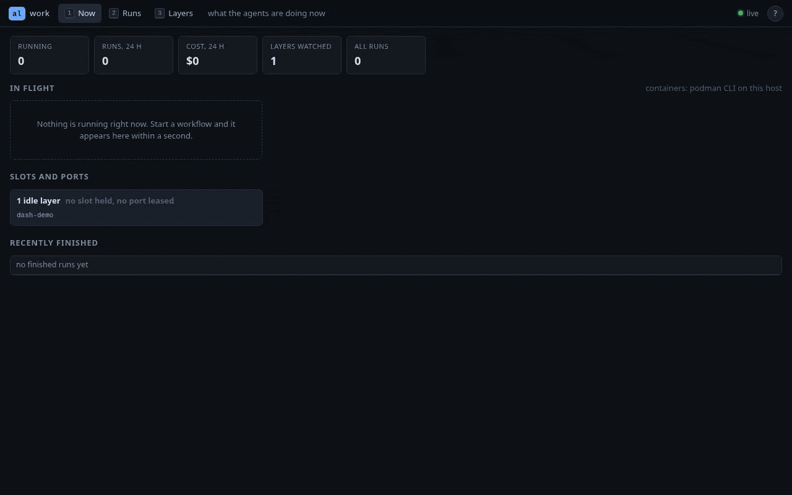

# al work dashboard

A live view of what the agents of one or more layers are doing (with three guarded writes: which
model each tier uses, starting work: a workflow, a single command or a failed run again, and settling
a finished run), which runs still need someone, which runs are in
flight and what each agent is doing right now, the workflow of every run as a graph that colours
in as steps finish, where the time went, what it cost, and every agent's transcript formatted for
people. One Python file (standard library only) serves one page (HTML, CSS and vanilla JS, no
CDN, no build step) and pushes updates over Server-Sent Events. Its **Repos** view also lists the git
repositories beside the layers with their al state and runs allow-listed `al` commands on one of them,
each confirmed first when it writes (see Safety, "Actions").



[live.mp4](https://github.com/dancegit/al/releases/download/media-v1/demo-dashboard-live.mp4) (52 s): three runs of a demo layer, two at a time;
the Now view fills, the third run waits for a slot, the graph colours in, a transcript streams,
a test fails and its resolve agent fixes it. More: [run detail](../../docs/demo/dashboard/run-detail.png) ·
[transcript, filtered](../../docs/demo/dashboard/step-transcript.png) ·
[timeline and costs](../../docs/demo/dashboard/timeline-costs.png) ·
[artefacts](../../docs/demo/dashboard/artefacts.png) · [a layer's workflows](../../docs/demo/dashboard/layers.png).
The still images are real Claude Opus runs (the flask layer and the healthcare staffing demo).

## Run it

Every generated layer has its own (the default `(dashboard local)` in `agentic.rkt`; see
"Declared in the layer" below):

```bash
uv run adws/dashboard.py                                         # in a layer: this layer, its #:also layers
al dashboard ~/code                                              # any layers, several codebases at once
```

Or straight from the kit:

```bash
uv run kit/dashboard/dashboard.py --scan .                       # every layer below this directory
uv run kit/dashboard/dashboard.py --layer ~/code/myapp.al --open # one layer, open a browser
kit/dashboard/run-in-podman.sh ~/code/myapp.al                    # in its own container (below)
```

| Flag | Meaning |
|---|---|
| `--layer DIR` | watch this layer (a directory with `agentic-layer.json`); repeatable |
| `--scan DIR` | find layers below DIR, in-repo ones included (depth `--scan-depth`, default 4; `.git`, `node_modules`, `trees`, `testbeds`, … are skipped); rescanned every 10 s, so new layers appear |
| `--port N` | default 8765 |
| `--bind ADDR` | default 127.0.0.1; a non-loopback address is refused unless `--token` is given |
| `--token T` | every request needs it (`?token=T` once, then an HttpOnly cookie; or `Authorization: Bearer T`); also read from `AL_DASHBOARD_TOKEN` |
| `--open` | open the page in a browser |
| `--poll S` | seconds between file polls (default 0.75) |
| `--no-podman` | never call podman |
| `--podman-socket PATH` | opt-in: read container status from a podman API socket (for the container mode) |
| `--in-container` | the host's processes and locks are not visible: infer slot use from run state; starting work is off; no workspace and no actions |
| `--read-only` | refuse every write: no model settings, no starting work, no actions |
| `--no-start` | never start work from the page (the Models panel still writes) |
| `--allow-start-in-container` | with `--in-container`: allow starting work, only for an operator-built image that has `uv`, the application checkout and a writable layer (the image of `run-in-podman.sh` has none of them) |
| `--workspace DIR` | a folder of git repositories side by side: list them with their al state and act on them (repeatable). Default: the folder holding each `--layer`'s repository (its `codebase.root`'s parent); `--workspace` alone is enough to start |
| `--workspace-depth N` | how deep below a workspace folder repositories are looked for (default 1) |
| `--no-workspace` | list no repositories, only layers |
| `--no-actions` | list the repositories but run no action |
| `--jobs-dir DIR` | where actions are recorded (default `$XDG_STATE_HOME/al/dashboard-jobs`, else `~/.local/state/al/dashboard-jobs`) |
| `--al PATH` | the al tool the actions run (default: `tools/al` of the checkout this kit belongs to, else `al` on `PATH`) |
| `--author-agent claude-code\|mock`, `--author-mock FILE` | the agent `al author` uses in the create and adopt actions (`--author-mock` for tests: `--agent mock --mock FILE`) |
| `--no-voice` | no voice helper panel and no speech service (implied by `--in-container`) |
| `--voice-dir DIR` | where voice conversations are kept (default `$XDG_STATE_HOME/al/dashboard-voice`, else `~/.local/state/al/dashboard-voice`) |
| `--voice-fake FILE` | tests: run the speech service with its fake engines and the transcripts of FILE (`{"transcripts": [...]}`) |

## What you see

| View | What it shows |
|---|---|
| **Now** (`1`) | every run in flight: layer, workflow, request, current step, the agent's latest action in one line ("editing tests/test_basic.py", "running pytest", "thinking"), elapsed time, cost so far, whether it waits for a slot, its container (name, state, CPU and memory when podman is available); a **Subscription usage** panel per layer: what the agent CLI last reported about the subscription's usage windows (5-hour, weekly, or whatever name the CLI uses): share used as a bar, status, reset time, when and by which run it was reported, and the layer's threshold when it declares one. It has three states: the windows, "API key: not applicable" (the last call ran on an API key), "no data yet"; where the CLI gave no share it says so. It is not a live meter: it changes when an agent call ends. Then slot pools per layer (runs / agents / checks, held / total, from the lock files) and leased ports; recently finished runs. Dollars of runs whose calls ran on a subscription are marked "API-equivalent" |
| **Runs** (`2`) | opens on **Needs you**: the runs that still need someone, each with a one-line reason and the next action (below). Chips switch to **Running**, **Landed**, **Settled** or **All**, each with its count; the filters (layer, workflow, status, class, dates, text) apply inside a chip, sortable by time, cost and duration; count, pass rate, total and median cost and time. The header reads "N need you", and the Runs link carries the same count |
| **Run** | the workflow as a graph from the layer's IR (agent / check / review / ship / fan-out nodes; `when` branches stacked in one column; resolve loops and the review → patch → re-check loop as back-edges; fan-out candidates as lanes linked to their own runs), coloured live with duration and cost per node; a timeline of every step, check attempt, resolve agent, reviewer, patch round and gate re-run, with agent / check / slot-wait totals, setup bars at the top for a sandbox image build (`building sandbox image <recipe> (<size>)`) and the preflight (`preflight: all checks passed` or `preflight: missing <checks>`) from `env.build.*` / `env.preflight` events (while a build runs the run's current action reads "building the sandbox image"), and marks for what the CLI reported about subscription usage, a limit stop and a wait for a reset (`limit.*` events); cost and tokens per agent ("API-equivalent" when the calls ran on a subscription); the outcome: gate decision and reasons, ship target or PR, **why the run stopped** (a run a subscription limit stopped carries a "limit stop" mark and a "Subscription limit" block with the window, the share used and the reset time) and what the agent asks a human to do, review verdicts per round and reviewer with issues by severity |
| **Step** | the exact prompt (sections collapsible), the transcript as one row per event: what the agent said, tool calls summarised (file read / edit with a diff / write, shell command, search pattern), results collapsed with size, errors marked, thinking as a marker, the final cost / turns / time. Filters (kind, errors only, tool), search with highlight, follow mode, raw JSON of any event, download of the raw `.jsonl`. Checks: every attempt's log with ANSI colours, its exit code and the resolve agent that followed. Under the head of an agent step the runtime checked, one line: "Stayed in its step" (HEAD unchanged, no refs changed, nothing outside the worktree), or "Left its step:" with the violation, what was restored and what was left for a person Next to a check's exit code an amber `N skipped` badge shows when the attempt skipped tests (its title lists the reasons, `no podman ×2`), and `in ENV` for a check that runs `#:in` another environment option; the graph's check node reads `N skipped` too. A check the runtime decided not to run has a decision instead of an attempt: a `not affected` badge with why and the paths that were compared, or a `reused` badge with the step whose pass on the same tree was reused and the tree hash (the log shown is that run's log); neither carries an exit code. |
| **Documents** | what the run has written for people to read, as soon as each file exists: the plan, the `.md` / `.txt` / `.json` / `.log` outputs its steps recorded (a review's `patch-<n>` plans among them), review patch plans, `PR.md` (the handoff or PR text) and other text files in `agents/<id>/`, each reviewer's verdict (`review-*/output.txt`) and text artefacts; with the step that produced each, its size and time. **View** renders Markdown in the page (with a raw toggle), pretty-prints JSON and shows text as text; **Download** saves the exact file, **Download all** a zip of them all. A step's panel links the documents it produced (the plan on `plan-feature`). A new document appears live |
| **Artefacts** | screenshots as thumbnails (click for full size), videos playable in the page with their keyframes, logs with their tail, all with the step that collected them |
| **Kept on a branch** | on the run page of a workflow without a ship step: the branch its work was committed on, the commit, how many files changed, each kept file as a link to its copy in `artefacts/<id>/kept-files/`, the whole change as `changes.diff` (the files and the diff open in the Documents viewer), the files too large to copy (they are on the branch only); "nothing changed" when the run left nothing, "keeping failed" with the reason when the worktree was kept instead |
| **Repos** (`4`) | the workspace: every git repository of the folder(s), searchable, with its state badge (`layer`: an `agentic.rkt` in it or in a sibling `NAME.al`; `setup`: rule files, prompts, workflow scripts or a hand-built suite, the same detection as `al scout`; `none`), branch, a mark for uncommitted changes and its last activity; **refresh** rescans. A selected repository (`#/repo/<key>`) shows al scout's "Existing agent setup" summary, its layer with a link to its workflows and runs, its jobs, and the **al** panel: one button per action with the exact command line(s) it runs, disabled with the reason when it does not apply (`needs the al tool; looked for …`, `--read-only`, `--no-actions`, the state), and a tools table: what `al doctor` sees on this machine (racket, raco, uv, git, the author agent's CLI: where each was found, or the sentence saying where al looked, and its version; kept 5 minutes). **create** and **adopt** have a placement picker above their command lines: **beside the repository** (`<folder>/<name>.al`) or **inside the repository** (`<repository>/agentic`), each with what it means, the resulting path and three checks (exists and is kept / will be created; writable; not a layer yet), disabled with its reason when it cannot be used; the command lines are those of the selected placement. A writing action first shows what it runs and writes (for adopt the dry run's diff, line by line; for create and adopt the placement with its path and the detected choices, each editable, with a sentence saying what it decides and its fact) and runs on **Confirm**. **generate a layer…** beside **refresh**, and **guided** in the al panel of a repository without a layer, open guided generation (below) |
| **Job** | one action (`#/job/<id>`), in the order a person reads it: the header (repository, action, for a create or adopt its placement (`placement: inside the repository`), status, exit code, duration, why it failed, `needs a person: N` when the author left items out, **Download full output**); once it ended, the **outcome** card: for a passed job what was created (the layer with the files added, changed and removed) or adopted, what is `UNVERIFIED` and the next action (the last `next: …` line the steps printed); for a passed create or adopt the same card also holds the **result card** of its `result` step (forge clause, workflows, adopted rules, commands and suite workflows, what was left behind, unverified commands, the next steps, the first of which is the next action; paths as the job shows them), for a failed or interrupted job the failing step, the reason in one sentence (a generic "exited N" is replaced by the step's last error), up to 12 last relevant lines, **Retry from STEP** (asks first; the steps from the first that did not pass run again in the same job, a retried `author` with `--accept-existing`) and **Download log**; the **steps row**, one chip per step with status, exit code and time, a failed step's reason, and under the running one what it is doing right now ("reading the CI files", "compiling, attempt 2", "writing agentic.rkt", or a plain step's last line); the **activity** of the selected step (the running one, else the failed one, else the last agent step, so `author` rather than `scout`; a click picks another and the address keeps it as `?step=`): an agent step's journal with its messages as Markdown, one line per tool call (tool, target, result size, duration), errors in red, the final report and the totals, hooks, start-up, rate limits and other bookkeeping only with **show everything**; a plain step's own output as text (ANSI stripped); both the latest rows with **show earlier** and a search box, and the step's log (an agent step's **raw events**) and journal to download; the author's **Decisions** and **Left out and why** cards; the layer's files it added, changed or removed, and whether the repository changed (for a layer written inside the repository, when only `agentic/` changed: "the layer was written inside the repository: N path(s); commit agentic/ with the code", not a warning); its documents (`LLM.txt` of scout, `preview.diff.txt` of an adopt preview, `choices.json` of a create or adopt preview, `result.json`, `verify.json`, `EXPLAIN.md`); and, collapsed, **Full output** (every step as it ran, ANSI colours; an agent step condensed), opened by itself for a job from before the `steps/` files |
| **Layers** (`3`) | a **Start work** panel (below), then each layer's workflows as static graphs with input / trigger / environment / review, runs, pass rate, average time and cost per workflow, recent runs, and the layer's plain-language explanation when an `EXPLAIN.md` exists |

The **Start work** panel (on the Layers view; a layer chooser when several are watched) takes a
request, any workflow of the layer (adopted ones included) or a single command or hop (one recorded
step in the layer's normal environment that never ships), picked from a list or typed as `/NAME …`
with completion (arrow keys, Enter, Esc; `/command:NAME` when a workflow has the same name). It says
in one line what the choice does and whether anything ships without a person, takes an optional
class, tier and model ids, and, when the layer has a forge, can log the request as an issue ("start
now", or "let the trigger start it" for a workflow a cron or webhook trigger starts from issues). A
workflow that merges or deploys without a person, and the same request again within five minutes,
open a confirmation dialog. Then the page opens the new run. When starting is off, the panel says why
(`--read-only`, `--no-start`, the container, or a layer generated before this feature: "run `al gen`").

**Guided generation (`#/generate`, `#/generate/<key>` with the repository chosen)** leads through create
or adopt in four steps: the repository (those with a layer are disabled, "already has a layer"; for one
with an agent setup a checkbox "adopt the existing agent setup", checked by default), the placement (the
picker of the al panel, read from `GET /api/repo`; Next is disabled until a usable one is selected), the
options (the detected choices, each with its explanation, fact and detected value; for adopt also the
dry run's diff) and a review (repository, action, placement and path, every choice with the changed ones
marked, "It runs", "It writes") with **Start**. It adds no endpoint: the options step sends the
`POST /api/action` preview of the buttons and Start its confirmation, with the same `placement`, so
every guard below applies unchanged. Back keeps the answers and the preview; another repository, action
or placement asks for a new preview; a refusal (for example "changed since the preview") is shown with
**detect again**. When actions are off (`--read-only`, `--no-actions`, no workspace, no al tool) the
first step says why and there is no Next.

Every run is in one bucket (`attention()` in dashboard.py, recomputed when a layer's runs change and
every 20 ticks):

| Bucket | Runs | Row shows |
|---|---|---|
| **Needs you** | a waiting run; a handed-over run whose work is not on its target branch (or only partly: "partly landed: N paths differ (…)"); a failed or died run nothing replaces and nobody settled | the reason (the handover reasons, "waiting at STEP", "STEP: first line of the error") and the next action ("review PR #N", "merge BRANCH into TARGET, or `al settle`", with "or `al integrate`" and a **Resolve with an agent** button when the run can be integrated, the resume command, "Start again"); a run whose integration failed or waits says so ("integration ID did not land: WHY", "integration ID waits for approval") |
| **Running** | running and unknown runs; a handed-over run an integration run is bringing onto its target ("being integrated by ID") | the current step |
| **Landed** | a handed-over run whose work is on its target branch (see Landing below); a run an integration landed (`settlement.json` with `via: integrate`) | "landed in SHA (ancestor / forge / patch-id / paths), DATE"; "landed by ID (integration)", a link to the integration run on the run's page |
| **Settled** | a run a person settled (`al settle`, or the run page's form); a handed-over run a later landed run integrated ("superseded by B"); a failure a later run replaces ("replaced by NEW (status)") | what settled it: "superseded by B", "replaced by NEW", "AS by WHO: note" |
| done | passed runs | (only under All) |

Failures of one layer that stopped at the same step with the same reason (the first line of the error
with ids, numbers, paths and times dropped), each ending within 30 minutes of the one before, show in
Needs you as **one group row**: "5 runs: preflight, same reason", with **show runs** and **Start all
again**, which asks once and then starts each run again in turn (`POST /api/start {again}`), listing
each new run above the table. A run page shows "replaces OLD", "replaced by NEW", "superseded by B" and
the landing result in its Status block, a **Start again** button on a failed or died run nothing
replaces, and, on a finished run nobody settled, a **Settle this run** card: landed, superseded or
abandoned, an optional run or commit (`by`), a note, and your name (kept in the browser like the
promotion card's).

**Resolve with an agent.** A handed-over run that could not merge (its handover reasons name a merge
conflict or a failed ship, and its review passed) has a **Resolve with an agent** button: in the Next
column of its Needs-you row, and above the fields of its Settle card. It opens a card that says what
will happen, from the layer's own `adws/integrate.py preview`: the branch and its tip, the target and
its head, the conflicted files (generated ones marked; "applies cleanly" when there are none), the
steps of the integration, "waits for your approval before it ships" when the layer asks for that, the
integrations queued ahead, and a tier select. **Start the integration** starts it and goes to the new
run's page; a run the layer refuses (a protected path, a branch a person changed, …) shows the reason
in words and no start button. The button is shown disabled, with the reason as its title, when the run
has a conflict but cannot be offered (the layer has it switched off, or its settings file is broken);
a layer generated before the workflow shows none. The original's page links to the integration run
(`integration` in its Status block, the badge "landed by ID (integration)"), and the integration run's
page links back (`integrates`). An integration that waits at its `approve` step shows an **Approve and
ship** card with a name field. Beside the Resolve button, **Check if it has landed** and **Find what
replaced it** ask `GET /api/settle/evidence` and list what was compared ("tip 4b8f959 of BRANCH: the
same change (equal patch-id) is a commit of main", "run c0000002 (passed, landed) names run f0000007 in
its request", or what differs); when something was found they fill the Settle form in and the button
reads "Settle as landed by 4b3cb6e". They only read: the write is the Settle button's `POST /api/settle`.
When the layer's stand-in decider looked at a stopped run (`al decider`, `agents/<id>/decision.md`),
the run's outcome shows a **Decision** block after "Why this stopped": a badge (`auto`, `suggested`,
`answered: go` …, `not used`, `failed`), the decider's one-line summary, its mode, action, the step it
resumes from, its instructions, the status, the last answer (kind, channel, time, text), why it was
not used or failed, and a link to `decision.md`. Every value is text, never markup, and the answer code
is not shown. The block is read-only, like the rest of the run page: answers are given with
`al answer LAYER RUN go|alter|explain|reject`, by replying to the notification e-mail, or with the
webhook's `decision` payload.

A run whose `script` step exited with a code the step declares as waiting (`#:waiting-exit (75)`)
ended **waiting**: it is neither failed nor passed, its worktree is kept, and nobody is notified.
The run list, its status filter, the graph node and the timeline show it as `waiting` (⏸), and the
run's header shows the step it waits at and the command that resumes it
(`uv run adws/adw_<workflow>.py --resume --adw-id <id>`).

A check step whose command was not run because no changed path touches what it covers has the
status **not-affected** (∅, dashed and dimmed like `skipped`, never green): the graph node reads
`not affected`, the timeline shows the words instead of a bar, and the step panel says why and
lists the compared paths. A check whose earlier pass on an identical tree was reused keeps its
status and reads `reused` on its node. The run's outcome has a block **What the checks proved**:
one row per check and place (its check step or a review round, then the gate) with the result in
the runtime's words (`passed`, `failed (exit N)`, `not affected (WHY; N paths compared)`,
`reused from STEP, same tree HASH`) and the evidence (the tree hash and log, or the compared
paths). It is built from the run's ledger (`check_results` in `state.json`) and absent for runs
from before it; everything in it is shown as text.

A review whose final verdict failed is shown as **rejected** (⊗, amber), with each round's verdicts
under the review step. Its run went on to the ship step, where the gate handed the work to a person,
so the run is **handed-over** (↪, amber), with the reasons (`review-rejected`, the gate's fallback
reasons) in the run's header. A run whose gate fell back is handed-over too. Records written before
these statuses existed (review `passed` with a failed verdict, run `passed`) are read the same way
when the files are read; the files are never rewritten. Pass rates count handed-over runs as
finished, not passed.

A run whose environment prepares (`(environment worktree #:prepare (…))`, or a podman option that reuses a
dev container: its postCreateCommand) starts with a **setup** node `prepare` on the graph and the timeline;
its log is the one in `state.scripts["prepare"]` (`agents/<id>/scripts/prepare.<n>.log`), shown like a script step's
(screenshots: `run-setup-step.png`, `run-setup-step-log.png`).

A `script` step that follows the script's own run journal (`#:journal`) shows that journal's lines
(mirrored as `script.event` events) as **inner steps** under the script step: time, kind, subject,
and the tokens and cost when the line reports them (`usage.input_tokens` / `output_tokens` / cache
fields or `tokens.in` / `out`, `cost_usd` / `cost`), with the step's totals. A `*.start` … `*.end`
pair with the same subject is one bar on the timeline, under the script step; any other line is a
point. Each inner step's `prompt.md` and `output*` files, copied into the run, are documents of
kind `inner` (named `<inner>/<file>`) on the Documents tab and in the step panel.

Every view is a URL (`#/run/flask/11bf99ac/step/build?q=static`), so a link can go into a PR or a
chat. Keys: `j`/`k` move through runs, nodes or transcript events, `Enter` opens, `/` searches,
`f` follows, `Esc` goes back, `?` lists them.

## What it reads, and how

Everything comes from files the runtime already writes. The dashboard itself writes
agents/settings/models.json (the Models panel) and, for the actions, its jobs directory; starting
work is done by the layer's own `adws/dispatch.py --start`, which writes the run's files; the
actions run `al`, which writes what that command writes. `--read-only` turns all of it off, and
`--no-start` and `--no-actions` each turn off their own.

| File | Used for |
|---|---|
| `agentic-layer.json` | the workflows (graphs; a `script` step is its own node type), slot limits, spending limits (`budget`: shown on the Now view with what today's runs cost, and against each run's cost), review options, declared commands |
| `agents/<id>/events.jsonl` | when present (runs of this runtime version and later): exact start and end of every agent call (with the agent, its kind and model), check attempt (exit code, re-check or not, skipped tests and their reasons, the environment it ran `#:in`), a check that was not run (`check.decision`: not affected or reused, why, the compared paths, the tree), gate and deploy command, slot wait and the container; the check running now; subscription usage reports, limit stops and waits (`limit.status`, `limit.stop`, `limit.wait`). See "Run events" in `docs/DESIGN.md`. Older runs have no such file and are read as below, from file times |
| `agents/<id>/state.json` | status, class, request, step records (status, start, end, detail, the agent, model and model tier used), every agent call's tier and why it was chosen (`agent_calls`), cost and spending limits (`cost`, `budget`: a run a limit stopped carries a distinct "budget stop" mark; `cost.billing` for "API-equivalent"), what the run recorded about subscription usage (`usage`: billing mode, the limit that stopped it, waits), script steps (`scripts`), checks (with `outcome` and `why` when the runtime recorded them), what the checks proved (`check_results`), review rounds, ship and gate, fan-out candidates and a candidate's parent (`fanout_parent`), artefacts. Liveness: `pid`, `host` and `heartbeat` (refreshed every ~5 s). A run whose state says running but whose heartbeat is older than 20 s while its process is gone is shown as **died**, with when it was last seen (other host, or inside the container where pids are not visible: after 5 min without a heartbeat). Older files without newer keys are fine. A run without `state.json` is shown as `unknown` from its `run.log` |
| `agents/subscription-usage.json` | the Now view's "Subscription usage" panel: the billing mode and the latest report per usage window, written by the runtime after each agent call. Read-only, polled like the run files; a change is pushed to the page. Missing = "no data yet"; anything unreadable or of the wrong type is ignored, and its content is shown as text |
| `agents/settings/models.json` | the Now view's "Models" panel: the layer's local model setting (`{"models": {TIER: MODEL_ID}, "version": 1}`, never committed), the same file `al models LAYER --set TIER=ID` writes. With the IR's agent tiers it gives each tier's model and its source (`local setting`, `layer`, `built-in default`). Polled like the usage file; a change is pushed to the page. An unreadable file is shown as an error and not used. Also the one file the dashboard writes (see Safety) |
| `agents/<id>/run.log` | without events: container name and removal, slot waits (`[slots] … waiting for a free runs slot`), gate re-run exit codes. Newer runtimes start each line with its UTC time, which is stripped before matching |
| `agents/<id>/<step>/{prompt.md,raw.jsonl,output.txt,stderr.log}` | one directory per agent call (the transcript's init event also says whether the call ran on a subscription or an API key, so older runs are labelled too). `<check>-resolve-<n>` belongs to that check, `review-<n>`, `review-<round>-<n>`, `patch-<n>`, `implement-<n>` to the review step. Without events: start = `prompt.md` mtime, end = `output.txt` mtime |
| `agents/<id>/scripts/<name>.<n>.log` | the output of a `script` step, shown when its node is opened |
| `agents/<id>/checks/<name>.<attempt>.log`, `<name>.not-affected.log`, `gate-<name>.log` | ANSI logs (for a check that was not run: the decision, as text), followed live while the check runs (newer runtimes write a check's output to its log as it comes). Without events: attempts end at the log's mtime and start where whatever ran before them ended, since the runtime is sequential; a log only appears when its command finished |
| `agents/<id>/PR.md` | the "Why this stopped" and "What the agent asks" sections of a handoff; also a document of the run |
| `state.json` `plan`, `outputs`, `review.rounds[].patch.patch_plan`, `artefacts` | the run's **Documents**: recorded paths (absolute on the host or in a container, or layer-relative) mapped to the layer's `specs/`, `agents/<id>/`, `artefacts/<id>/`; with `PR.md`, other text files in `agents/<id>/` and `review-*/output.txt` |
| `agents/.slots/<pool>.<n>.lock`, `agents/.ports.json` | which slots are held (from `/proc/locks`, read-only) and by which run; leased ports and whether their owner is alive |
| `artefacts/<id>/manifest.json` | artefacts when `state.json` has none |
| `commands/<name>.md`, `hops/<name>.md` | the `argument-hint` of their front matter, shown next to `/name` in the Start work panel (regular files inside those directories only) |
| `adws/dispatch.py`, `adws/adw_modules/launch.py` | starting work: their presence enables the Start work panel; `dispatch.py --start --json` is run (see Safety) |
| `agents/starts.json` | written by the layer's launcher, not read by the page: the request keys of the last two days (`{key: {run_id, target, prompt_sha, at, issue}}`) behind the double-start guard; `agents/.starts.lock` serialises starts |
| `agents/<id>/request.md`, `agents/<id>/launch.log` | a started run's prompt (mode 0600) and the output of its detached process until the run's own `run.log` takes over; both are documents of the run. "Start again" rebuilds its request from `request.md` (else `state.prompt`), the run's workflow or command, its fixed class and its tier |
| `agents/<id>/settlement.json` | a person's settlement of a finished run (`{"as": landed\|superseded\|abandoned, "by", "note", "who", "at", "via": cli\|dashboard}`, the record before it under `"previous"`, one level; `"pruned"` after `al runs … prune`); written by `al settle` and `POST /api/settle`, atomically, mode 0600; also part of a run's signature, so a new one moves the run at once |
| `agents/<id>/integration.json` | the integration run of a handed-over run (`{run, status: queued\|running\|waiting\|landed\|failed, why, commit, target, by, at, previous}`), written by the layer's runtime (`adw_modules/integrate.py`), never by the dashboard; part of a run's signature. A landed integration also writes the run's `settlement.json` with `"as": "landed"`, `"by": <integration run>`, `"via": "integrate"` |
| `state.json` `integration`, `definition.integration` | an integration run: the run it integrates (`integrates` in its summary), its conflicted files and report; its graph is drawn from `definition` (workflow `integrate`, steps of kind `integrate`: prepare, resolve, approve) |
| `adws/integrate.py`, `templates/integrate.json` | "Resolve with an agent": the script's presence and the settings (`enabled`, `approval`) decide whether the button is offered; `integrate.py preview RUN --json` is run for the preview, `run RUN --detach --json --by dashboard` and `approve RUN --who NAME --detach --json` for the writes (see Safety) |
| `state.json` `replaces`, `branch`, `ship.commit`, `ship.pr`, `delivery.branch` | what landing and settlement need: the run a run starts again (a run whose `replaces` names another makes that one "replaced by"), the run's branch and shipped commit, its pull request, and its target branch (`delivery.branch` with stages, else `codebase.defaultBranch`, else `main`) |
| the application repository (`codebase.root`, `AL_APP_ROOT` when set) | **Landing**, read-only: whether a handed-over run's tip (its branch, else `ship.commit`) is on the target branch's heads (`refs/heads/<target>` and every `refs/remotes/*/<target>`, read from the ref files): (1) `merge-base --is-ancestor` (landed in the oldest commit of `rev-list --ancestry-path`), (2) the forge says the pull request is merged, (3) the stable `patch-id` of the branch's change equals one of the last 500 target commits' (a squash merge), (4) every path the branch changed has the same blob on the target (an integration; some only: "partly"). git through the same hardened `safe_git` as the workspace scan, 10 s per call, never a fetch, never a write. Cached per (repository, run tip, target heads), so a new target commit recomputes; at most 8 uncached checks per tick (the others show "checking"). A later landed run whose prompt names a run's branch or id, or whose tip holds the run's tip, supersedes it |
| `adws/dispatch.py --pr-state N --json` | the forge's answer for a run with a pull request whose local result is open: the layer's own runtime asks its forge read-only (`pr_state`, so credentials stay with the layer), kept 10 minutes per run and target heads; not asked for forge `none` or in a container |
| `state.json` `definition` | a single-command run's one-step workflow (`command:<name>`), which the compiled layer does not declare: the run's graph is drawn from it; likewise a promotion run's workflow (`promote-<from>-<to>`, steps of kind `promote`) |
| `state.json` `promotion`, `promotions/<id>/acceptance.jsonl` | the **promotion card** of a promotion run (below); the decisions are read through the same safe-path rule as every served file |
| `agents/promotions/<from>-<to>.json` | the open promotions: the layer page's Promote / Continue buttons, and whether a card still takes decisions |
| `adws/promote.py` | promoting from the page: its presence enables the buttons; it is run for every promotion write (see Safety) |
| workspace repositories | the Repos view, read-only: directories below each workspace folder (depth `--workspace-depth`; symlinked entries, hidden and pruned directories and a sibling `NAME.al` skipped; at most 500) that hold `.git`. Per repository `git ls-files -z` (at most 20 000 paths; a path whose real path leaves the repository is dropped, so a symlinked rule file pointing elsewhere is never read), given to `al scout`'s detection (`tools/al_adopt.py`, `tools/al_suite.py`, which read files and run nothing), `symbolic-ref`, `status --porcelain`, `log -1`. git runs with `core.fsmonitor=false`, `core.untrackedCache=false`, `core.hooksPath=/dev/null`, `--no-optional-locks` (the index is never rewritten), no prompt, no inherited `GIT_*` variables, and its process group is killed after 5 s. A repository is reread only when its signature changes (stats of `.git/HEAD`, `.git/index`, `.git/logs/HEAD`, its directory, the sibling `NAME.al/agentic.rkt` and its layer's IR); rescanned every 60 s and on **refresh** (at most once per 5 s). A layer of a workspace repository that has `agentic-layer.json` is watched like any other |
| `<jobs-dir>/<id>/job.json`, `output.log`, `docs/`, `steps/` | the Job view: an action's steps (argv, the command line as shown, `stream` (`agent` for the scout and author steps), exit code, times, `reason` of a failed step), its status and `reason`, the runner's `pid` / `host` / `heartbeat` (as a run's `state.json`), `path` (the folders of the tools found by tools/al_tools.py, then the dashboard's `PATH`: the steps' `PATH`), `preflight` (the `al doctor LAYER --for …` argv run before the first pending step), `retries` (`{"from", "at"}` per retry), changed files; its output; its documents. `<jobs-dir>/locks/` holds one lock file per repository. The second place the dashboard writes, outside every repository and layer. Two dashboards with different `--jobs-dir` do not see each other's locks. `steps/<name>.log` is one step's whole output, stdout and stderr as they arrived (an agent step's raw Claude Code event stream), started afresh when a retry runs the step again, while `output.log` keeps every attempt. `steps/<name>.journal.jsonl` is an agent step's journal, written by the runner as the stream arrives (`AgentJournal`, which wraps the run Step view's transcript normaliser): one event per line with `t`, `kind` and `text`, the kinds `message`, `tool` (`id`, `tool`, `target`, `doing`), `tool.done` (`bytes`, `lines`, `error`, `ms`), `error`, `report` (`decisions`, `left_out`), `result` (`cost`, `turns`, `ms`, `tokens`) and `hidden` (`what`: hook, init, system, rate, task, thinking, meta), every path shortened (the layer and repository as shown, the home directory as `~`); only its one-line form goes into `output.log`. The page reads a step through `/api/job/journal` and `/api/job/log`, never a step file whole |

Transcripts (`raw.jsonl`) are read incrementally (only new bytes; a half-written last line waits
for its newline; a truncated or replaced file restarts with a `reset`). Claude Code stream-json
events become rows:

| Event | Row |
|---|---|
| `system/init` | "session started · model · permission mode" (its `cwd` makes paths relative) |
| `assistant` text / thinking / tool_use | says / thinks (marker only) / one line per tool: `read <path>`, `edit <path>` + diff, `write <path> (n lines)`, `$ <command>`, `search /pattern/ in <path>`, `find files <glob>`, `delegate: …`, todo list |
| `user` tool_result | attached to its tool call: size, line count, error flag, preview; `tool_use_result.structuredPatch` as a diff, `stderr` shown |
| `user` with a plain string | a user row |
| `system/task_started`, `task_notification` | task rows (hidden with "system") |
| `rate_limit_event` | "rate limit: allowed (seven_day 38%)" (hidden with "system") |
| `system/thinking_tokens`, `system/ui_invalidate` | no row; thinking tokens are counted |
| `result` | cost, turns, duration, tokens (in / out / cache read / cache write), error subtypes such as `error_max_turns` |
| a line that is not JSON | text (codex and custom CLI agents write plain text); a broken JSON line is marked "unreadable" |
| `{"synthesised": …}` / `{"script": …}` | the mock agent |

Cost and tokens come from each agent's `result` event; while a step runs, tokens are summed from
its messages and the cost shows as "so far" for the finished steps. Paths in agent output are
shown relative to the run's worktree (`layer:` for the layer, `~` for the home directory).

## Promotions

A layer with stages (`(delivery …)` or `(stage …)`) has promotions (`al promote`; see "Promote a stage" in
`docs/GUIDE.md`). On the dashboard:

- **The layer page** lists each promotion (`sprint → main`, who approves, method, tag) with a **Promote
  FROM → TO** button (**Continue** when one is open) and a **Dry run** button. Both start the layer's own
  `adws/promote.py run FROM TO --detach` and land on the promotion run.
- **A promotion run's page** draws its steps (`open`, `checks`, `pack`, `request`, `approval`, …, `close`;
  node type `promote`) and shows the **promotion card**: each change with its request, its acceptance
  criteria and the proof that covers each (checks with exit codes, pictures and recordings as links, the
  reviewer verdict; a criterion with no passing check and no picture is marked "no proof"), the decisions
  recorded so far, links to the presentation pack (`artefacts/<id>/pack/index.html`), `sign-off.md` and
  `approval.md`. With your name and a comment you can **Accept** or **Refuse** (revert, or revert and start a
  patch run) the selected changes, **Approve all**, and **Continue** the run. A decision is a line in
  `promotions/<id>/acceptance.jsonl`, written by `adws/promote.py decide`; the card shows it at once, the run
  acts on it when it continues.
- The run card and the runs list carry a badge: `promote sprint → main · 3 changes · waiting for approval`.
- The pack page is served inline as `text/html` under `Content-Security-Policy: sandbox allow-same-origin;
  default-src 'none'; img-src 'self'; media-src 'self'; style-src 'unsafe-inline'`: it may show its own
  pictures and recordings and its inline style, and can run no script at all.

## Voice helper

A layer that declares `(voice kokoro)` (with `#:dashboard-helper`, the default) gets a voice helper panel on
its layer page and on the panel of a repository whose layer is watched. The person speaks (hold to talk, or
always listen with voice-activity detection) or types; the helper answers aloud and in text, and proposes
work as a **card**. How to use it: "Talk to the dashboard" in `docs/GUIDE.md`.

- **Speech service.** Speech runs in a separate uv script, the layer's `adws/voice/serve.py`
  (faster-whisper, Kokoro int8 ONNX with 4 threads, the Silero VAD bundled in faster-whisper), so
  `dashboard.py` stays standard-library. The dashboard starts it on demand per layer
  (`uv run --script adws/voice/serve.py serve --layer L --port 0`, its own session), bound to `127.0.0.1`,
  with a random token in `AL_VOICE_TOKEN` that only the dashboard knows (never on a command line or in the
  page), and proxies to it; it is stopped after 10 idle minutes and when the dashboard stops. The service
  loads models only from the cache `al voice LAYER setup` verified, never downloads, and refuses (and logs)
  every non-loopback connection. Without the models the panel says "voice is not set up" and shows the
  command.
- **The helper's mind** is the layer's own agent, run through `adws/dispatch.py --helper --json` (the
  prompt on stdin): claude-code with every tool disabled (`--tools ""`, `--strict-mcp-config`,
  `--max-turns 1`) in an empty temporary directory, or the mock agent's `mock/helper.json`. It answers with
  one JSON object per turn. Its only tools are a fixed, read-only registry inside the dashboard
  (`HELPER_TOOLS`: `list_runs`, `run_summary`, `run_documents`, `startables`, `repo_state`, `queue`,
  `propose`); it cannot read files, run processes or write. Recognised speech is quoted to it as data.
- **Proposals.** `propose` validates an action (`start`, `retry`, `resume`, `answer`, `stop`, or a `scout`,
  `check` or `explain` job) and creates a card whose summary the server writes. The person's "yes", "no"
  or a change is classified by the server, never by the agent: yes confirms the card, a change supersedes it.
- **Transcript** in `<voice-dir>/<conversation>.jsonl` (mode 0600). Audio stays in memory unless **Keep
  recordings** is ticked; then utterances are written under the layer's `agents/voice/<conversation>/`.

## Safety

- **Writes, guarded.** Only GET and HEAD, plus `POST /api/models`, `POST /api/start`,
  `POST /api/settle` and `POST /api/action` (with `POST /api/job/retry`, which belongs to the actions, and `POST /api/promotion` and `POST /api/integrate`, which start runs through the layer's own scripts), the voice helper's routes
  (below) and its one write, `POST /api/voice/approve`; every other method and path is 405 (GET on `/api/models`, `/api/start`, `/api/settle` or `/api/integrate` is
  405 too). No endpoint changes a run's records (a settlement is a file of its own), and only an approved voice proposal can resume, answer or stop a run. All four writes pass one guard
  (`Handler._write_guard`): the token as for every request, but from the `Authorization` header or
  the cookie only (a token in the query string is refused); a loopback `Host` when there is no
  token; an `Origin` header equal to `http://<Host>` (a missing one is refused); the
  `X-AL-Dashboard: 1` header, which a plain HTML form cannot send; `Content-Type:
  application/json`; a body of at most 4 KiB (models, actions) or 64 KiB (start); and no
  `--read-only`.
- **The model setting.** `POST /api/models` sets or resets one tier of a layer's local model setting
  (`agents/settings/models.json`). The tier and model id are validated like `al models` (a declared
  tier; a non-empty id without whitespace or control characters; an unknown id gets a note), and the
  file is replaced atomically (temporary file, `fsync`, rename). `--read-only`
  (`al dashboard --read-only`) turns the write off; the panel then says so.
- **Starting work.** `POST /api/start` is also refused with `--no-start`, and in a container
  (`--in-container`) unless `--allow-start-in-container` (403, naming the flag); for a layer without
  `adws/adw_modules/launch.py` (409, "run `al gen`"). The request may only name what `GET
  /api/startable` lists for that layer: a workflow of its compiled IR or one of its commands or hops
  (400 otherwise), with a request key, a declared class and tier, valid model ids and an issue mode
  the layer supports. The dashboard then runs the layer's own `adws/dispatch.py --start --json` as a
  short subprocess: an argv list, never a shell, the prompt on stdin. The launcher (the layer's
  `launch.start`, the same code as `al run`) checks it all again against the compiled layer, returns
  the run of a request key it has seen (a double click or a retry starts one run), asks for a
  confirmation (409) for a workflow that merges or deploys without a person and for the same request
  within five minutes, refuses at the layer's day limit or usage threshold (429), writes the prompt to
  `agents/<id>/request.md` (it never reaches a command line), and starts the run detached in its own
  session, so stopping or restarting the dashboard does not stop the run. A single-command run has no
  review and no ship step: it cannot ship. "Log as an issue, start now" opens the issue with a
  `<!-- al:claimed run=<id> -->` marker in its body, which the layer's poller and webhook skip;
  "let the trigger start it" opens it with the issue input's labels and starts nothing.
- **Actions.** `POST /api/action {"repo": KEY, "action": NAME}` (and `"confirm": NONCE`, and for `create`
  and `adopt` `"placement": "beside" | "inside"` and `"choices": {KEY: VALUE}`) runs `al` on a scanned
  repository, from this fixed allow-list only (AL = the found tool, APP = the repository's real path,
  LAYER = its layer, else `<folder>/<name>.al` or, for the inside placement, `<repository>/agentic`):
  `{layer, again: RUN, request_key, confirm_duplicate, confirm_ships}` (no target, no prompt) starts
  the failed or died run RUN again: the server rebuilds the request from RUN's own records (its
  workflow, or its command for a single-command run; the full prompt from `request.md`; its class when
  it was fixed; the tier it was started with) and the launcher gets `--replaces RUN`, so the new run
  records `replaces` and RUN reads as "replaced by" it. A run that is not failed or died is 400, one a
  run already replaces 409 (naming it), unless the request key is the one that started that run (a
  double click: the launcher answers with it). "Start again" of an issue-sourced run restarts from the
  recorded prompt, not from the issue.
- **Actions.** `POST /api/action {"repo": KEY, "action": NAME, "placement": P, "confirm": NONCE, "choices": {…}}`
  (`repo` and `action` always; `confirm` to confirm a preview; `placement` and `choices` for `create` and
  `adopt` only) runs `al` on a scanned repository, from this fixed allow-list only (AL = the found tool,
  APP = the repository's real path, LAYER = its layer, else `<folder>/<name>.al` for the placement
  `beside`, the default, or `<repository>/agentic` for `inside`):

  | Action | States | Writes | argv |
  |---|---|---|---|
  | `scout` | all | no | `AL scout APP` (stdout = document `LLM.txt`) |
  | `create` | none, setup | yes | preview: `AL create APP --choices --json` (stdout = `choices.json`); then `AL init APP [--in-repo]` (`--in-repo` for the placement `inside`); `AL scout APP --into LAYER [--agent …] --raw`; `AL adopt LAYER --app APP`; `AL author LAYER [--agent …] --raw [--choice KEY=VALUE …]`; `AL gen LAYER`; `AL check LAYER`; `AL result LAYER --json` (stdout = `result.json`) |
  | `adopt` | setup | yes | preview: `AL adopt LAYER --app APP --dry-run --diff` (stdout = `preview.diff.txt`) and `AL create APP --choices --json` (`choices.json`); then the same seven steps as `create` |
  | `gen` | layer | yes | `AL gen LAYER` |
  | `check` | layer | no | `AL check LAYER` |
  | `verify` | layer | yes | `AL verify LAYER --json` (stdout = `verify.json`) |
  | `explain` | layer | no | `AL explain LAYER --md <job>/docs/EXPLAIN.md` |

  `placement` says where `create` and `adopt` put the layer. One function, `placement_view`, computes
  each placement's path and whether it is usable; `GET /api/repo` lists both under the action's
  `placements` (with `path`, `exists`, `writable`, `layer`, `ok`, `problem` and that placement's command
  lines and written paths), and the same function guards the request, so what the page shows is what
  the server enforces. A `placement` on another action, or a value other than `beside` and `inside`, is
  400 and starts nothing. A placement whose path is already a layer (an `agentic.rkt` or an
  `agentic-layer.json` there), exists and is not a directory, is not writable or, for `inside`, already
  holds tracked files of the repository is 409 with that sentence, before any job. A preview's nonce is
  bound to its placement: a confirmation that names another one is 409 ("the placement changed since the
  preview") and spends the nonce. The answer of a create or adopt preview has
  `"placement": {"name", "path"}`; the job records `placement` and its page shows it.

  `create` and `adopt` run the sequence of `al create` / `al adopt-all` (tools/al_create.py, with
  `--in-repo` for `inside`; a test keeps the two equal for both placements): `adopt` is a clear no-op when the repository has nothing to adopt, so the author sees
  the adopted material when there is some. The start form shows each choice of `choices.json` (forge,
  host, repository, input, trigger, environment, review, delivery preset) with the fact that supports it;
  each is editable, a changed one is marked "changed", and only the changed ones are sent as `choices`.
  They are checked against `CHOICE_RULES` (the keys and values of `CHOICES` in tools/al_author.py; any
  other key, a value that is not a string or not allowed, a host or repository that does not match its
  pattern, or `choices` on another action is 400 and starts nothing), recorded as the job's `choices`, and
  passed to the author step as `--choice KEY=VALUE`, sorted by key. The job view shows the `result`
  step's `result.json` as the result card, inside the passed outcome card: the layer, its forge clause, workflows, what was adopted and
  left behind, the commands that failed or did not run, and what to do next.

  Before its first step a job runs `AL doctor LAYER --for <its subcommands> [--agent …]` (10 s at most,
  not a step): a missing tool fails the first step with that sentence and skips the rest, so no agent time
  is spent. The steps run with `PATH` = the folders of the tools al_tools finds, then the dashboard's own,
  so the al tool's `uv` shebang works under a unit's fixed `PATH`; when `uv` itself is not found the job is
  written as failed at once and no runner starts. The scout and author steps run with `--raw`, so the runner receives
  the agent's event stream and condenses it itself (see `steps/` under "What it reads").

  `POST /api/job/retry {"job": ID, "from": STEP}` runs a failed or interrupted job again from STEP, which
  must be its first step that did not pass (409 otherwise, and for a preview, a running job, a repository
  that is no longer a git repository in the workspace, or another job on it; 404 for an unknown job; 400
  for any other key, a non-string value or whitespace). It has the same write guard as `/api/action` and
  is refused by `--read-only` and `--no-actions` (403). The job is rewritten in place: STEP and the steps
  after it go back to pending, a reset `author` step gets `--accept-existing`, `retries` gets an entry,
  and the runner is launched again; it skips the steps that passed and writes `--- retry from STEP ---`
  into `output.log`.

  The request passes the same checks as `POST /api/models`, in the same order and with the same
  messages; any other key, a non-string value (except `choices`) or whitespace in a value is 400, an unknown action 400,
  a repository that is not scanned 404. Then: the state must allow the action (409); the repository's
  real path must still be a git repository inside a workspace folder (409, so one replaced by a symlink
  after the scan is refused); `create` and `adopt` are refused when any `agentic.rkt` exists in LAYER or
  in the repository, committed or not (409, "never overwritten" / "has uncommitted changes"); no other job
  may be running on the repository (409). The argv lists are built from the scanned entry only, run
  without a shell (`Popen(argv, shell=False)`), never with a flag from the request. A writing action
  without `confirm` returns a preview (its command lines, the paths it writes, a nonce; for `create` a
  read-only job whose document is `choices.json`, for `adopt` one with the dry run's diff as well); the
  confirmation must echo the nonce, which is
  single use, expires after 10 minutes and is bound to the repository's commit, branch, status and layer
  definition: a change in between is 409 "changed since the preview". A job is run by its own detached
  process (`dashboard.py --run-job DIR`, `start_new_session`), which holds the repository's `flock` for its
  lifetime (a second runner on the same repository records `refused`), refreshes its heartbeat every 5 s,
  kills a step's process group at its timeout, and stops at the first failing step. It survives a
  dashboard restart; one whose runner is gone is rewritten as `interrupted`, never shown as running.
  `--no-actions` (403 "actions are off") and `--read-only` turn actions off; without the al tool they are
  409 and every button says where it looked. No action in `--in-container` or `al dashboard --podman`.
- **The voice routes** (`/api/voice/session`, `service`, `utterance`, `listen`, `turn`, `speak`, `cancel`,
  `recordings`) pass the same guard as the writes, in the same order and with the same messages, except
  the `--read-only` refusal, plus the per-browser `al_voice_session` cookie (HttpOnly, SameSite=Strict);
  `recordings` is refused under `--read-only`. They talk and listen; none of them starts anything. A layer
  without `(voice …)` answers 404.
- **Approval.** `POST /api/voice/approve {layer, proposal, digest}` is the one write of the voice helper. It
  passes the full write guard and the session cookie, and succeeds only for a proposal of the same browser
  session (403 otherwise) that the person confirmed by answering yes (409 "not confirmed: answer yes first"),
  unchanged since (409 "changed after confirmation"), within two minutes of the yes (410), once (409 on a
  second click). `--read-only` refuses every card; `--no-start` (and a container without
  `--allow-start-in-container`) refuses start, retry, resume, answer and stop; `--no-actions` refuses jobs
  (403; the conversation keeps working and the card says why). A start or retry goes through the same code as
  `POST /api/start`, a job through the same code as `POST /api/action`, a resume, answer or stop through the
  layer's own `adws/dispatch.py --resume/--stop --json` (a stop sends SIGTERM to the run's process group on
  this host; the run ends `failed`, "stopped by a person").
- **Served files** are limited to a watched layer's `agents/`, `artefacts/`, `specs/`, its
  `agentic-layer.json` / `agentic.rkt` and `EXPLAIN.md`. Traversal (`..`, encoded or not), absolute
  paths, NUL bytes and anything whose real path leaves that tree (symlinked files or directories)
  are refused. Files are sent with `Content-Security-Policy: sandbox`, `nosniff`, and unknown
  types as downloads, so an HTML artefact cannot run in the dashboard's origin.
- **A job's files** (`/api/job/doc`, `/api/job/journal`, `/api/job/log`, `/api/job/file`) are read-only and
  confined to that job's directory: the id must match the job id pattern, the step must be one of the
  job's steps, the file a regular file whose real path stays in the job directory (a symlinked step file,
  `..`, an encoded traversal, an absolute name, a NUL, another job's file and an unknown step are all 404).
  `/api/job/journal?id&step&from=N` answers at most 5000 events with `next_from`; `/api/job/log?id&step&from=N`
  (or `&tail=N`) at most 20 000 lines or 2 MB, ANSI stripped, the home directory as `~`, with `next_from`
  and `total`; `/api/job/file?id&name` downloads only `output.log`, `steps/<step>.log` or
  `steps/<step>.journal.jsonl`, as an attachment with a `sandbox` CSP. The job output's tail
  (`/api/tail?what=job`) shows the home directory as `~` too.
- **Documents** (`/api/doc`, `/api/doc/download`, `/api/doc/zip`) serve only files listed for that run:
  in `specs/`, or in the run's own `agents/<id>/` and `artefacts/<id>/`, regular files whose real path
  stays in the layer. Anything else (traversal, absolute paths, symlinks out, another run's file,
  `state.json`, transcripts, a missing file) is 404. Only `.md`, `.txt`, `.json` and `.log` up to 1 MB
  are shown inline; Markdown is built as DOM text by the page's own renderer (raw HTML stays text,
  links only `http(s)`, `#` or `/`, with `rel="noopener noreferrer"`); downloads are attachments with a
  `sandbox` CSP; the zip is built in memory (at most 50 MB of files).
- **Agent output is untrusted.** The page never parses data as HTML: everything is set with
  `textContent` or SVG attributes (a test checks the script for `innerHTML` & co.), JSON responses
  escape `<`, `>` and `&`, and the page's CSP allows only its own script (no inline, no eval).
  A transcript full of `<script>` and `` displays as text (tested in Chrome).
- **Network.** Loopback by default, with a Host-header check against DNS rebinding. A non-loopback
  `--bind` needs `--token`; then every request needs it.

### `POST /api/settle`

`{layer, run, as: landed|superseded|abandoned, by, note, who}` passes the same guard as every write (a body
of at most 4 KiB; refused with `--read-only`). Only those keys are accepted. `by` is empty, a run of the
layer (8 hexadecimal characters with a `state.json`) or a commit (7 to 40 hexadecimal characters that `git
cat-file -e` finds in the application repository); a note is at most 500 characters (kept as one
paragraph), `who` at most 80 printable characters on one line. An unknown layer or run is 404, a running or
unknown run 409, any other bad field 400. It writes `agents/<id>/settlement.json` (above) and nothing
else, recomputes the layer's buckets and answers `{"status": "settled", "record": …}`. `al settle` writes
the same record with `"via": "cli"`.

### `POST /api/promotion`

`{layer, action: decide|start|continue, from, to, decision, changes, by, comment, then, dry_run}` passes the
same guard as every write (loopback Host or token, the token never from the URL, Origin naming the Host,
`X-AL-Dashboard: 1`, `application/json`, a body of at most 8 KiB, not `--read-only`); `start` and
`continue` are also refused with `--no-start` and in a container without `--allow-start-in-container`.
Only those keys are accepted; `action` and `decision` come from fixed lists, change ids are 8 hexadecimal
characters, `by` is 1–80 printable characters on one line, a comment at most 2000 characters, `then` is
`revert` or `patch`, the stage names are plain names. The layer's own `adws/promote.py` (argv list, no
shell, the dashboard's token not passed on, a 60 s limit) does the rest; a layer without it (no stages, or
generated before promotions) answers 409 "run `al gen`".

### `GET /api/integrate/preview`, `POST /api/integrate`, `GET /api/settle/evidence`

`GET /api/integrate/preview?layer=K&run=ID` is read-only (the host and token checks of every GET): it
runs the layer's own `adws/integrate.py preview ID --json` (argv list, no shell, the dashboard's token
not passed on, a 60 s limit), which checks whether the run can be integrated and does a dry merge that
writes nothing into the application (`git merge-tree --write-tree` with a temporary object directory).
The answer is `{eligible, reason, why, run, branch, tip, target, target_head, clean, conflicts,
generated, approval, ahead, steps, tiers, start: {enabled, why}}` and, when the run is eligible and
this dashboard may start runs, a `nonce` that is valid for 10 minutes for this layer and run. A layer
without the script answers 409 "run `al gen`".

`POST /api/integrate` takes `{layer, run, action: start|approve, confirm, model_set, who}` and nothing
else, behind the guard of every write (loopback Host or token, the token never from the URL, Origin
naming the Host, `X-AL-Dashboard: 1`, `application/json`, at most 4 KiB, not `--read-only`), and is
refused with `--no-start` and in a container without `--allow-start-in-container`. `start` needs the
`nonce` of a preview as `confirm`: unknown, expired, used before or of another layer or run is 409 "the
preview is stale: open it again". `model_set` is empty or one of the layer's tiers (400 otherwise).
The layer's `adws/integrate.py run ID --detach --json --by dashboard` then starts the integration
run: 202 `{"status": "started", "run_id", "original", "url": "#/run/K/NEW"}`, and the two runs are
read again at once, so the original leaves Needs you without waiting for the next tick. A refusal of
the layer's runtime is 409 `{"error": "<reason>: <words>", "reason"}` (the reasons of
`adw_modules/integrate.py`: `review-rejected`, `protected-path`, `branch-changed`, `settled`,
`already-integrating`, …). `approve` takes `who` (1–80 printable characters on one line) and runs
`integrate.py approve ID --who NAME --detach --json`: 202, or 409 `not-waiting`.

`GET /api/settle/evidence?layer=K&run=ID&kind=landed|replaced` is read-only: `{found, as, by, note,
evidence: [lines], why}`. `landed` runs the landed check now (not bounded per tick; the forge is asked
when the layer has one) and also accepts the commit of the run's integration run when it is in the
target's history; `replaced` lists later runs that start it again (`replaces`), name its id or branch
in their request, or have the same source (a task or an issue), and proposes the newest that has
landed. An unknown kind is 400, an unknown layer or run 404. Nothing is written.

## Its own podman container

```bash
kit/dashboard/run-in-podman.sh [--port 8765] [--podman-socket] [--read-only] [--no-start] DIR [DIR …]
```

It builds a small image (`python:3.12-slim` plus the script and its static files) and runs it
rootless as your user (`--userns=keep-id`, so it can read state files that only you can read),
with every DIR mounted **read-only at the same path**, `--cap-drop=ALL`,
`--security-opt=no-new-privileges`, `--read-only`, pids/memory/CPU limits, on an `--internal`
podman network (no route out), publishing only `127.0.0.1:PORT`. Inside, it must listen on all
interfaces for the published port, so the script generates a random token and prints the URL.

The one writable mount: for each DIR that is a layer (has `agentic-layer.json`), its
`agents/settings` directory is created if missing and mounted read-write, so the Models panel can
switch that layer's models. A directory is mounted rather than the file because a bind-mounted
single file cannot be replaced atomically. Layers found by scanning a DIR get no writable mount, and
their panel says "not writable here" with the `al models` command to use on the host instead.
`--read-only` mounts nothing writable and turns the panel's write off. Starting work is always off
in the container: it has no `uv`, no application checkout and no writable layer, so the Start work
panel says so (`--no-start` is accepted and passed on). The container has no workspace and no
actions either (`--in-container`): they need the host's git and al.

What the container can and cannot show:

| | Host | Container | Container + `--podman-socket` |
|---|---|---|---|
| runs, steps, transcripts, logs, costs, artefacts | yes | yes | yes |
| slot pools | exact (`/proc/locks`) | inferred from run state | inferred |
| port leases alive? | yes (owner pid) | unknown | unknown |
| container name / removed | from run.log | from run.log | from podman |
| container state, CPU, memory | podman CLI | no | yes |

`--podman-socket` mounts your podman API socket. Mounted read-only or not, **a socket gives full
control of your podman** (start, stop, exec): the `:ro` flag only stops the file from being
replaced, not the API from being used. The dashboard only sends GET requests, but you are trusting
it with that power, which is why it is off by default.

## Tests

```bash
cd kit/dashboard
uv run --with pytest pytest -q tests                        # unit + HTTP tests (no browser, no network)
uv run --with pytest --with playwright pytest -q tests      # + real-browser tests in the host's Chrome
AL_DASHBOARD_REAL_LAYERS=../../layers uv run --with pytest pytest -q tests -k real   # every real transcript you have
```

Browser tests use the host's Google Chrome or Chromium (`AL_DASHBOARD_CHROME` to choose); they
skip without Playwright or Chrome, and nothing is downloaded. A run page sets `#main[data-rendered]`
(a count of its completed loads) for tests to wait on instead of sleeping, and a fetched detail equal to
the one shown does not re-render, so an idle run page keeps its nodes
(`tests/test_browser_layout.py::test_an_idle_run_page_keeps_its_nodes`); with `AL_DASHBOARD_SHOTS=DIR` its
two layout tests save `run-graph-sdlc-1280.png` and `cost-table-totals.png` to DIR. `podman`-marked tests skip without
podman and `python:3.12-slim`. The fixture layers are code (`tests/fixtures.py`, `python
tests/fixtures.py DIR` writes them out): a passed run, a failed run with a handoff, a resolve loop,
two review rounds, a fan-out, a run in progress with a half-written line, hostile HTML, corrupt
JSON, a run without `state.json`, a plain-text agent and a mock run. `tests/fixtures_events.py`
adds runs with `events.jsonl` (all file times identical, so only the events can give the right
timings), a running check whose log grows, a run that died and a fan-out candidate naming its parent.
`tests/test_generated_layer_e2e.py` generates a layer for a pinned example repository, starts its
`adws/dashboard.py`, runs two mock-agent workflows through the generated scripts with the page open
in Chrome, and checks the page live (skipped without Chrome or the testbed).
`tests/test_usage_models.py` has the runtime make a subscription run and a run a subscription limit
stopped (the mock agent replays the events of `kit/runtime/tests/data/usage/`), and checks the
"Subscription usage" panel, the limit marks on the timeline and the "API-equivalent" labels, in the
model and in Chrome; with `AL_DASHBOARD_SHOTS=DIR` its browser test saves
`subscription-usage-panel.png` and `subscription-usage-run.png` to DIR.
`tests/test_documents.py` covers a run's documents: the list (plan, `PR.md`, patch plans, verdicts),
path mapping, view, download, zip, refusals (all 404), the token and a new document arriving on the
event stream. `tests/test_browser_documents.py` (Chrome) checks the Documents tab, the rendered and raw
view, the download, an inert `<script>` in a plan, live appearance and the step panel's link; with
`AL_DASHBOARD_SHOTS=DIR` it saves `run-documents.png` and `run-documents-step-link.png` to DIR.
`tests/test_browser_discipline.py` (Chrome) opens a build step that stayed in its step and one that
left it, and with `AL_DASHBOARD_SHOTS=DIR` saves `step-discipline-ok.png` and
`step-discipline-violation.png` to DIR.
`tests/test_start.py` starts work through the real server and the layer's own launcher
(`tests/start_layer.py` builds a git app and runnable layers the way `al gen` lays them out, with the
mock agent): the catalog, a workflow and a `/plan-chore` single-command run with its plan as a
document, one run per request key (also from two threads at once), both confirmations, a run that
outlives the dashboard, every refusal, and the issue race against the layer's poller in both orders
and in trigger mode (`tests/fake_forgejo.py`, an in-memory Forgejo). `tests/test_browser_start.py`
(Chrome) types `/plan-c`, picks the completion, starts and lands on the run, and opens the ship
confirmation; with `AL_DASHBOARD_SHOTS=DIR` it saves `start-form.png`, `start-confirm.png` and
`start-run.png` to DIR. `tests/test_browser_promotion.py` (Chrome) checks the promotion card, the pack
page and the layer page's Promotions section; with `AL_DASHBOARD_SHOTS=DIR` it saves
`promotion-card.png`, `promotion-refused.png`, `promotion-pack.png` and `promotion-layer.png` (the
layer page's Promotions section with its buttons) to DIR.

`tests/settle_fixtures.py` builds the runs-list scenario as code: an invented application `orchard/` with
real git history and its layer `orchard.al/` with 27 runs (five merged, three squash-merged, two
integrated by a later run, four open, one with a pull request; five failures replaced by running
restarts; a waiting run; an older failure), and `build_group_scenario` with the five failures alone.
`tests/test_landing.py` checks Landing on small repositories built in the test (ancestor, patch-id, equal
paths, partly, open, the forge's answer, a gone branch, a remote-tracking target, the cache per target
head with a counting `safe_git`, and that refs, HEAD and the index are unchanged afterwards);
`tests/test_settle_model.py` the settlement record, the buckets of the scenario, replacement,
supersession, failure groups, `normalise_reason`, `needs_you` and the 8 checks per tick;
`tests/test_settle_http.py` `POST /api/settle` behind every guard, its refusals and the snapshot's counts;
`tests/test_start.py` "Start again" (`again`); `tests/test_browser_runs_settle.py` (Chrome) the chips and
counts, landed and settled rows, a failure group's **Start all again** and the settle form; with
`AL_DASHBOARD_SHOTS=DIR` it saves `runs-needs-you-1280.png`, `runs-needs-you-390.png`,
`runs-landed-1280.png`, `runs-settled-1280.png`, `runs-failure-group-1280.png`,
`runs-failure-group-started-1280.png` and `run-settle-form-1280.png`. `tests/tools/test_al_runs.py` (at
the repository root) runs `al runs`, `al settle` and `al runs … prune` on the same scenario.

`tests/integrate_fixtures.py` builds the scenario of "Resolve with an agent" as code: an invented
application `pantry/` (a `stock.py`, an `INDEX.md` generated by `./index.sh`, a protected `deploy/`) with
real git history, and its layer `pantry.al/` (the mock agent, a workflow that merges by itself,
`templates/integrate.json`, a mock script for the resolve step) with nine runs: a merge conflict in a
source file and a generated file, a branch that applies cleanly on a moved `main`, a rejected review, a
change to the protected path, a branch a person changed, work that is on `main` by a squash merge, a run
a later run redid, and the two runs that moved `main`. `tests/test_integrate_model.py` checks which runs
are offered the button, the buckets while an integration runs, waits, failed or landed, the evidence
for a settlement, the graph of an integration run, and that a settlement written by the layer's runtime
is read by the dashboard; `tests/test_integrate_http.py` the three endpoints on a real server: the
preview and its nonce (used once, not for another run), every write guard, `--read-only` and
`--no-start`, a start that lands the work and moves the original to Landed, an unknown tier, the
approval, and that the evidence endpoint writes nothing; `tests/test_browser_integrate.py` (Chrome) the
button in the row and on the page, the preview at 1280 and 390 pixels, the whole flow from the click to
"nothing needs you", the two evidence buttons and a refused run. With `AL_DASHBOARD_SHOTS=DIR` it saves
`integrate-needs-you-1280.png`, `integrate-button-1280.png`, `integrate-preview-1280.png`,
`integrate-preview-390.png`, `integrate-running-1280.png`, `integrate-landed-original-1280.png`,
`integrate-runs-landed-1280.png`, `integrate-nothing-needs-you-1280.png`,
`integrate-evidence-landed-1280.png` and `integrate-evidence-replaced-1280.png`.
`tests/tools/test_al_integrate.py` (at the repository root) runs `al integrate` on the same scenario.

`tests/test_workspace.py` covers the workspace scan (states, sibling layers, al scout's summary, depth,
symlinks out of the folder, the file and time bounds, git without fsmonitor or hooks, the cache and the
refresh limit, the default workspace, the al lookup, escaping); `tests/test_actions.py` the actions (the
allow-list and every refusal, the write checks shared with `/api/models`, `--read-only`, `--no-actions`,
preview and nonce, the adopt dry run, the create and adopt order (init, scout, adopt, author, gen, check,
result), the detected choices, a changed choice reaching the author step, refused choices, the result
card's document, the per-repository lock, a job surviving a restart, a dead runner
shown as `interrupted`, the job's tail, changed files, document confinement, never overwriting a
definition, a missing al tool, a missing tool as a step's failure reason, the prerequisite check stopping a
job before any step, "Retry from STEP" and its refusals, the tools table, the job's `PATH`), with
`tests/workspace_fixtures.py`: four invented repositories (`pantry`, `quill`, `comet`, `fern`) and
`fake_al`, a stand-in for al that records its argv, can fail a subcommand (`fail`; its `doctor` answers
`ok` otherwise), can replay a recorded agent stream for one (`streams`, with `job_stream`, which puts the
test's workspace and home into it), can keep one running (`hold`), and answers `create --choices --json`
with the start form's choices and `result --json` with a result card (`choices`, `card`).
`tests/test_placement.py` covers the placement of create and adopt: the two paths, `placement_view` for a
fresh repository, an existing folder, a path that is already a layer, a file or symlink there, an
unwritable folder and tracked files under `agentic/`; the action views listing both placements; the
default (`beside`), the preview naming the chosen path, `inside` reaching every step's argv for create
and adopt, refused values (400), the nonce bound to the placement and an unusable placement (409), the
same write guard, and a layer created inside listed as an in-repo layer.
`tests/test_job_journal.py` covers the job journal: the condenser on the invented streams of
`tests/data/job-streams/` (`author-running`, `author-finished`, `author-failed`: hooks with long output,
tool calls, failed compiles, a report with Decisions and Left out) — hidden bookkeeping, condensed tool
calls, errors, the "doing" lines, plain and corrupt lines, the home directory as `~`, report parsing — then
the runner's `steps/` files and condensed `output.log`, a retried step's fresh files, `job_detail` for a
running, a finished and a failed job and for one from before `steps/`, the paged routes and every refusal
of `/api/job/file`. `tests/test_browser_job_activity.py` (Chrome) opens a running, a finished and a failed
create job at 1280 and 390 px: the steps row and its "doing" line, hooks hidden until **show everything**,
search, the outcome card, Decisions and Left out, hostile agent text staying text, and a failed job's step,
reason, **Retry from author** and **Download log** inside the first viewport, the download byte-equal to
the raw stream; the page only reads `/api/job/journal` and `/api/job/log`. With `AL_DASHBOARD_SHOTS=DIR` it
saves `job-running-1280.png`, `job-running-390.png`, `job-finished-1280.png`, `job-finished-390.png`,
`job-failed-1280.png` and `job-failed-390.png`.
`tests/test_browser_workspace.py` (Chrome) checks the Repos view, the selection in the URL, the filter,
the adopt preview's diff (an injected `<script>` stays text), Confirm and a job streaming to `passed`, and
disabled actions without al, a failed job's reason with its Retry button, the start form's detected choices
(a changed review reaching the author step) and the result card; with `AL_DASHBOARD_SHOTS=DIR` it saves
`workspace-repos.png`, `workspace-adopt-preview.png`, `workspace-job.png`, `job-missing-tool.png`,
`job-retried.png`, `start-form-choices.png` and `result-card.png`. `tests/test_browser_generate.py` (Chrome)
checks the placement picker of the al panel (the path, the checks and the command lines of the selected
placement, the placement in the confirmation dialog and on the job page) and guided generation: the four
steps to a started job with only `POST /api/action` sent and nothing but the read-only preview run before
Start, Back keeping the answers and a new placement asking again, an unusable placement disabled, adopt by
default for a repository with a setup, and the reason shown when actions are off; with
`AL_DASHBOARD_SHOTS=DIR` it saves `generate-placement-panel.png`, `generate-wizard-repo.png`,
`generate-wizard-placement.png`, `generate-wizard-options.png`, `generate-wizard-review.png` and
`generate-wizard-job.png`. `tests/tools/test_dashboard_workspace.py` (at the
repository root) runs the same flows end to end with the real al and the mock author agent, a create
inside the repository included.
`tests/test_voice_helper.py` covers proposals (confirm then approve, every refusal, expiry with an injected
clock, single use, the flags per action kind, retry as a start), `classify_answer`, the fixed tool
registry and that speech cannot widen it, `speakable`, `parse_helper_reply`, the four-tool loop limit,
`is_echo` and where conversations are kept; `tests/test_voice_server.py` runs the routes against the speech
service in fake mode (`--voice-fake`, `tests/voice_fixtures.py`): status, guards, a card from an utterance,
yes without Approve starting nothing, Approve starting a mock run, every refusal, the job, resume, answer
and stop cards, speak and cancel, echo, recordings and the service's start and reaping.
`tests/test_browser_voice.py` (Chrome with a fake microphone and fake engines, 1280 and 390 px) checks every
panel state, hold to talk, always listen, approve, barge-in, the synthesizer following the audio, reduced
motion, `--read-only` and hostile text; with `AL_DASHBOARD_SHOTS=DIR` it saves `voice-*.png` and
`voice-exchange-{1280,390}.webm`. `tests/test_browser_voice_real.py` (markers `voice`, `slow`;
`AL_VOICE_REAL=1` and the models set up) runs the same flow with the real engines.
`tests/test_writes_together.py` runs both features in one server: `--read-only` refuses all three
writes, `--no-start` and `--no-actions` each refuse only their own, each write has its body limit,
and both features' GET routes and banner states are there; the voice helper's Approve follows the same
flags per kind of card while its conversation keeps working.

## Demo scripts (`demo/`)

| Script | Does |
|---|---|
| `live_demo.py` | builds a tiny app and its layer in a temp directory, starts the dashboard and three runs, records Chrome with Playwright and writes `live.gif` into `--out` and the video into the ignored media folder as `demo-dashboard-live.mp4` (a release asset, `docs/media.json`). Planning, commit and review use the mock agent; the build step uses `replay_agent.py`, a scripted stand-in CLI agent that streams a Claude-format transcript while it really edits the worktree (no LLM, $0). Checks run for real in podman |
| `screenshots.py` | screenshots of real local runs; refuses to write one whose page text contains the home directory, `/home/`, `~/` or the user name |
| `gif.py` | GIF encoder with the dashboard's own colours as palette, so status colours survive a small file |
| `perf.py` | the dashboard's own CPU use, idle and with busy runs |

## Declared in the layer

```racket
(dashboard local #:port 8765 #:bind "127.0.0.1" #:also ("../other.al") #:poll-ms 750 #:systemd #f)
(dashboard podman #:port 8765 #:podman-socket #f)   ; the container recipe above
(dashboard none)
```

`local` is the default when a layer says nothing. `al gen` then writes `adws/dashboard/` (this
script and its page; for `podman` also the `Containerfile` and `run-in-podman.sh`) and the launcher
`adws/dashboard.py`, which starts it with the layer and its `#:also` layers (paths relative to the
layer) and the declared port, bind address and poll interval; flags given to the launcher win
(`uv run adws/dashboard.py --port 9000 --open`). A non-loopback `#:bind` needs `#:token-env "VAR"`
(a compile-time rule); the launcher hands the token over in the environment, not on the command line.
`#:systemd #t` adds a user unit under `systemd/` (machine-specific, so git-ignored in an in-repo
layer; everything else is the same on every machine and committed). `al check` requires these files
when a dashboard is declared, and notes runs that died.

`al dashboard [LAYER_OR_DIR …] [--port N] [--open] [--podman]` runs this kit's dashboard over any
layers (a directory with `agentic-layer.json`) and directories (scanned), the current directory
when none is given: one page for several codebases. `--workspace DIR` (repeatable), `--workspace-depth N`,
`--no-workspace` and `--no-actions` are passed through (not with `--podman`).
